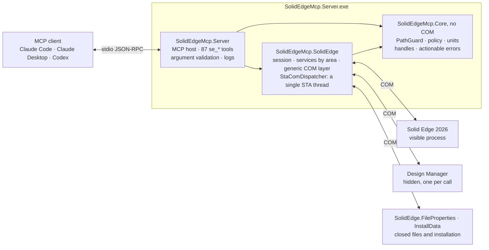

<div align="center">

<picture>
  <source media="(prefers-color-scheme: dark)" srcset="docs/assets/banner-dark.svg">
  
</picture>

**Unofficial local [MCP](https://modelcontextprotocol.io) server to operate Siemens Solid Edge from Claude Code,
Claude Desktop, Codex or any other MCP client.**


[](docs/COVERAGE.md#progress)
[](#license)

[Quick start](#quick-start) · [Examples](#what-you-can-ask-for) · [Tools](#tools) · [Coverage](docs/COVERAGE.md) · [Changelog](CHANGELOG.md) · [Contributing](CONTRIBUTING.md)

</div>

It lets an AI assistant help you work in Solid Edge through COM: querying models, drawing
sketches, creating part and sheet metal features, building assemblies, making drawings,
exporting, and managing closed files as Design Manager does. You stay in control: tools that can
change anything are flagged so your MCP client asks for your approval. It is general purpose: it
does not depend on specific files, a specific machine or a specific workflow.

<table>
<tr>
<td width="50%" valign="top">

**Broad coverage**

Parts, sheet metal, assemblies, drawings, export and Design Manager with 87 tools, plus the whole
API through a generic COM layer.

</td>
<td width="50%" valign="top">

**Verified changes**

Each modeling operation is measured. If it fails or has no effect, it is undone and the error
explains why and what to do next.

</td>
</tr>
<tr>
<td width="50%" valign="top">

**Safe by default**

Files only inside allowed folders. Tools that can change anything are flagged so the client asks
for approval.

</td>
<td width="50%" valign="top">

**Tested for real**

7208 calls and 3694 checks against real Solid Edge 2026 in the last full run, compared with expected values computed from formulas.

</td>
</tr>
</table>

> [!NOTE]
> Current version (1.1.0), tested with Solid Edge **2026 Foundation** and, until 2026-10-16, **Community Edition 2026** on Windows 11 x64. It
> works and has been validated end to end with Claude Code and Codex. Tool names and parameters are
> stable: a change that breaks them waits for a new major version and is listed in the changelog.

## Progress

<picture>
  <source media="(prefers-color-scheme: dark)" srcset="docs/assets/progress-dark.svg?v=86a009a5">
  
</picture>

Each square is one function of the [coverage map](docs/COVERAGE.md): it works through the MCP, it fails
in Solid Edge 2026 itself (documented, with an alternative when there is one) or it is not tested yet.
`scripts/update-progress.ps1` redraws the chart from the coverage tables.

**73 % of the functions work today**; the highest reachable on the tested installation is **73 %** (why the rest do not: [progress](docs/COVERAGE.md#progress)).

## What you can ask for

Natural-language requests that Claude Code and Codex completed using only this server. The result
was measured afterwards, separately, by reopening the generated files.

| Request (summary) | Client | Verified result |
|---|---|---|
| Sheet metal part with a 100 × 60 tab and two 20 flanges; flat pattern to DXF and an A3 drawing with the flat pattern and an isometric view to PDF | Claude Code | 9,871.239 mm³ = 6000 + 2·(75π + 1700); box 100 × 60 × 21; DXF with the contour and 2 bend lines; one-page A3 PDF |
| Assembly with a 120 × 80 × 10 base and two 20 × 20 × 30 blocks: mates, interference check, bill of materials, and an A3 drawing with a parts list to PDF | Claude Code | 50 calls, 0 errors; 6 mates solved and both blocks fully defined; no interference; BOM 1 + 2; one-page A3 PDF |
| Plate with 4 holes and 4 R5 fillets, 6061-T6 aluminum, exported to STEP | Codex | 20 calls, 0 errors; 58,416.92 mm³ = 58,631.52 − 4·(25 − 25π/4)·10; 0.15843 kg |
| A Ø50 × 30 cylinder from the installation's inch part template, a stainless steel found in its libraries, the top face red, an isometric capture, and where the hole button is on the ribbon (names searched, not assumed) | Claude Code | 19 turns, 0 errors; 58,904.86 mm³ = π·25²·30; 0.4565 kg at 7,750 kg/m³; Home › Solids › Hole, id 10307 |
| Prompt `/mcp__solid-edge__model_part`: a 100 × 60 × 10 steel plate with four Ø8 holes 10 mm from the corners and R5 vertical corner rounds, saved | Claude Code | 17 turns, 0 errors; 57,774.78 mm³ = 60,000 − 4·(25 − 25π/4)·10 − 4·π·4²·10; 0.4525 kg; bounding box 100 × 60 × 10 |
| Weldment: a 200 × 100 × 10 base plate, a mitred frame of a 20 × 20 section of its own on a closed rectangle, a 4 mm fillet weld between the plate and one bar, and an assembly hole repeated in 3 columns | Claude Code | 30 turns, 0 errors; cut length 520 mm = 180 + 80 + 180 + 80, bars of 64,000 mm³; bead 1,440 mm³ = 4·4/2·180; 1 + 2 hole faces |
| Solid Edge's version and default part template; the start screen turned off and back on; a 100 × 60 × 8 steel plate with a Ø10 through hole; a dark blue to white gradient background for an isometric capture, then the previous background again; an A3 drawing with front, top and right views, printed to PDF with Microsoft Print to PDF | Claude Code | 40 turns, 0 errors; 47,371.68 mm³ = 48,000 − π·5²·8; 0.3711 kg at 7,833 kg/m³; start screen and background as before; first-angle views (top below, right on the left); one-page A3 PDF, 420 × 297 mm |
| A 120 × 80 × 8 steel plate with four Ø8 holes, an 8 × 30 pin, an assembly with two pins in the holes and an A3 drawing; then, with the files closed, as in Design Manager: the drawing's links at every level, the pin renamed and the plate revised without losing references, a title and In Review for the assembly; the parts and the assembly to STEP and the drawing to PDF in batches; the assembly's thumbnail and the installed Solid Edge and Parasolid versions | Claude Code | 61 calls, 1 close refused for unsaved changes and repeated without saving; renamed pin and plate revision 1 used by the assembly and the drawing, 0 broken links; title and In Review read from the closed file; 4 STEP files and a one-page A3 PDF; the assembly's STEP read back with 78,207.43 mm³ = 76,800 − 4·π·4²·8 + 2·π·4²·30, 0.6126 kg at 7,833 kg/m³ |
| A 1 mm sheet metal tray: a 100 × 60 tab, a 20 flange measured from the outer face, a round gusset on its bend, unbent to check the flat size and bent again; a 100 × 60 × 20 steel block with four Ø8 holes 15 mm from the corners and a 10 × 5 slot along it, made by sweeping a Ø10 cylinder along a line; an A3 drawing with two views and a hole table, to PDF; an assembly with the tray resting on the block and its bill of materials | Claude Code | 67 calls, 0 errors; block 110,978.76 mm³ = 120,000 − 4·π·4²·20 − 100·10·5, 0.8693 kg; flat pattern 100 × 78.089; hole table with 4 rows at (15, 15), (85, 15), (85, 45), (15, 45); one-page A3 PDF, 420 × 297 mm; tray fully constrained at z 20, no interference; BOM 1 + 1 |
| Through the Claude Code plugin: a steel block whose length is a variable L, set by goal seek for a volume of 75,000 mm³; a quarter cylinder surface of R50 × 40 thickened 2 mm outwards into a solid; a 200 × 200 × 5 plate with a 3 × 3 pattern of Ø10 holes 60 mm apart, a Ø10 × 20 pin and an assembly with the pin repeated along the plate's pattern; a PMI dimension and a PMI note on the plate; an automatic exploded view saved with the assembly | Claude Code (plugin) | 72 calls, 0 errors; L = 125, 75,000 mm³; 6,408.85 mm³ = π/4·(52² − 50²)·40, box 52 × 52 × 40; plate 196,465.71 mm³ = 200,000 − 9·π·5²·5, holes at x, y ∈ {−60, 0, 60}; 10 occurrences, BOM 1 + 9, no interference; PMI 200 and "Material: S235"; explode configuration saved |

## Quick start

### Requirements

- Windows x64 with Solid Edge installed and licensed (the Community Edition and Foundation work; simulation needs a
  licence with Simulation, such as the Simulation Express of Foundation).
- Windows PowerShell 5.1, which comes with Windows: the server uses it to generate the Solid Edge
  interop, and the plugin to install the server.
- To build from source, the .NET 10 SDK (version pinned in `global.json`).

The Community Edition, and Foundation with a license server, get the license through the machine
variable `SE_LICENSE_SERVER`. Processes opened before Solid Edge was installed do not have it; the
server copies it when it starts `Edge.exe`.

### Install

The Solid Edge interop derives from Siemens files, so it is not distributed: the server generates it
from your installation on its first start, in a few seconds, and keeps it in
`%LocalAppData%\SolidEdgeMcp\interop\<Solid Edge version>`. Install the server in one of three ways.

**As a Claude Code plugin** (from 1.0.0):

```text
/plugin marketplace add gabichuuuuu/solid-edge-mcp
/plugin install solid-edge-mcp@solid-edge-mcp
```

Or from a terminal:

```powershell
claude plugin install solid-edge-mcp --marketplace gabichuuuuu/solid-edge-mcp
```

On its first start the plugin downloads the server package of its version from the GitHub release,
checks it against the SHA-256 published with it and installs it in
`%LocalAppData%\SolidEdgeMcp\server\<version>`; it then starts the server from there. Its tools are named `mcp__plugin_solid-edge-mcp_solid-edge__se_*`. Then write
your policy (below).

**From the release package** (from 1.0.0), for any MCP client: download `solid-edge-mcp-<version>-win-x64.zip` and
its `.sha256` from the [releases](https://github.com/gabichuuuuu/solid-edge-mcp/releases), check the
hash and extract it to a folder of your own (`%LocalAppData%\SolidEdgeMcp\server` belongs to the
plugin). The package is self-contained: it does not need .NET.

```powershell
(Get-FileHash .\solid-edge-mcp-<version>-win-x64.zip -Algorithm SHA256).Hash   # the hash in the .sha256
Expand-Archive .\solid-edge-mcp-<version>-win-x64.zip "$env:LOCALAPPDATA\Programs\solid-edge-mcp"
```

**From source:**

```powershell
git clone https://github.com/gabichuuuuu/solid-edge-mcp.git
cd solid-edge-mcp

# 1. Interop from the type libraries of your Solid Edge (not distributed; goes to lib\interop)
.\scripts\generate-interop.ps1

# 2. Build and publish (self-contained for win-x64)
dotnet publish src\SolidEdgeMcp.Server -c Release -r win-x64 --self-contained -o publish
```

Optional: `.\scripts\dump-api.ps1` dumps the API to `reference\api\*.txt` so you can look up
signatures and constants. It is not versioned either.

**Policy.** Without one, the server only works in `%LocalAppData%\SolidEdgeMcp\work`. Copy the
example and adjust the allowed folders. It is in `config\` of the repository and beside the server in
the package; the plugin keeps it in `%LocalAppData%\SolidEdgeMcp\server\<version>`, once its first
start has installed the server.

```powershell
New-Item -ItemType Directory -Force "$env:LOCALAPPDATA\SolidEdgeMcp" | Out-Null
# From the repository; with the plugin, use the path of the example given above
Copy-Item config\policy.example.json "$env:LOCALAPPDATA\SolidEdgeMcp\policy.json"
```

Restart the client after changing the policy, which the server reads when it starts.

### Register with your client

The plugin registers itself. Otherwise replace `<path>\publish` with the folder of your build or of
the extracted package, and `<path>\policy.json` with your policy; without `--policy`, the server
loads `%LocalAppData%\SolidEdgeMcp\policy.json`.

**Claude Code**

```powershell
# -s user: in all your projects; -s local: only in the current project
claude mcp add -s user solid-edge -- "<path>\publish\SolidEdgeMcp.Server.exe" --policy "<path>\policy.json"
```

If long operations exceed the client's limit, adjust the `MCP_TOOL_TIMEOUT` variable. When the client asks for progress notifications, the server sends one every 5 seconds while a call runs, so clients that reset their time limit on progress keep waiting.

<details>
<summary><b>Claude Desktop</b> (<code>claude_desktop_config.json</code>)</summary>

```json
{
  "mcpServers": {
    "solid-edge": {
      "command": "<path>\\publish\\SolidEdgeMcp.Server.exe",
      "args": ["--policy", "<path>\\policy.json"]
    }
  }
}
```

</details>

<details>
<summary><b>Codex</b> (<code>~/.codex/config.toml</code>, or <code>.codex/config.toml</code> in a project that Codex trusts)</summary>

```toml
[mcp_servers.solid_edge]
command = "<path>\\publish\\SolidEdgeMcp.Server.exe"
args = ["--policy", "<path>\\policy.json"]
env_vars = ["USERPROFILE", "LOCALAPPDATA", "APPDATA"]  # the policy expands %USERPROFILE%
startup_timeout_sec = 30
tool_timeout_sec = 300
```

</details>

## How it works

- **Few tools, many actions.** Each `se_<area>` tool groups its operations under an `action`
  parameter, so the model does not have to load hundreds of schemas.
- **Millimeters and degrees.** Lengths in mm and angles in degrees. Only the generic `se_com_*`
  layer uses API units (meters and radians, collections starting at 1).
- **Handles.** Objects are returned as identifiers (`doc:3`, `sketch:5`, `face:12`) that are passed
  unchanged to other calls. They expire when the document is closed, undone or recalculated; face
  and edge handles also expire when the model changes.
- **Verification.** Each new operation is checked (status and volume change). If it fails or has no
  effect, it is deleted or undone, and the error carries a code, the cause and the next step.
- **Three layers.** Specific tools verified for common tasks; access to any API object and method
  (`se_com_*`); and any interface command (`se_command`). What each route covers, function by
  function: [docs/COVERAGE.md](docs/COVERAGE.md).

Illustrative example of the sequence an assistant follows for a 100 × 50 × 20 mm block:

```text
se_session    {"action":"connect"}
se_documents  {"action":"new","kind":"part"}
se_sketch     {"action":"create","plane":"1"}                                → sketch:5
se_sketch     {"action":"rectangle","sketch":"sketch:5","points":[0,0,100,50]}
se_sketch     {"action":"close","sketch":"sketch:5"}
se_extrude    {"sketch":"sketch:5","operation":"add","distance":20}
se_physical   {"density":7850}                       → 100 000 mm³ (100 · 50 · 20), 0.785 kg
```

## Tools

87 tools, grouped by area.

| Area | Tools |
|---|---|
| **Server and session** | `se_server_info` `se_session` |
| **Documents and data** | `se_documents` `se_properties` `se_variables` `se_part_family` `se_material` `se_appearance` `se_layer` `se_links` |
| **Query** | `se_feature_tree` `se_geometry` `se_measure` `se_physical` `se_selection` `se_sensor` |
| **Simulation** | `se_simulation` |
| **View and application** | `se_view` `se_section_view` `se_model_view` `se_options` `se_ui` `se_app` `se_customize` `se_styles` |
| **Sketches** | `se_sketch` `se_sketch_constraint` `se_sketch_edit` `se_sketch_tools` `se_sketch3d` `se_region` `se_ref_plane` |
| **Part** | `se_extrude` `se_revolve` `se_hole` `se_round` `se_chamfer` `se_pattern` `se_shell` `se_draft` `se_loft_sweep` `se_part_feature` `se_recognize` `se_body` `se_face_relation` `se_face_split` `se_pmi` `se_pmi_annotation` `se_primitive` `se_surface` `se_curve` `se_feature_edit` `se_simplify` `se_thread` `se_thin_wall` `se_decal` |
| **Sheet metal** | `se_sheetmetal` `se_sheetmetal_form` |
| **Assemblies** | `se_assembly` `se_relations` `se_assembly_pattern` `se_assembly_config` `se_assembly_family` `se_component_group` `se_internal_component` `se_component_query` `se_assembly_feature` `se_frame` `se_tube` `se_interference` `se_bom` |
| **Drawings** | `se_drawing` `se_drawing_view` `se_dimension` `se_annotation` `se_sheet_content` |
| **Export, publishing and printing** | `se_export` `se_publish` `se_print` |
| **Programs installed with Solid Edge** | `se_design_manager` |
| **Full API access** | `se_com_describe` `se_com_get` `se_com_set` `se_com_invoke` `se_com_items` `se_com_constants` `se_command` |

<details>
<summary><b>What each tool does</b></summary>

| Area | Tool | What it does |
|---|---|---|
| **Server and session** | `se_server_info` | Version, allowed folders, work folder, limits and configuration warnings, and the Solid Edge installation (version, folders, language, Parasolid version). Does not need Solid Edge running. |
| | `se_session` | Status, connect (attaches to the open Solid Edge or starts it visibly), disconnect, quit and restart (refused while a document has unsaved changes). |
| **Documents** | `se_documents` | Create a part, sheet metal, assembly, drawing or weldment; open, activate, save, save as or copy, close; import STEP, IGES, Parasolid, JT, SAT, STL, OBJ, 3MF, CATIA V5 and V4, DXF or DWG files as new documents; the thumbnail saved in a closed file, as Windows Explorer shows it; undo and redo what Solid Edge records; recalculate (Update Relationships; `se_options` turns Automatic Update off); list this installation's templates; read and set the document status (in work, in review, released…); save a part as its mirror image about a plane; read or switch a part between synchronous and ordered modeling. |
| **Data** | `se_properties` | Document properties by configuration (summary, custom…): list, set (a standard name such as Title goes to its own set, any other becomes a custom property; dates in ISO 8601) and delete; with `path`, the same on a closed file without opening it, as Property Manager does. The dates Solid Edge keeps itself (last print, origination, last save, editing time) are written only to closed files. |
| | `se_variables` | Variables and dimensions: list (also the physical property variables of a part: Mass, Volume, Surface_Area...), read, set a value or formula (returns the volume change), create, delete, rename, comment, expose and limit; Goal Seek (Solid Edge varies one variable until another reaches a value; on the mass, volume or surface area of a part the server measures the model at each step); the adjustable variables of an adjustable part. |
| | `se_part_family` | Family of parts: family variables, members with their values and suppressed features, apply a member to the master (checked), write member files, copy, rename and delete members. |
| | `se_material` | Material libraries, from the folder of the Solid Edge options or those installed with Solid Edge: current material, properties and assignment (updates density and mass); the material of a weldment's weld beads. |
| | `se_appearance` | Colours (face styles): list, create and delete styles; colour the body, faces, features or assembly components by style or #RRGGBB with opacity, read them back and remove them. |
| | `se_layer` | Layers of models and drawing sheets: list, create, activate, show or hide, make selectable or not, delete empty ones and move sketch geometry, drawing views, dimensions and annotations between them. |
| | `se_links` | Links between files: what a document refers to (components, drawing models, copied parts) and whether they are found, replace a referenced file, break copied parts, where a file is used (directly or up to the top), top-level assemblies, the document search of File > Open (title, subject, date) the search of the text inside documents through the Windows Search index, Pack and Go (a document and all its files copied to one folder, linked to one another), the component files an assembly cannot find (looked for again once they are back) and CAD Direct (a STEP or other CAD file placed as a linked component, read again when it changes). |
| **Query** | `se_feature_tree` | Features in order with their status, the modeling mode and the volume. |
| | `se_geometry` | Summary, faces and edges with handles and filters; in assemblies, per occurrence and in assembly coordinates; draft analysis of the faces along a pull direction; the free edges of a surface (Show Non-Stitched Edges). |
| | `se_measure` | Minimum and maximum distance and angle between faces, edges, planes or occurrences, also in assemblies; normal distance from a plane or planar face to an end of an edge; wall thickness analysis of a body (thinnest and thickest wall and where, and the area thinner than a limit). |
| | `se_physical` | Volume, area, mass, center of gravity and inertia of a part (with the given density or the material's) or of an assembly (with the material of each part), with the table of its parts: material, density, volume, mass and occurrences (Physical Properties Manager). |
| | `se_selection` | Read, replace, extend or clear the active selection. |
| | `se_sensor` | Sensors of parts, sheet metal and assemblies: watch a variable, the minimum distance between two faces, edges or occurrences (a clearance between parts that follows their moves) the area of a face, or in sheet metal the smallest distance between holes, cutouts, edges, dimples, louvers or beads, with a condition (greater or less than, equal, between); list their values and whether each one meets its condition, change them and read manual ones again. |
| **Simulation** | `se_simulation` | Finite element studies of parts and sheet metal, solved by Simcenter Nastran: static, modal and buckling studies, constraints and force or pressure loads on faces, solve (largest displacement and von Mises stress, applied load and reaction, natural frequencies or buckling load factors), result plots with their minimum, maximum and picture, list and delete; the kinds the licence includes (Simulation Express: fixed, force, pressure, static and modal). |
| **View and application** | `se_view` | Capture the view as an image (optionally with the colours at its corners, edges and centre), framing (on drawings, the whole sheet with the title block), orientation, display mode and named views (list, save the current one, apply, delete); the view style of a model window and its background (solid, gradient or image); the camera (eye, target, up, perspective and field of view), zoom and rotation; look square at a sketch, plane or face (Sketch View). A capture that comes out blank (for example while the Windows session is locked) says so. Does not change the model. |
| | `se_section_view` | 3D section views of parts, sheet metal and assemblies (View > Section) from a sketch profile or by a plane (the side cut away, or a slab): the part that stays (inside or outside of a closed profile, either side of an open line), depth and direction along the sketch normal, caption, fasteners cut or not; show, hide, what is drawn, the cutting plane and its opacity; delete, reporting the unused reference planes that Solid Edge deletes with it. Does not change the model. |
| | `se_model_view` | PMI model views of parts, sheet metal and assemblies: by standard orientation or the current one, render mode, the section views, PMI dimensions and annotations each shows (read back), its 3D PDF flag; apply one to the window, update one to the window's orientation, rename, delete. Drawings place them as views and `se_publish` puts them in 3D PDF files. |
| | `se_options` | Every Solid Edge option by page of the Options dialog (general, save, file locations, colours, helpers, assembly, drawing, units, simulation…) and document units: list, read and change them (returns the previous value), show a value as the document displays it or read a typed one ("2.5 in" is 63.5 mm); save all of them to a snapshot file and restore it. The preferences a drawing saves (projection angle, drawing view defaults, grid, the line style of each kind of edge…) and its sketching buttons (Maintain Relationships, Alignment Indicator, Relationship Handles, Locate Background). |
| | `se_ui` | Windows, environments, ribbon and interface display: list, activate and arrange windows; list environments and the tabs, groups and commands of the ribbon; find a button by the text it shows (any language or theme); colour theme, status bar, edge bar, recent files shown, and position and size of the main window. |
| | `se_app` | Solid Edge as a program: version, edition, language and folders; the Add-In Manager (load and unload add-ins); default template of each document type; the recent files list; the data Solid Edge's AI automatic drawing creation learns from, extracted from saved drawings; the file naming rule and the next document numbers; the DXF/DWG translation settings back to their defaults. |
| | `se_customize` | The Customize dialog: ribbon themes (create from the default one, activate, rename, button size and labels, remove), tabs, groups and commands of a theme, and keyboard shortcuts of each environment. |
| | `se_styles` | Styles of a document: dimension, text, character, line, fill, hatch, dash, drawing view, table and frame styles of drawings, and view and face styles of models. List them, read every property, change one (read back, with the previous value; colours as #RRGGBB and enumerations by name), create one from another, activate, delete, and import them from another drawing. The 8 lights of a view style: colour, intensity and direction, read back. |
| **Sketches** | `se_sketch` | Lines, rectangles, regular polygons, polylines, circles, arcs, ellipses, splines, conics, points, corner fillet and chamfer, edge projection, revolve axis and validated close, which leaves the sketch fully defined where it lies, as a designer would (the relations the drawing shows, the sizes, the angles, and the position from the base planes or from the contour it sits in, without fixing what is drawn, so its variables drive it and the features made from it follow them; model edges brought in with the projection, or lines you choose, serve as references), with the dimensions named after what they size (`Sketch_1_Width`), as every feature that uses a sketch requires; list the elements and relations of a sketch and whether it is fully defined; tear a part sketch off onto another plane. The same 2D geometry is drawn on drawing sheets (2D drafting) and on the 2D layouts of an assembly. Sketch blocks of parts and layouts: make a block from elements, place it at a scale and angle; features take the profile with its blocks. |
| | `se_sketch_constraint` | Geometric relations (horizontal, parallel, tangent, equal, symmetric…) and dimensions that move the geometry, in sketches and on drawing sheets; auto-scale a sketch by its first dimension. |
| | `se_sketch_edit` | Move, rotate, scale and mirror elements (in place, keeping the relations among them, or as connected copies), trim, extend, split, corner, offset a chain (also to both sides with arc or line caps: Symmetric Offset), construction geometry, rectangular and circular patterns and delete, in sketches and on drawing sheets; on sheets also the drawing order (front, back, forward, backward) and groups; each result measured. |
| | `se_sketch_tools` | Sketch tools of the ribbon: clean a sketch or a drawing sheet (duplicate, overlapping and small elements, with the counts before and after); convert lines and arcs into B-spline curves of the same length; move the origin and x direction of the local axes of a sketch or put them back; place a picture at a corner and a width; section sketches of the design bodies on a plane and on parallel planes; the total length of curves; copy an assembly layout into the part of an occurrence. |
| | `se_sketch3d` | 3D sketches of parts in model space: polylines tied end to end, arcs (also through three points or tangent to a line), rectangles, circles, splines through points, curves driven by equations of t, points, model edges included, fillets between lines, mirror copies about a plane, split and trim, and 3D relations (parallel, perpendicular, connect, tangent, on a plane, symmetric, lock…); each element read back with its ends, centre, length or radius. A 3D sketch is a sweep path for `se_loft_sweep`. |
| | `se_region` | Closed regions of drawing sheets and sketches: fills and hatching (round a point among the elements or by the corners of a polygon) with fill style, colour, angle and spacing; list, restyle and delete them; area properties (area, perimeter, centroid, second moments, principal axes, radii of gyration and section moduli), minus holes. The point is proved to be inside a closed loop before Solid Edge looks for the region. |
| | `se_ref_plane` | Reference planes of parts and assemblies: list (also the planes of an occurrence's part, in assembly coordinates); offset (at 0: Coincident Plane), angled (about the line where it meets another plane, or about a straight edge on it: Perpendicular and Coincident by Axis), through three points, midway between two planes, normal to an edge (at an end, a distance or a fraction of its length) and tangent to a cylinder, each checked against its geometry and global, as the Planes commands make them; in an assembly, offset and angled from assembly planes or faces of occurrences (also about an edge of an occurrence) and normal to an edge of an occurrence. Coordinate systems by origin and angles or along two edges, with their origin and axes. Show, hide, rename and delete planes and coordinate systems (the base ones and those something is built on are kept). |
| **Part** | `se_extrude` | Boss or cut by extrusion: blind, through all, up to next, up to a plane or face, or from one plane or face to another; normal, reversed or symmetric; with a draft angle on the side faces; a boss can be a thin wall of the profile (inside, outside or symmetric, with end caps). |
| | `se_revolve` | Boss or cut by revolution about the sketch axis; a boss can be a thin wall of the profile. |
| | `se_hole` | Simple, counterbored, countersunk and threaded holes at points on a plane, without a sketch. |
| | `se_round` | Edge fillet with a constant radius, or a variable one (a radius at the start and the end of each edge); a synchronous part stays synchronous. |
| | `se_chamfer` | Edge chamfer with an equal setback, two setbacks or a setback and an angle; a synchronous part stays synchronous. |
| | `se_pattern` | Rectangular pattern, circular pattern, pattern along an edge, fill pattern inside a region (rectangular or staggered), pattern by table (copies at given offsets, no Excel needed) and mirror of features; mirror copies and copies along an edge of construction geometry (surfaces, curves, construction bodies); copies of the whole part along an edge. |
| | `se_shell` | Shell with a common wall thickness and optional open faces. |
| | `se_thin_wall` | Mounting bosses of plastic parts, grown from a plane to the next face, with an optional mounting hole; the volume change is read back. |
| | `se_decal` | Decals: a picture wrapped on a face of a part, with a name and an offset; list and delete. |
| | `se_draft` | Face draft relative to a neutral plane. |
| | `se_thread` | Physical ISO metric threads cut into a shaft or a hole, from either end, right or left hand; the volume removed is checked against the profile. |
| | `se_loft_sweep` | Loft, sweep (along a sketch, a 3D curve or a 3D sketch) and helix (also conical), as a boss or a cut; a boss can be a thin wall (a pipe from a swept circle); tubes and rods of a diameter and wall along a path, with no section to draw; solid sweeps, a closed tool body moved along a path and cut from or added to the part. |
| | `se_part_feature` | Rib from an open sketch (up to the part or to a finite depth), thicken faces (a surface alone becomes the first solid) and mirror the whole body; direct edits (offset and delete faces and rounds keep a synchronous part synchronous): delete faces (the solid heals), holes up to a diameter and rounds, offset faces, replace faces with a plane or a surface, turn a face about one of its edges, cut the part by a plane keeping one side, merge adjacent faces into one B-spline face, delete a region bounded by a loop of edges, resize holes and rounds, and radiate round faces (synchronous: the radius grows or shrinks); slots along an open path, web networks and lips in shelled parts, normal protrusions and cutouts (the region inside or outside closed curves projected or wrapped onto faces, raised or recessed, e.g. a logo), scaling of the body, copies of saved parts (scaled or mirrored), splitting a body by a plane into design bodies and uniting them again (`se_geometry` and `se_physical` measure every body), fillet weld beads between faces of the part, with equal or unequal legs, and label welds that mark edges as welded, with an optional weld symbol. |
| | `se_body` | Bodies of a part: list the design and construction bodies; subtract and intersect design bodies (with a closed body as the tool, or an open surface that keeps the side its normal points to or the other one); unite closed construction bodies (end-capped surfaces) with a design body, the tools staying as construction bodies; emboss closed bodies into another (thickened or as a cut only, with a clearance, on either side); turn design bodies into construction bodies and closed construction bodies (end-capped surfaces) into design bodies; divide a saved part into one part file per piece by a reference plane or a surface; heal and optimize the bodies (Simplify body only or Full body optimization), with Solid Edge's report; publish chosen bodies of a saved part as part files of their own, optionally gathered in a new assembly. Each result is checked by the volume and the bodies. |
| | `se_face_relation` | 3D relations between faces of a part, as the Relate commands of synchronous modelling: coplanar, offset at a distance, parallel, perpendicular, tangent and concentric (the faces move and the target stays; each relation is checked on the geometry, and one that Solid Edge cannot meet is deleted), and fixed faces; list relations, edit the distance of an offset and delete relations; read and set the live rules of the session, restore their defaults and put them back. |
| | `se_face_split` | Faces of the body split into more faces without changing its volume (to draft, colour or relate part of a face): by reference planes, surfaces or curves that cross them, along the silhouette seen from a plane (a sphere at its equator), or by a line at a distance from an edge of the face. Each split is checked by the faces and the volume, and the new faces are returned. |
| | `se_pmi` | 3D (PMI) dimensions of a part or sheet metal document, the ones synchronous features carry (the height, width and length of a box, the height and diameter of a cylinder): list them with their value, type, lock and status; drive the model to a new value with the measured end, the origin end or both ends moving (the value the model reaches is read back, and the old one is put back if Solid Edge does not reach it); lock and unlock them; delete them (the model stays as it is); place new ones (linear between two vertices or along a straight edge, diameter, radius, the angle between two straight edges), read in a reference plane and checked against the geometry, and move them (their line's stand-off); copy the dimensions of a feature's sketch to PMI; show or hide the PMI dimensions and annotations in the window; set their text size (fixed pixels or with the model), the plane PMI is placed on and the axis, and clear them. |
| | `se_pmi_annotation` | 3D (PMI) annotations of a part or sheet metal document, attached to the edges of the model picked by model points and drawn in a reference plane: text, balloons and callouts, leaders, datum frames, datum targets and datum points, surface texture symbols, feature control frames (with lower and composite rows), weld and GOST weld symbols, edge conditions, centre marks, centre lines and bolt hole circles; each is checked (attached, content and leader end read back) and removed if wrong; list, move (the leader end, or a text, to a new position) and delete them. |
| | `se_primitive` | Box (optionally turned about the plane normal), cylinder or sphere placed by its centre on a plane or face, added or cut, without a sketch. |
| | `se_surface` | Construction surfaces: extruded or revolved from a sketch (open or closed, with end caps), offset from a face, lofted through sections, swept along a sketch or a 3D curve, stitched, filling a closed chain of edges, copied from faces, and BlueSurf through section edges with guides; split a surface or trim it where surfaces or curves cross it, extend it from its edges (natural, linear or reflective), close surfaces that enclose a volume into a solid construction body, blend two surfaces with a constant radius (trimmed to it), and ruled bands along the edges of a planar face, square to it or tapered; list and delete. Each result is checked by its area or volume. |
| | `se_curve` | Construction curves: through 3D points, intersections of faces, surfaces and the body, sketches projected onto faces, crossings of two sketches, chains of edges, contours drawn on faces through points on them (across faces, joined into one curve), sketches wrapped onto cylindrical or conical faces, isoclines (where the face normal makes an angle with a plane, e.g. a silhouette) and helices about a cylinder or an axis (e.g. the path of a spring); split a curve where planes or other curves cross it (its length is checked); list and delete. |
| | `se_feature_edit` | Suppress, unsuppress, delete or rename a feature or a group; group features and dissolve a group; move a feature before or after another; roll the model back to a feature (new features go after it) and forward to its end; move ordered features to synchronous (e.g. the body of an imported part; a copy of the part is saved first, which Solid Edge needs after synchronous edits). |
| | `se_recognize` | Recognize holes, patterns and chamfers in synchronous geometry without history (an imported part moved to synchronous): they become hole, pattern and chamfer features, with the volume unchanged. |
| | `se_simplify` | The simplified model of a part or sheet metal part, which assemblies can show instead of the design body: make it, delete holes up to a diameter, rounds, chosen faces and regions bounded by edges from it (each change checked on its body, the design body untouched), switch between the design and the simplified model, list and delete its features; the simplified model of an assembly (without chosen or small components, or only the faces or bodies seen from outside), updated from its components and written as a part; the simplified model of a part written as a Parasolid file. |
| **Sheet metal** | `se_sheetmetal` | Settings (thickness, radius, reliefs, K-factor), gauges of a material library, tab, contour flange, flange (its length measured from the inner or the outer face), hem, corner break, flat pattern with cut size, changes of the angle and radius of existing bends, a flange matched to a parallel plane (onto it, short of it or beyond it), louvers (lanced or formed, with rounded ends) placed on a flat face, conversion of a thin-walled part into sheet metal, tabs and slots between two sheet bodies, and unbending the chosen bends or all of them about a fixed face (deleting the unbend bends the sheet again), and gussets across a bend (rounded or square; one, several spread over it or at a spacing); the bend table of the model, and a bend moved in its sequence. |
| | `se_sheetmetal_form` | From a sketch: dimple, drawn cutout, normal cutout (through all, through next, a depth or up to a plane), etch (also in a part), jog, bend and bead (U, V or circular, with lanced, punched or formed ends). |
| **Assemblies** | `se_assembly` | Insert (also a new empty part from a template, or an adjustable part), move, rotate, mirror about a plane, fix, replace (also with a copy of the file or a new part), show or hide, suppress and delete occurrences; make an occurrence adjustable; save an occurrence's part as a part file of its own in its assembly position; activate or inactivate them; make a subassembly from occurrences, move occurrences into a subassembly and disperse one; copy the components of another assembly in, kept in step with it, plain or mirrored; read and set occurrence properties (quantity, bill of materials, physical properties, interference, reference, display) and what of each component is shown (Show/Hide Component); reorder components; Show Only, Show All, Hide All. |
| | `se_relations` | Planar (mate and flush), axial (rotation locked or free), insert, parallel, tangent, angle, center-plane, connect (points of edges onto points, faces, planes or edges), coordinate system and rigid set relations, each checked geometrically; gear relations between two gears or a gear and a rack, in teeth or turns; list, edit (offset, angle or suppress: the parts follow, gears included) and delete; base planes by name (`xy`, `yz`, `xz`) of the assembly or of an occurrence's part. |
| | `se_assembly_pattern` | Component patterns that follow a part pattern (e.g. a pin repeated on every hole of a hole pattern), duplicate patterns, and patterns along a curve of an assembly layout: list, create, delete and dissolve; clone occurrences onto the matching faces of other occurrences. |
| | `se_assembly_family` | Alternate positions and families of assemblies: turn a saved assembly into one with named members, add, activate, rename and delete members, write one as a plain assembly, and leave components out of a member of a family; the alternate components an occurrence may be swapped for. |
| | `se_assembly_config` | Display configurations: save which components are shown under a name, apply, list and delete them; automatic exploded views in a chosen orientation with the exploded placement of each component, kept by saving the assembly for an exploded drawing view; the Large Assembly Performance mode. |
| | `se_component_group` | Component groups (the groups of PathFinder): create, add and remove components, rename, show and hide, ungroup, pack the occurrences of one file and unpack, and delete a group together with its components (with an explicit confirmation). |
| | `se_internal_component` | Internal components: parts, sheet metal parts and subassemblies kept inside the assembly file, created empty and placed grounded or free, listed, deleted, and published as files of a folder that their occurrences then point at. |
| | `se_component_query` | Find components as the Select Tools do: by occurrence name or by the properties, material and status of their files (all criteria at once), among all, shown, hidden or selected components and inside subassemblies, or inside a box (zone); the matches are selected and can be shown alone (a matched subassembly whole), hidden or shown; queries and zones can be saved in the assembly, run, renamed and deleted. |
| | `se_assembly_feature` | Extruded and revolved cutouts and holes (simple, countersink or counterbore) made in the assembly through chosen parts, from a sketch drawn in the assembly or centers on an assembly plane; mirrors of cutouts about an assembly plane; rectangular patterns of cutouts and holes; extruded and revolved protrusions (assembly bodies); fillet welds (bead) and label welds in a weldment; list and delete. |
| | `se_frame` | Structural frames (sections from the installed library or your own part, mitred or butted) and pipes with elbows and fittings, along a polyline or assembly sketch lines; members and segments with their extent and cut lengths (also per member); list the library, list, delete and repair (frames made elsewhere before any assembly feature). |
| | `se_tube` | Tubes routed in an assembly along a path of straight segments, bent at the corners, solid or hollow, with a material; each tube read back with its diameter, wall, bend radius, flat length, volume and path. |
| | `se_interference` | Interferences between occurrences, among themselves, against others, against all the rest or against the visible ones, with the affected pairs and their volume. |
| | `se_bom` | Bills of materials and reports: the parts list (top level), the summary of atomic parts (flat), the indented bill of materials, the exploded one (every occurrence) and the assembly statistics (parts and subassemblies in total and unique), also written to a .csv or .xlsx file. |
| **Drawings** | `se_drawing` | Sheets and background sheets (the frame and title block: list, show or hide, draw and write on them, replace one with a background of another drawing, add, rename and delete one no sheet uses); base (also of an assembly display configuration, of a member of an assembly family or alternate position, or of a PMI model view), projected, auxiliary, section (also from a cutting plane drawn first) and detail views; views turned on the sheet and cropped to a rectangle; 2D model views (what is drawn on the 2D model sheet, at a scale); dimensions (also coordinate, angular coordinate, chamfer and symmetric diameter dimensions) and dimensions retrieved from the model; parts list (also a family of assemblies parts list, a quantity column per member); bend table; tolerance table (the dimensions of a view with an ISO fit); family of parts table (one row per member); block table (the blocks placed on a sheet and their quantity); hole table (the holes of a view with their X and Y from an origin and their size); the tables of a drawing read back with their cells; blocks (create from sheet graphics, place scaled and turned, import from a drawing, delete, unblock one occurrence or all of them); update. |
| | `se_drawing_view` | Display of a drawing view as in its Properties dialog: hidden and tangent edges, shading, captions and the display of each member of an assembly view (hide a part, show it as reference), checked by the edges drawn; single edges hidden or shown and those overrides cleared (Hide Edges, Show Edges); break lines (add, list, show or hide, remove); broken-out sections cut to a depth; the other alternate positions of an assembly drawn as phantoms; conversion of a view to 2D geometry; automatic centre lines and centre marks; activating and inactivating the drawing views. |
| | `se_dimension` | Tolerance of a dimension of a drawing, a sketch or the PMI: plus/minus deviations, limits, ISO fits for holes and shafts (H7, g6, alone or with deviations or limits), basic and reference dimensions; prefix, suffix and a text shown instead of the value; the dimensions a drawing update changed (dimension tracker), whether alignment sets are kept, and dimensions arranged (spaced out from the outline they measure, also PMI dimensions). |
| | `se_annotation` | Text (several lines), technical requirements (a numbered list under a title), balloons, callouts, centre marks, centre lines, leaders, surface finish symbols, datums, datum targets and points, bolt hole circles, corner annotations (edge conditions, ISO 13715), feature control frames, weld symbols and GOST weld symbols attached to the views; the saved notes of the note library; list and delete. |
| | `se_sheet_content` | Tables of your own (a revision list, notes in columns), pictures (a logo), smart frames (reserved areas), symbols (saved drawings, embedded, linked or copied as geometry) and connectors (line, jump, corner, step or gap, free or tied to two elements) on drawing sheets: a table with headers, rows and column widths where you want it, a cell changed, rows added, an image sized by width or height, an empty frame of a style, a watermark, texts lined up with another; list and delete (also the parts lists and hole tables of `se_drawing`), everything read back. |
| **Export, publishing and printing** | `se_export` | Part, sheet metal and assembly to STEP, IGES, Parasolid, STL, JT, SAT, 3MF or PDF (a picture of the view); drawings to PDF, DXF, DWG, IGES or TIF; sheet metal flat pattern to DXF or DWG. PDF files are read back for their pages and page sizes. One design body of a part, or all of them, can be written alone as Parasolid (Save Selected Model). A parts list or another table of a drawing is written to a .csv or .xlsx file. Also CATIA V5 and V4 (parts, sheet metal and assemblies), OBJ, PLM XML, U3D and XGL. In batches, as Solid Edge Translation Services: saved files or whole folders written to one folder, each file with its result. |
| | `se_publish` | 3D PDF documents of saved parts, sheet metal and assemblies (one file, or a folder with its subfolders) with the 3D PDF templates of the installation: the model in 3D that the reader can turn, every PMI model view as a 3D view, next/previous view buttons, STEP AP242 and JT files embedded, and an HTML page with the model; each PDF checked for its pages, 3D views, widgets and embedded files. |
| | `se_print` | Prints the sheets of a drawing as the Print command does: lists the Windows printers (connection, port, driver, state, whether they ask for a file name) and Solid Edge's print settings; prints every working sheet or the chosen ones on a printer or to files in a folder (one PDF, PostScript or printer file per sheet, checked for its pages and page size), with paper size, orientation, scale or fit to the paper, colours as black and copies; Solid Edge's print settings are put back afterwards. The mesh of the 3D Print command for a part, sheet metal or assembly: triangles, mesh area and volume against the model's. |
| **Programs installed with Solid Edge** | `se_design_manager` | Design Manager on closed files, started hidden for each call: the links of a document at every level (whether each file exists, its status, revision and document number); rename, copy, replace, move and revise files of a set with every document of the set updated (and the documents outside it that use a renamed or moved file, in the chosen folders), and release them; copy a drawing or an assembly together with its files, the copy using the copies and the original left as it was; the document status of closed files, forward as Solid Edge's workflow does; redefine links (one file or a whole folder pointed at another) in one document or a folder of them; broken links and duplicate documents (the same document ID or the same name) in some folders. Every change is checked by reading the files and their links back. |
| **Full API access** | `se_com_describe` | Properties and methods, with the types of their parameters, of any API object or interface. |
| | `se_com_get` | Reads a property of an API object; objects come back as handles. |
| | `se_com_set` | Changes a property of an API object. |
| | `se_com_invoke` | Calls any API method with positional arguments (through the typed interface, with an IDispatch fallback for omitted optional arguments). Refuses the few members known to close Solid Edge or leave it unstable. |
| | `se_com_items` | Lists the items of an API collection with their handles. |
| | `se_com_constants` | Searches the API enumerations for constants. Does not need Solid Edge. |
| | `se_command` | Searches for and runs interface commands, as if the person clicked them; checks whether this installation knows a command and its licence includes it. |

</details>

### Prompts

Workflow prompts, which Claude Code shows as `/mcp__solid-edge__<name>` commands
(`/mcp__plugin_solid-edge-mcp_solid-edge__<name>` with the plugin): `model_part` (a part from a description, feature
by feature, checked and optionally saved with a material), `part_from_template` (a variant of a saved part from
variable values, with its drawing, STEP and PDF), `manufacturing_drawing` (views, dimensions and parts list of a part or
assembly, to PDF) and `welded_frame` (plates, structural frames, fillet welds and holes in a weldment). Example: `/mcp__solid-edge__model_part "a 100 x 60 x 10 plate with four 8 mm holes" "<folder>\plate.par" "Steel"`.

Each tool declares its MCP annotations (read-only, destructive…) so the client can decide when to
ask for approval. What has no specific tool (booleans between bodies, 3D sketches…) is done with
`se_com_*` or `se_command`; details are in [docs/COVERAGE.md](docs/COVERAGE.md).

## Architecture



- **`SolidEdgeMcp.Server`**: the executable. MCP host over stdio with the official
  `ModelContextProtocol` 2.2.0 SDK, the 87 tools, argument validation and logging of each operation
  with an `op#` number.
- **`SolidEdgeMcp.SolidEdge`**: everything that talks COM. The session (attaches to Solid Edge or
  starts it), the services by area, the generic layer and `StaComDispatcher`, a single STA thread
  with an OLE message filter through which every COM call passes, one at a time and with a time
  limit.
- **`SolidEdgeMcp.Core`**: no COM, covered by unit tests. `PathGuard`, policy, unit conversion
  (mm ↔ m, degrees ↔ rad), the handle registry and the error model.
- **The programs installed with Solid Edge** have COM servers of their own: Design Manager
  (`se_design_manager`, started hidden for each call and closed after it), the file property library
  (properties and thumbnails of closed files) and the installation data (`se_server_info`).
- The Solid Edge interop is generated on each machine from the local installation
  (`scripts/generate-interop.ps1`): beside the server in a build from source, and by the server itself
  on its first start in the distributed package (from 1.0.0). It is not versioned or distributed.

## Configuration

`policy.json` accepts comments and trailing commas; an unknown property is an error. It is looked up,
in this order, in `--policy <path>`, in the `SOLID_EDGE_MCP_POLICY` variable and in
`%LocalAppData%\SolidEdgeMcp\policy.json`.

| Key | Purpose | Example |
|---|---|---|
| `allowedRoots` | The only folders where files are opened, saved, exported and inserted. Absolute paths; environment variables are expanded. `%LocalAppData%\SolidEdgeMcp\work` is always allowed. | `["%USERPROFILE%\\Documents"]` |
| `startSolidEdgeIfNotRunning` | Starts Solid Edge on first use if none is open. | `true` |
| `operationTimeoutSeconds` | Maximum time of each COM operation, in seconds. | `120` |
| `startupTimeoutSeconds` | Maximum time for Solid Edge to start, in seconds. | `180` |
| `limits` | `maxListItems`, `maxImageWidth`, `maxImageHeight`, `maxHandles`. | `500`, `4096`, `4096`, `5000` |

Full example in [config/policy.example.json](config/policy.example.json). `se_server_info` shows the
effective folders and the configuration warnings.

Logs go to `%LocalAppData%\SolidEdgeMcp\logs` (one UTF-8 file per day; each operation with its
`op#`). Standard output is reserved for the MCP protocol.

## Security

- **Allowed folders only.** Every file path goes through `PathGuard`, which resolves `..`, links,
  junctions, 8.3 names, network drives and letter case before comparing, and rejects anything outside
  `allowedRoots`: including `\\?\` paths, alternate data streams, device names and links that leave
  the folder.
- **Generic layer behind approval.** `se_com_*` also filters arguments that look like paths or go to
  file methods, but it can do anything the API allows. For that reason, the tools that write
  (`se_com_set`, `se_com_invoke`, `se_command`…) are announced as destructive, so the client asks for
  approval.
- **Documents are data.** Text read from documents (names, properties, notes) is treated as
  information, never as instructions.
- **Errors without stack traces.** The client receives a code, the cause and the next step; the
  details stay in the log.
- **Residual risk.** Solid Edge can open, on its own, linked files of an assembly that are outside
  the allowed folders, and between a path check and its use another process could change a link
  inside an allowed folder.

To report a vulnerability, see [SECURITY.md](SECURITY.md).

## Privacy

- **The server collects nothing.** It has no telemetry or accounts and makes no network connections
  of its own. It talks to your MCP client over standard input and output, and to Solid Edge through COM.
- **What your AI client receives.** Tool results, such as names, properties, measurements and
  captures of your documents, go to the MCP client, which may send them to its AI provider under that
  provider's terms. Only use it on documents you are allowed to share that way.
- **Local files.** The policy, the generated interop, the installed server and the logs stay in
  `%LocalAppData%\SolidEdgeMcp`. The logs record operations and can include file paths; they are
  never sent anywhere.
- **Network use.** The plugin only downloads the server package from the GitHub release on its first
  start for each version, and GitHub handles that request under its own terms. Solid Edge contacts its
  license server on its own.

## Validation

Results (unit tests and acceptance scripts run on 2026-10-16):

- `dotnet build SolidEdgeMcp.slnx`: 0 warnings (warnings are treated as errors).
- Tests without Solid Edge: `SolidEdgeMcp.Core.Tests` 86/86 and `SolidEdgeMcp.Server.Tests` 743/743.
- Acceptance suite against real Solid Edge 2026: scripts `A01`–`A136`, with expected values computed
  from formulas (or Solid Edge reference values when there is no simple formula, noted in the script). The full run
  of 2026-10-16, against the distributed package with the interop it generated, made **7208 calls and 3694 checks**:
  129 scripts passed. In `A42`, `A48` and `A53` Solid Edge began to refuse surface trims and PMI model views and then
  closed; they passed after `se_session restart`, and the fault did not come back when the same scripts ran again in one
  Solid Edge session (89 scripts in a row, more than in the full run).
- Coverage by value: the 87 tools have correct calls, and `A10` runs every value of the action,
  orientation, direction, type and unit enumerations that the other scripts do not use.
- Real end-to-end use by Claude Code and Codex with natural-language requests
  ([What you can ask for](#what-you-can-ask-for)).

<details>
<summary><b>Acceptance scripts</b></summary>

| Script | Covers |
|---|---|
| `A01` | Session and errors |
| `A02` | Full part: data, view and named views, selection, editing, exports and undo |
| `A03` | Part features, ribs, thicken, mirrored body, reference planes and coordinate systems, direct face edits, slots, web networks, lips, body scale, copied parts, and split and united bodies |
| `A04` | Sketches, corner chamfers and dimensions, also on a drawing sheet |
| `A05` | Sheet metal, bend angle and radius changes, bend table on a drawing, flat pattern DXF (through a drawing where Solid Edge refuses it), and a flat thin part turned into synchronous sheet metal |
| `A06` | Assemblies |
| `A07` | Drawings, annotations, drawing and weld symbols, a parts list with chosen columns (an unknown saved setting refused), and export to PDF, DXF and DWG |
| `A08` | COM layer and commands |
| `A09` | Faces per occurrence and measurements in an assembly |
| `A10` | Enumeration variants |
| `A11` | Options and document units |
| `A12` | Windows, environments and ribbon |
| `A13` | Colours of a body, faces, features and assembly components |
| `A14` | Component patterns that follow a part pattern; display configurations; cutouts, holes, patterns, protrusions and welds made in the assembly |
| `A15` | Primitives: box (also turned), cylinder and sphere added and cut, on base planes and faces |
| `A16` | Layers of a part (sketch geometry), a drawing (per sheet: a view and annotations) and an assembly |
| `A17` | Construction surfaces: extruded, revolved, offset, lofted, swept, stitched and bounded |
| `A18` | Construction curves (also contours on a face and wrapped sketches) and sweeps or cuts along them |
| `A19` | Family of parts: members, apply, member file; part display configurations through the COM layer |
| `A20` | Structural frames and pipes from the installed libraries |
| `A21` | Solid Edge as a program: options by page with snapshot and restore, interface display, version, add-ins, default templates, recent files, command licence check, ribbon themes and keyboard shortcuts; every setting is put back |
| `A22` | Document styles (drawing and model), the preferences a drawing saves, the view style and background of a window checked by the colours of a capture, and the camera: perspective, zoom and rotation |
| `A23` | Display of drawing views (hidden edges, shading, members of an assembly view), break lines, conversion to 2D, and import of STEP, IGES, Parasolid and STL files (DXF, refused by Solid Edge 2026 Foundation, gives `import_failed`) |
| `A24` | Sketch editing: move, rotate, scale and mirror (related sets and copies), trim, extend, split, corner, offset, construction, patterns and delete, also on a drawing sheet |
| `A25` | Assembly structure (activate, inactivate, bundle, transfer, disperse), links (list, replace, break), where used, top-level assemblies, document search, physical properties of assemblies and attribute sets |
| `A26` | Closed regions: fills by elements and by points, the side of a split region, refused points (outside, on an element, no loop, island), fill styles, list and delete, and area properties with holes against values computed from formulas (inertia of a triangle, an L-like section, an ellipse) |
| `A27` | Background sheets: list them with the sheets that use them, show or hide the background of a sheet, draw and write on a background, replace one with a background of another drawing (changes detected, a frame of another paper size reported), add one of a custom size and give it to a sheet, refuse to delete one in use, rename, and the background view |
| `A28` | 3D section views checked by the colour of the cut in a capture: inside and outside of a closed profile, both sides of an open line, extents along the sketch normal (front, back, a depth, symmetric), show, hide, edit, the look repeated by the next section views, delete (the reference plane of the profile stays), refused arguments and a section of an assembly |
| `A29` | 3D PDF publishing: a part with STEP and JT files embedded, the same part published again without the pages of the first publish, an assembly with its template, a folder with and without its subfolders, the HTML page, and refused cases (existing file, unknown template, a drawing, two files that would write the same PDF, open documents) |
| `A30` | Reference planes and coordinate systems: global planes in a part (in the feature tree), rename, hide, delete, and the planes kept because a plane, a sketch or a feature is built on them; in an assembly, planes offset from base planes and from a face of an occurrence, turned about a hinge and normal to an edge of an occurrence, a coordinate system, hide and show every plane, and the planes kept because of a plane, an assembly sketch or a relation |
| `A31` | Component groups, queries and zones: pack and unpack, groups that refuse a component already grouped, remove, add, rename, hide and show, ungroup and delete with the components; queries by occurrence name, title, material and a custom property, two criteria at once, hidden, shown and selected components, parts inside a subassembly (also three levels down) with their path, show only (a matched subassembly whole), show and hide; zones with and without overlap; saved queries and zones run, renamed, kept after saving and reopening, and deleted |
| `A32` | Printing drawing sheets to PDF files with the Microsoft Print to PDF printer (nothing goes on paper): the Windows printers and Solid Edge's print settings, every working sheet fitted to A4 (one PDF per sheet, checked for its page count and size), one sheet named in another case on A3 portrait at half size, as black and with two copies, refused cases (a printer that asks for a file name without a folder, an unknown printer or sheet, a bad scale, existing files) and the print settings put back |
| `A33` | More kinds of assembly relations: center plane with two faces and with one, connect (the start of an edge onto a face, onto the end of another edge, the middle of an edge onto a face), coordinate systems (an origin and axes turned 90 degrees, and a system of the assembly), gears with the axial rotation unlocked (40:20 driven by an angle relation, flip) and a rack moving 100 mm per turn, the refused cases, and the cam and path methods refused by the COM layer |
| `A34` | More drawing dimensions and annotations: coordinate dimensions from a corner (horizontal and vertical, also in a view at 1:2), angular coordinate dimensions of holes about a flange centre (counterclockwise and clockwise), a chamfer dimension, a bolt hole circle through three holes, a datum target A1 on a leader and a datum point, and the refused cases |
| `A35` | Tables and pictures on a drawing sheet: a revision table with headers, rows, column widths and position, a cell changed and a row added, a table in the default place, a logo sized by width with its proportions kept, the list, the refused cases and deleting them |
| `A36` | Drawing views: a broken-out section of a block with a blind hole from below cut 15 mm deep from the top inside a square outline, with the refused cases (an outline away from the part, too few points, no depth); a base view of an assembly display configuration that hides one part, and an unknown configuration refused |
| `A37` | Feature tree: a group of two holes (holes apart and a hole already in a group refused) suppressed and dissolved, holes moved (not before the synchronous box), the model rolled back to a hole, a variable-radius round added there and the model rolled forward; holes resized (a blind one keeps its depth) and a round resized (a variable-radius one refused); user-defined sets in synchronous modelling; the generic layer refusing `Rounds.AddBlend` and `ResizeHoles.Add` |
| `A38` | Bodies: the design and construction bodies listed, an end-capped surface turned into a design body and subtracted from the block (the tool body stays), a design body turned back into a construction body, an open surface as the tool keeping either side, intersect (the common volume; refused when the bodies do not overlap), a construction body remade with `RecoveredBodies` through the generic layer, emboss thickened, with a clearance, on the other side and as a cut only; normal protrusions inside and outside a projected rectangle, a normal cutout, a clockwise outline closed on its first point and a rectangle wrapped on a cylinder; a saved part divided by a plane into two part files (refused before saving, with too few paths and when already divided), each piece opened and measured |
| `A39` | Face relations: a box top kept 10 mm below another and edited to coplanar, two box tops made coplanar with a third, a side of a turned box made parallel and another perpendicular to the side of the block, a cylinder made tangent to the back face, a hole made concentric with a boss (it now runs through it), a fixed face, relations deleted by index and by a handle that follows the renumbering; refused cases (the target among the faces, planes that are not parallel, a negative distance, a tangent between planes, faces of ordered features, a boss concentric with another: the model and the earlier relation stay); live rules read, switched off, restored by Solid Edge (offset stays off) and put back with the values read before, also from sheet metal, which has no face relations. |
| `A40` | Match face of sheet metal: the outer face of a 20 mm flange moved onto a plane 10 mm into the tab (-1000 mm3, the face at y = 10), 5 mm short of it and 5 mm beyond it, onto a plane 10 mm outside the tab (+1000 mm3), the inner face onto the plane (the outer one ends at y = 9) and 20 mm short of the end face of the tab given as the plane; refused without a face or a plane, with a bend face, with a plane that is not parallel and in a part, and the edge face of the flange left failed by Solid Edge and deleted |
| `A41` | PMI dimensions and unite: a closed construction body added to a block (+16000 mm3, the body reaching x = 120 and z = 30), two at once (144000 mm3) and one inside the block refused (the volume stays), refused with an open surface, a design body or no tools; the three dimensions of a synchronous box listed (20, 60 and 100, driven), the width set to 80 by name, the length to 120 by index with the origin end moving and to 140 by handle with both ends moving and left locked; a height Solid Edge cannot reach rejected (the model keeps 20), lock and unlock, the dimensions hidden and shown, refused calls, the height deleted (the model stays); the diameter of a cylinder set from 40 to 50 with both sides moving; refused in a drawing |
| `A42` | Surface, curve and face edits: the top and front of a block copied as one surface (8000 mm2), the top split by a plane (3000 + 3000), a line 10 mm from the bottom's front edge (1000 + 5000) and the same line asked for on the front face, which Solid Edge first puts on the bottom (redone on the front: 1500 + 500), the front split by a surface and the back by a curve, the volume unchanged; a wall trimmed by another wall (1000 left) and by a curve (500), extended natural, linear and reflective (+800, +300, +450), a tube and two planes closed into a solid (60000 mm3), BlueSurf through two lines with and without a guide (6324.555 mm2), a circle refused as a section; isoclines of a sphere at 30 degrees (circles at z = 10 and -10, 108.828 long) and its parting split into two halves; a curve split by a plane, by a crossing curve, by two planes at once on different edges and by a curve and an edge of another curve at once (its length stays 100), the curve itself and a curve along it refused, a curved curve split by another; the top of a block and the round along its edge merged into one B-spline face (6285.4 mm2, 7 faces to 6), a second merge with the front face whose fit changes the volume, reported and deleted, and the same merge on the second body of a split part (1885.6 mm2), whose round is also resized and deleted and whose top is offset and replaced by a plane; a surface split by a plane and by a crossing surface (1, 2 and 4 faces, 4800 mm2); refused cases, and the generic layer refusing `SplitCurves` with a curve or several edges instead of one edge |
| `A43` | Welds, copies and simplified models: a fillet weld of leg 5 between a plate and a rib (a bead body of 1250 mm3) and of legs 5 and 8 (2000 mm3, 100 x 5 x 8), refused without target faces or a leg and between faces that do not meet; a wall surface mirrored about YZ (x = −10) and copied along a curve (x = 30 and 50), refused in a rectangular pattern; a block copied three times along a 400 mm curve (360000 mm3), refused with features, mixed handles or another type; the 3D print mesh of a block with two holes within 0.2 % of its volume; the holes of both halves of a split block deleted (two features, 120000 mm3, then refused); a simplified model without its round (118429.2 mm3) and its hole (120000 mm3) while the design body stays, switched to the design model and back, a feature deleted, its hole face deleted (120000 mm3 again), refused before it exists, twice and with a face of the design body. |
| `A44` | Sensors, surface blends, deleted regions and conics: a variable sensor between 20 and 50 (30 met, 60 flagged), a thickness sensor between the top and bottom faces (20 mm, changed to more than 25: flagged) and a face area sensor (6000 mm2), a manual sensor out of date until read again, refusals of bad conditions, names and deletions, and the sensors and their units kept after saving and opening the part; variable and area sensors of a sheet metal part, which still saves, and its distance sensor refused; a clearance sensor between two blocks of an assembly that follows a move (30 mm, then 10 mm and flagged); a blend of R10 between two crossing surfaces in the corner a point picks (a quarter cylinder of 471.24 mm2 at x = y = 10) and of R5 in the opposite corner (235.62 mm2), refused on one surface, with the point on a face and with a radius that does not fit; a 20 x 20 x 5 boss removed by the loop of edges at its base from the simplified model (122000 to 120000 mm3, design body unchanged) and from the design body; a conic of rho 0.5 closed with a line (15 mm high, 5002.29 mm3). |
| `A45` | Dimension tolerances: a sketch dimension of 100 mm with +0.2/-0.1; drawing dimensions with +0.1/-0.2, a fit H7 on the 60 mm one, prefix 2x and suffix TYP, a shaft fit g6 with limits and limits of ±0.05, then texts cleared and back to nominal; refusals of missing or bad deviations and fit classes (h7 for a hole, G6 for a shaft); the tolerance table of the view refused while no dimension has a fit, then one row 60 / H7 at the position given. |
| `A46` | Family of parts and block tables: refused for a view of a part without a family and for a sheet without blocks (no table left behind); the table of a block whose depth is the family variable, members Thick (30.000 mm) and Thin (10.000 mm), at the position given; a sheet block placed twice listed once with quantity 2, above the title block. |
| `A47` | Corner annotations (edge conditions, ISO 13715) on the edges of a drawing view: one deviation of +0.3 at the picked edge, a range of -0.1 and -0.3 on a leader in the ISO corner style, deleted one by one; refused texts (a word, three values); smart frames on a sheet, an empty one of the default style read back, and a style that sizes the frame to its content refused. |
| `A48` | Model views and symbols: a drawing of a PMI model view named "Shop view" (exact case) and of the 2D model at its scale, GOST weld symbols on a shelf with the note above or above and below, symbols from saved drawings (embedded, linked or copied as geometry only), saved notes listed read-only with an unknown one refused, and the drawing data for automatic drawing creation written as one CSV row per drawing, with the drawing left closed. |
| `A49` | Alternate positions and families of assemblies: a pin of a block moved 100 mm in y in the "Open" position, each member keeping its own positions; members added, renamed once saved and deleted (not the active one), one written out as a plain assembly, a family with a member without the pin; drawings of a member and of the other position drawn as a phantom. |
| `A50` | Assembly copies and simplified assemblies: a copy brings in the components of a block (120000 mm3) and a pin (3141.593 mm3), and mirrored about the YZ plane their centre of volume moves to the other side; a simplified assembly without the pin is written as a part of the block alone. |
| `A51` | Assembly layouts: drawn on the XY plane and on plane 2 (a rectangle of 80 x 40 with a circle of radius 10, and a line), counted, and deleted like sketches; refused in a part, and an assembly feature sketch is not a layout. The generic layer refuses EndCaps.Add, which left Solid Edge unstable. |
| `A52` | 3D sketches and a sweep along one (a circle of 5 along its path, 13462.975 mm3), an intersection point and a subdivision box that leaves a block as it was, sketch blocks of a part (three occurrences, the profile extruded to 48000 mm3), document status from available to in review and released (which does not go back), the lights of the Medium view style, and the relief patches of a flat pattern (about 4.2 mm3 added). |
| `A53` | PMI model views with the section views shown when they are made, sheet metal checker sensors (a hole 7 mm from the edges: a minimum of 5 met, 8 raises the alert, a face required), complex strings, block views and labels, copied constructions, Teamcenter mode and inter-part links; the generic layer refuses automatic simplification; a named view kept after reopening, and a 3D PDF with a view per model view and its navigation buttons (13 widgets added to 67). |
| `A54` | Tubes routed in assemblies (XpresRoute): an L path of 100 and 80 mm with outer diameter 12, wall 1 and bend radius 20 (flat length 171.416 mm, volume 5923.71 mm3), and a solid rod of diameter 10 and 50 mm (3926.99 mm3), both read back after the assembly is saved and reopened, also with the assembly in inches. |
| `A55` | Mounting bosses of a shelled part and decals: a 100 x 60 x 20 box shelled 2 mm with its top open (23232 mm3), bosses of 8 mm from the open face down to the floor (904.779 mm3 each, 70.686 mm3 less with a 3 mm hole 10 mm deep); a picture captured from the window wrapped on the bottom face and on a side face with an offset (projection onto several faces avoided: it left Solid Edge unstable). |
| `A56` | Assembly additions: a 10 mm cube mirrored about a plane of the assembly (from x 50 to x -50), and components found by their document status (a cube in work and another available). |
| `A57` | Sheet metal louvers: a lanced louver 40 long, 5 wide and 3 high on a 100 x 60 tab of thickness 1 (centred at x 50, from y 30 to 35, up to z 4), a formed one with rounded ends of die radius 0.5 opening towards -x (x 80 to 85), a point off the face plane refused and a louver past the edge rejected by Solid Edge and undone. |
| `A58` | Thin wall protrusions: a 40 x 40 square extruded 30 with a 2 mm wall inside (9120 mm3), symmetric (9600 mm3) and with end caps (14304 mm3); a revolved profile with an inside wall (13571.68 mm3); a circle swept along a path with a 1 mm wall (2619.37 mm3), a loft with a 2 mm wall (11938.52 mm3) and a helix with a 0.5 mm wall (1730.10 mm3). |
| `A59` | Extrusion limits and draft: a 40 x 40 square extruded 30 with 5 degrees of draft inside (a frustum ending at 34.75 mm, 41976.37 mm3) or outside (45.25 mm at the top), and a symmetric one tapering both halves (44919.30 mm3); extrusions up to a plane (19000 mm3 added), from one plane to another (16000 mm3 added), up to a face (a post of 3534.29 mm3) and a cut between planes (1130.97 mm3 removed). |
| `A60` | Fill pattern: a hole of diameter 4 mm (62.832 mm3) copied on a 10 mm grid inside a closed region of a 100 x 60 x 5 plate, starting at the feature: 44 copies on a 9 x 5 grid (2764.60 mm3 removed), 46 with every other row shifted 5 mm (2890.27 mm3) and 45 with the grid turned 45 degrees (2827.43 mm3). |
| `A61` | Chamfer variants on a 40 x 40 x 30 block (48000 mm3): two setbacks of 3 and 5 mm removing 300 mm3 and leaving the top face 40 x 37 mm, and a 3 mm setback at 30 degrees removing 103.92 mm3 more (top face 40 x 34 mm). |
| `A62` | Document properties written by name: Title goes to the summary set and Project Name to the project set, and any other name, such as Supplier code, becomes a custom property read back by set. |
| `A63` | Physical threads: an M10 thread cut as a helix into a shaft of diameter 10 (191.70 mm3 removed by 13.33 turns, 192.18 expected for full turns) and into a hole of the minor diameter 8.376 through a 20 mm block (141.26 mm3, 142.19 expected); a shaft of another diameter refused for M10. |
| `A64` | Counterbore holes in an assembly: two 6.6 mm holes through all from plane 1 through two stacked plates (hole wall areas of 165.876 mm2 and 414.690 mm2), with counterbores of diameter 11 and depth 6 that reach only the first plate; with the plates at z 10 to 30 the counterbore fails and is removed with its hole, and plane 1 still takes a hole in each plate. |
| `A65` | Multi-line text boxes and technical requirements on a drawing: lines separated by a carriage return, a line feed or both are kept as lines (5.727 mm each in the default style, 17.182 mm for three lines), and the requirements, a title with numbered items below it (four lines, 22.909 mm). |
| `A66` | 3D section views by a plane: a block of 40 x 20 x 10 with the side kept by the extent chosen by the plane's normal (the front kept, the back cut away), a 6 mm slab around the plane keeping the centre and a 12 mm one cutting it, checked in a capture; in an assembly, the side along the reported front normal that holds the whole block. |
| `A67` | Tubes in a part: a circle or an annulus with a wall swept along a path of a line of 100, a quarter arc of radius 30 and a line of 70 (217.124 mm); a tube of diameter 20 and wall 2 (24556.133 mm3), and a solid rod of diameter 8 along a curve through three points (7419.55 mm3 against 7418.63 expected, 0.012 %); a wall of half the diameter and a missing path refused. |
| `A68` | Faces turned about an edge: the top of a 100 x 60 x 20 block turned 10 degrees outwards about an edge along x adds a wedge of 31738.857 mm3, and -10 degrees takes it away; an angle of 0 and an edge not on the face refused. |
| `A69` | Part cut by a plane: a 100 x 60 x 20 block cut by a plane 5 mm above its base, keeping the part below it (30000 mm3) or above it (90000 mm3); refused without a side. |
| `A70` | Draft analysis along a pull direction: on a 100 x 60 block with a 5 degree draft and a vertical hole of diameter 10, the sides lean 5 degrees towards the pull, the top reads 90 degrees, the bottom -90 degrees and the hole wall 0 degrees (insufficient); reversed, every sign turns; a horizontal cylinder goes from -90 to 90 degrees (mixed) and its flat ends are insufficient. |
| `A71` | Conical helices: a circle of radius 2 drawn 10 mm from the axis and coiled 5 turns of 8 mm (40 high) reaches 12 mm from the axis with no taper, 19.053 mm at the end with a 10 degree taper and 2.947 mm with -10 degrees; a taper on a loft refused. |
| `A72` | Helical curves about a cylindrical face, starting on its bottom face: 5 turns of 8 mm on a cylinder of radius 10 and 40 high (316.696 mm, climbing into it, or away when reversed); a spring path on a 30 mm diameter along which a 3 mm tube adds 3342.9 mm3 (the physical measurement gives 15909.34 mm3 in total, the body volume change reads 0.14 % low); an axis that is a planar face, and another diameter, refused. |
| `A73` | Pack and Go of an assembly with a subassembly, a part kept in another folder and a drawing: the five files are copied to the new folder, where each copy refers only to files in that folder, while the originals keep their links; packing into the document's own folder, a missing document and an open one refused. |
| `A74` | Design Manager on closed files: a drawing of an assembly with a subassembly and a pin, and an assembly outside the set that uses the pin. The drawing's four links read at every level; a title and a custom property written to the closed pin and read back; the drawing copied with its whole set (the copies use one another, the original keeps its files, Solid Edge opens the copy with no missing link; the drawing and the plate alone refused); an existing name, a file outside the set, the top document renamed or released and a set open in Solid Edge refused; the pin renamed (the assembly outside the set, in the folder given, uses the new name too), the plate copied and replaced by the original again, the pin moved without looking outside the set (the broken link found and redefined), the plate revised (plate-1.par with Revision 1, or plate-a.par where the revisions are letters), the pin released (taking it back to available refused) and the assembly put In Review; the subassembly's links under one folder redefined to a packed copy; duplicates by name and by document ID; Solid Edge then opens the assemblies with every new file found and the released pin read-only with its title. |
| `A75` | Contour curves across several faces of a 100 x 60 x 20 block, one curve per face joined into one: top and front (58.416 mm), top, front and right (75.765 mm), a closed loop over the top and front, and a single face (89.443 mm); the volume stays 120000 mm3. |
| `A76` | Property tables attached to faces and edges through the generic layer: a Finish table (roughness 1.6, coating Zinc) on the top face and an edge, and Treatment (hardness 45) on an extrusion's faces, values changed per attached table and kept after saving and reopening, found by table, name and value, one deleted; scalars only (arrays make Solid Edge throw a server fault), and the select filter must be an integer array. |
| `A77` | Tab and slot between two sheet bodies, the second made as a new body: a rib on a 100 x 60 plate of thickness 1; a fitted set of two tabs (20 mm3 added, 29.12 mm3 of slots cut, 8330.88 mm3 left) and a filled one of three 3 mm deep tabs (90 mm3 added, 30 mm3 of slots cut, 8400 mm3 left); a rib whose top edge is not on the plate fails and is deleted, and a part is refused. |
| `A78` | Component patterns along a curve of an assembly layout: a pin moved (not turned) along a line of 200 mm, 3 instances every 50 mm from the start (copies at x 50 and 100) and, reversed from the end, 2 instances every 40 mm (the copy moved -40 mm); along a quarter arc of radius 100, 3 instances every 50 mm (copies offset by (-12.242, 47.943) and (-45.970, 84.147) mm); refusals, and delete removes the copies while dissolve keeps them as ordinary occurrences. |
| `A79` | Sketches torn off onto another plane: a 100 x 60 rectangle copied onto a plane 50 mm above at the same x/y and extruded 10 (60000 mm3, centre of volume at z 55), and an open chain onto the YZ plane (two lines, normal along x); refused without a plane, for an empty sketch, an assembly layout and a drawing. |
| `A80` | Label welds in a part: on a 100 x 60 x 20 block, one edge of the top face labelled without a symbol, two with a V-groove symbol on both sides (note a5, all around, field weld) and one with a fillet symbol (note 4), the volume staying 120000 mm3; an edge that already has a label weld refused by Solid Edge, and taken again once that weld is deleted (a square weld on the other side); refused without edges, a note without a weld type and a face instead of an edge. |
| `A81` | Symmetric diameter dimensions: a shaft of radius 20 and length 80 seen from the side (axis horizontal) reads 40 at 1:1 and at 1:2, and a post of radius 15 (axis vertical) reads 30, each from a centre line drawn between the silhouette edges; refused without a centre line through the first point, with the end edge across the axis and with one point. |
| `A82` | Unbend: a tab 100 x 60 with flanges of 20 on its two long edges and a hole lies flat about its bottom face: one chosen bend (that flange 19.09 mm beyond its edge, neutral factor 0.33, 26.703 mm³ less, the other flange still up) and then every bend (no bend faces left, the hole kept); deleting the unbend restores the volume and the bend faces; refused without a face, with a bend face as the fixed face, with the hole's face or a planar face as a bend, on a sheet without bends and in a part. |
| `A83` | Bead shapes and ends: seven beads of height 3 and width 8 on one tab, each changing the volume by its value alone: U lanced +325.645 mm³, circular +152.374, U punched 2 mm +284.042, U punched with the default width +159.105, U formed +347.665, V formed +228.067 and circular formed +155.117; refused with a punch width that is not positive. |
| `A84` | Normal cutout extents: on a tab with flanges at both long edges, 15 x 10 rectangles on the outer face plane of one flange cut only that flange with a depth of 5, through next and up to a plane at y = 30 (-150 mm³ each), and both flanges through all (-300); refused without a depth or a plane. |
| `A85` | Gussets: on the bend of a 20 mm flange, a rounded gusset of depth 8 and width 5 in the middle (+69.993 mm³, side faces at x 47.5 and 52.5), a square one, three spread over the bend and three every 25 mm from one end (+210.354 each set), and one 10 mm from the other end (side faces at x 87.5 and 92.5); refused on a sheet without bends, a planar face, a distance or a pattern longer than the bend, a straight edge and a part. |
| `A86` | Hole tables: the top view of a plate with holes of 6.6 and 12; by default the origin at its lower left corner and every hole (X 15, 85, 50; Y 15, 15, 40), the corner (100, 0) as the origin (X -85, -15, -50) and a hole centre as the origin with two chosen holes (35 and -35, -25); refused with an origin on an edge, a point with no hole and the same hole twice. |
| `A87` | Ruled surfaces: square to the top of a 100 x 60 x 20 block on its four edges (1000 and 600 mm2, up to z 30) and reversed (z 10..20), leaning 30° away from the front face on its four edges (to y -8.660254, out to z -5 and 25, x 105 and -5) and -30° reversed over it (z 0..5 and 15..20), on the circular edge of a cylinder's top (1256.637 mm2), the volume unchanged; refused without edges or width, at 90°, with two faces, a reference plane, an edge off the face and a cylindrical face. |
| `A88` | Flange length measured inside or outside: on a tab 100 x 60 x 1, a flange of 20 ends at z 21 measured from the inner face (+1935.619) and at z 20 from the outer face (+1835.619); with the material outside the edge, +2035.619 and +1935.619, standing at y -1..0. |
| `A89` | Solid sweep: a cylinder of radius 5 across the top of a box 100 x 60 x 20, moved 100 mm along a sketch line, cuts a slot 100 x 10 x 5 (-5000, floor at z 15) and then adds the whole swept stadium (+16178.097, up to z 30, x -5..105); refusals for an open surface as the tool, a surface as the path and a face of the part. |
| `A90` | Measures, recognition and radiate: on a block 100 x 60 x 20 with three Ø10 holes and two chamfers of 3 (114387.611), the minimum distance between its top and bottom faces (20) and the maximum one (116.829), the normal distance from the base plane and from the bottom face to an edge of the top (20), the wall thickness (thinnest 15, none under 1); an etch on a plane at the top (volume unchanged); the block exported to STEP, imported, its body moved to synchronous (volume unchanged), one hole radiated to radius 7 and back (-1507.964 and +1507.964), then 3 holes (Ø10), 1 pattern of 3 and 2 chamfers recognized with the volume unchanged; refusals for recognition on ordered features, radiate of a planar face, of a hole feature's face and of 0 mm, and a normal distance between two faces; the maximum distance between faces of two blocks 200 mm apart in an assembly (306.022). |
| `A91` | Sketch polygon and 3D Draw: a hexagon with 20 mm to its vertices (sides of 20, extruded 10: 10392.305); in a 3D sketch an arc through three points (radius 10 about (10, 0, 0)), an arc tangent to a line from its end (radius 20 about (50, 120, 0), tied by connect and tangent relations), a 40 x 20 rectangle (four lines, four connect relations), a line mirrored about the XZ plane (y -100), a line of 100 split at 40 (40 and 60) and one trimmed at a crossing (50 left), an equation driven curve from (0, 500, 0) to x 200 and an edge of the prism included (10 long); refusals for points in line, an unreachable tangent arc end, a missing size, 2 sides and a reversed range. |
| `A92` | Pattern by table: a Ø10 hole at (20, 20) of a 100 x 60 x 20 block copied at the offsets (30, 0) and (30, 25): two more holes (-3141.593, three cylinders); refusals for a zero offset, an incomplete one and none. |
| `A93` | Drawing and PMI tools: the two dimensions of a sketch copied to PMI; automatic centre lines (a centre mark at the hole of a top view, at the view centre) and their removal; drawing views inactivated and activated again; a watermark; texts lined up by their centre and their bottom; the drawing order of three lines; groups made, ungrouped and all ungrouped; refusals. |
| `A94` | Auto-scale of a sketch (100 -> 200, the whole sketch following), Goal Seek (GA 10 -> 25 so that GB = 50; an unreachable goal puts GA back), adjustable parts, Save As Mirrored Part, heal and optimize, the bend table, emboss in sheet metal (+659.734 mm3), cloned components, new, adjustable and copied components, Save Model As, the dimension tracker (100 -> 120) and alignment sets. |
| `A95` | Internal components (a grounded part and a free sheet metal part), alternate components, the large assembly performance mode, missing component files found again, CAD Direct (a STEP file placed in an assembly and read again after it changed; without geometry with Solid Edge 2026 Foundation, which the result says) and the visible-faces simplified assembly (two blocks of three, 240000 mm3). |
| `A96` | Sketch tools: clean (two identical lines and a tiny one leave one line, also on a drawing sheet), convert to curve (a line and a quarter arc, 81.416 mm, become B-splines of the same length; a line of a sheet too), the local origin, an image 40 mm wide (30 high), section sketches (the base plane and three more 5 mm apart: rectangles of four lines), total length (320 mm) and Copy Sketch (a layout's rectangle in a part); Multi-Body Publish (the second body of a part, 12000 mm3, and an assembly of it), Save Selected Model (one body, 12000 mm3, and both, 132000), PMI text size, plane and axis, Update Model View, display snapshots and the simplified part as Parasolid (120000 mm3). |
| `A97` | Drawing tools: three dimensions of a view arranged at twice the stack pitch (all moved, values 100, 100 and 60 kept) and the three PMI dimensions of a box; a free gap connector and a step connector tied to the end of one line and the start of another (its end follows the second line moved 30 mm), listed and deleted; one block occurrence unblocked into its 4 lines and Unblock All of a block holding another (5 lines); a family of assemblies parts list with a quantity column per member (pin 1 and 0) and one for a single member; refusals. |
| `A98` | Assembly reports: a block, a subassembly of two pins placed twice and a pin: the parts list (4) and atomic parts (6), the indented bill of materials (the pins of the subassembly once under it, 3.1, quantity 2), the exploded one (8 lines, 4.2 the last pin) and the statistics (6 parts of 2 files, 2 subassemblies of 1, 2 levels). |
| `A99` | Update, planes, offsets and edges: a copied part kept at 120000 mm3 with Automatic Update off until recomputed (180000); planes at 90, 0 and 45 degrees about the top front edge of a block, in a part and in an assembly (an edge off the face refused); a 50 x 10 slot from a symmetric offset with arc caps round a construction centerline extruded to 5785.398 mm3, line caps (5000 mm3 more), the inner and outer copies of a rectangle; an edge of a front view hidden (3 of 4 drawn), shown again and the overrides cleared; the Update Model Links dialog that then blocks a call answered with `se_session answer`. |
| `A100` | PMI annotations and dimensions: on a block with three holes, a balloon, callout, leader, datum frames (one on a leader drawn square to its edge), datum target and point, surface texture symbol, feature control frames (one composite), weld, GOST weld and edge condition from its front edges, and a text, centre mark, centre lines and a bolt hole circle of radius 20 on its top; the locked PMI plane used by default; points off the edges, a missing plane and mixed edges refused; linear (100, 101.98 and 20 mm), diameter (8), radius (4) and angle (270 degrees) dimensions checked against the geometry, and the volume unchanged. |
| `A101` | Moving PMI: on a block, a balloon, leader, feature control frame, weld and surface finish symbols, datum target, GOST weld symbol and edge condition moved to new positions projected onto the front plane, a datum frame whose leader stays square to its edge, a text moved in the top plane, and a dimension's line moved off its edge and back, keeping its value (also a dimension of a synchronous box); a datum frame without a leader, a position on the edge point and a missing position refused; a Coincident Plane on the top face; Optimize with Full body optimization on the block imported from STEP (6 faces, volume unchanged). |
| `A102` | Cutting Plane: on the drawing of a block with a hole, two cutting lines drawn without their views (captions A and B, each side), listed, the section view of one made later and deleted (the cutting plane takes a new one), and both cutting planes deleted, one with its section view |
| `A103` | The sketching buttons of a drawing (Maintain Relationships, also by its ribbon button, Alignment Indicator, Relationship Handles, Locate Background, Maintain Alignment Set) read, set and read back; refused in a part |
| `A104` | Sketch View: the camera looks square at a sketch on the front plane, the top plane, a face of a block and a plane at 30°, with the expected up direction |
| `A105` | Occurrence properties set and read back, with their effect on the bill of materials, the physical properties (and their table of parts, whose masses add up to the assembly mass) and the interference check |
| `A106` | The free edges of surfaces: a loft open at both ends, the same with end caps, two surfaces before and after stitching, a solid |
| `A107` | Interference of one occurrence against all the others and of the block against the visible ones, with pins in tapped holes |
| `A108` | Components reordered (kept after saving and opening again), Show Only, Hide All and Show All |
| `A109` | Closing a part with an extrusion and a drawing with a view leaves no window behind |
| `A110` | A drawing view cropped to rectangles of the sheet and shown whole again, turned to 30, 390 and -90 degrees |
| `A111` | The wall thickness of an open box, whose thinnest wall is its 5 mm floor |
| `A112` | Goal Seek on the volume (90000 mm3), mass (0.563976 kg of steel) and surface area (16800 mm2) of a block by its depth, and on the volume of an elliptical prism; a variable the model does not use is put back; the physical property variables read with the current values |
| `A113` | An exploded assembly saved: its explode configuration, and an exploded drawing view from it next to a display configuration's |
| `A114` | An open surface (an arc extruded) thickened 2 mm on either side into the first solid of a part |
| `A115` | A synchronous part kept synchronous: faces offset, rounds made and deleted, a hole face deleted, a chamfer; an offset through the part and a round on a tangent edge rejected with the body unchanged; a variable round switches it to ordered |
| `A116` | Move to Synchronous of an ordered round, with the part synchronous at the time and after a face relation edited the synchronous body |
| `A117` | Sketch diameter dimensions driven by user variables through formulas; changing the variable rebuilds the extrusion |
| `A118` | Dimensions in a 2:1 detail view of a rounded corner (an edge outside its circle is not found), and the diameter of a hole in a section view (symmetric, with a centre line) |
| `A119` | Values in the document's display units: 60 mm shown in inches, typed lengths and angles read back in mm and degrees |
| `A120` | PMI linear dimensions between vertices of a loft, whose top edges are B-splines |
| `A121` | The material of a weldment's weld beads: no mass until they have one, then the mass of the parts and the bead |
| `A122` | STL files in mm: a part and an assembly exported, their boxes read back from the files, and the part imported again |
| `A123` | Wall thickness of an open shell with draft: near-zero readings on its rim, the thinnest uniform wall 2 mm |
| `A124` | Relations edited (an angle that drives a gear pair, a planar offset, suppress and restore), base planes by name, a gear rotated that turns the other one, an assembly recomputed and queried while another document is active |
| `A125` | Base planes of an occurrence's part in relations and listed from the occurrence, a query that leaves the active document as it was, closing a document with nothing to save |
| `A126` | A sheet metal U as a contour flange unfolded with the document's neutral factor (0.33 and 0.5), with bend deduction and with bend allowance |
| `A127` | Overall dimensions on the drawing view of a flat pattern, and a point off the view answered with the nearest edge in model coordinates |
| `A128` | A hole table of a round lid that lists only its holes (not its outline or chamfer edge), also with the part closed, and a hole table deleted with `se_sheet_content` |
| `A129` | A drawing view of a part with unsaved changes: the part stays marked as changed (also when the view fails) and closing it with saveChanges writes them |
| `A130` | A hole table with one row per hole for a counterbore, a countersink, a tapered hole and a plain hole, and a view out of date with its part listing every circle until it is updated |
| `A131` | An explode in a chosen orientation kept by its drawing view, bills of materials written to .csv and .xlsx files, and the parts list of a drawing written to a spreadsheet |
| `A132` | The programs installed with Solid Edge beside Design Manager: the installation read by `se_server_info`; the 128 x 128 thumbnails of a closed part, assembly and drawing; a plate written as CATIA V5, CATIA V4, OBJ (with its material file), PLM XML (with a Parasolid file of the body), U3D and XGL, an assembly written as CATIA V5 and V4 and read back with its 2 occurrences, a plate refused for .catproduct, an assembly for .catpart and VRML refused; the CATIA files imported again with the volume of the plate (60000 mm3); batches as Translation Services: a folder with a subfolder to STEP (3 files, drawings left out, the subfolder kept), a drawing and a part that would write the same PDF (the second refused), a file open in Solid Edge exported from its document, which stays open, and a STEP file of the batch imported again with the same volume. |
| `A133` | Sketches fully defined where they lie: a rectangle off the origin and at the origin, a nested profile placed from its plate, a triangle, an ellipse turned 30° (driving its minor semi-axis halves the volume), open chains, a sketch the person already defined, a half section revolved, a turned rectangle, a slot, a rectangle centred on the origin, sketches with construction elements whose operations follow their dimensions (a closed one copied by its regions, crossing loops joined, an open rib used again after deleting it), a circle and an open line on a plane turned 30° placed from the traces of the base planes, an ellipse with a line to its centre and a plate with a cut-out bounded by an R200 arc placed first. |
| `A134` | Dimensions named after what they size (`Sketch_1_Width`, `Sketch_1_X`); a hole placed from the four edges of a face brought in as construction references, which follows the face when its plate grows; two edges alone refused; a hole placed first from a chosen datum line, which drives it. |
| `A135` | Open sketches with a construction line beside the profile: a slot that follows its length, a web network, a sweep path, a bend, a bead, an etch and a jog give the same results as without it. |
| `A136` | Simulation studies with `se_simulation` on a steel cantilever: static (displacement, stress, load and reaction against beam theory), pressure and modal (frequencies against Euler-Bernoulli), the plot picture, closing the results, listing and deleting studies, and the refusals of Simulation Express. |

</details>

## Known limitations

- Some Solid Edge 2026 API functions fail or damage the document (corner closing, gussets,
  louvers, several hem types…); they are marked with ✘ in [docs/COVERAGE.md](docs/COVERAGE.md).
- After an `RPC_E_SERVERFAULT`, or when features that worked start failing (it happened once in the full acceptance
  run, without a cause that could be reproduced), Solid Edge is unstable and must be restarted with
  `se_session restart` (refused while a document has unsaved changes).
- Solid Edge does not record as an undoable step an operation created through the API from a sketch:
  `se_documents undo` only undoes what Solid Edge records. To remove an operation, use
  `se_feature_edit`.
- The `se_command` commands that ask for a selection or a dialog box wait for the person.
- The server generates the interop, and the plugin installs the server, with unsigned Windows PowerShell scripts. Where a
  policy only lets signed scripts run, both fail and the tools answer `interop_missing`: the scripts have to be allowed,
  or the interop generated with `scripts\generate-interop.ps1 -OutputDir` beside the server where they are.
- A Solid Edge dialog that waits for an answer (e.g. a first-use tip) blocks Solid Edge until it is
  answered: the blocked call fails with `dialog_open` and names the dialog with its buttons and options,
  and `se_session status` lists it. `se_session answer` presses one of its buttons, after choosing one of
  its options, and the blocked call then finishes; an option such as "don't prompt me again" changes
  Solid Edge's options, so it is chosen only when the person asks.
- The Boundary and SmoothBoundary display modes are not applied in Solid Edge 2026.
- Program settings: suspending the recent files list (`se_app suspend_recent`) does not always stop Solid Edge
  2026 from adding the files saved with `save_as`; with no document window open Solid Edge cannot read some
  drawing options and reports others as -1, so an options snapshot is restored in the state it was made in;
  and a folder option that had no value (such as Macros) cannot be emptied again through the API.
- View: Solid Edge 2026 does not set the colour of a solid background through its API (`se_view background`
  draws a gradient with the same colour at both ends instead) and changes environment backgrounds to solid.
- The radial menu cannot be customized through the API: its `DumpPallets` and `SavePallets` methods close
  Solid Edge 2026, so the COM layer refuses them.
- An exported drawing that is not saved shows "Error: No reference" in the title block fields that
  come from the file, such as the date; the server warns about it.
- Planar cam and path relations leave Solid Edge 2026 unstable through its API, so they are refused: add them with
  the Cam and Path commands of Solid Edge.
- Surfaces: Solid Edge 2026 does not trim surfaces with reference planes through its API (use a surface on the plane or a
  curve). Faces merged with `se_part_feature redefine_faces` become a B-spline fitted to the edges around them, which
  can change the volume: the answer warns when it changes by more than 0.01 %.
- Printing: only printing to files (Microsoft Print to PDF) is tested, not printing on paper. When Windows manages
  the default printer ("Let Windows manage my default printer"), it makes the last printer used the default:
  `se_print` reports the change but does not undo it, since it is a Windows setting.
- Windows x64 only; tested with Solid Edge 2026 Foundation (with Simulation Express) and the Community Edition 2026.
- Simulation: with Simulation Express only fixed constraints, force and pressure loads and static and modal studies
  solve; the other kinds are on the ribbon but refused by the licence, and `se_simulation` refuses them first.

## Development

From the repository root (required by `global.json`):

```powershell
dotnet build SolidEdgeMcp.slnx
dotnet test --project tests\SolidEdgeMcp.Core.Tests\SolidEdgeMcp.Core.Tests.csproj
dotnet test --project tests\SolidEdgeMcp.Server.Tests\SolidEdgeMcp.Server.Tests.csproj
```

The tests do not need Solid Edge and do not exercise COM. If `dotnet` is not on the `PATH`, use the
one in `C:\Program Files\dotnet`.

### Repository structure

```text
solid-edge-mcp/
├── src/
│   ├── SolidEdgeMcp.Server/       MCP executable: Program.cs, Tools/ (87 tools), Infrastructure/
│   ├── SolidEdgeMcp.SolidEdge/    COM: Com/ (StaComDispatcher, generic layer), Services/, Session/
│   └── SolidEdgeMcp.Core/         no COM: PathGuard, policy, units, handles, errors
├── tests/
│   ├── SolidEdgeMcp.Core.Tests/   unit tests, no Solid Edge
│   ├── SolidEdgeMcp.Server.Tests/ tool registration and arguments, no Solid Edge
│   └── SolidEdgeMcp.Acceptance/   MCP client, run.ps1 and scripts A01–A136 against real Solid Edge
├── scripts/                       generate-interop.ps1, dump-api.ps1, package.ps1, update-progress.ps1
├── plugin/                        Claude Code plugin: manifest and launcher (start.cmd, install.ps1)
├── .claude-plugin/                marketplace.json, the marketplace of the plugin
├── config/                        policy.example.json
├── docs/                          COVERAGE.md (coverage by function and route), assets/
├── build/                         SolidEdgeInterop.props, the interop references of the projects
├── .github/                       issue and pull request templates
├── lib/interop/  reference/       generated on each machine, not versioned
└── CHANGELOG.md  LICENSE  NOTICE  CLA.md  CONTRIBUTING.md  SECURITY.md  CODE_OF_CONDUCT.md
```

### Acceptance suite

Tools are validated against real Solid Edge with `tests/SolidEdgeMcp.Acceptance`: scripts of MCP
calls (`A01`–`A136`, listed under [Validation](#validation)) with expected volumes, measurements
and errors written in advance. Each script creates and closes its documents without saving:

```powershell
dotnet build SolidEdgeMcp.slnx
.\tests\SolidEdgeMcp.Acceptance\run.ps1            # all; or e.g. run.ps1 A03 A09
.\tests\SolidEdgeMcp.Acceptance\run.ps1 -Server publish\SolidEdgeMcp.Server.exe   # the published build
```

The script syntax is described in the header of `tests/SolidEdgeMcp.Acceptance/Program.cs`.

### Republishing while the server is in use

While a session uses the server, `publish/` is locked. Publish to another folder and replace only the
files that change, moving the old ones into a subfolder: Windows allows renaming a loaded executable or
DLL, but not overwriting it. This is safe if the changed files are already loaded in that process
(usually only `SolidEdgeMcp.*`); the session keeps running the old version until the server restarts.

### Distribution package and plugin

`.\scripts\package.ps1` builds `artifacts\solid-edge-mcp-<version>-win-x64.zip` (self-contained,
without the Solid Edge interop, with `generate-interop.ps1` beside the server) and its `.sha256`. It
fails if an interop file or reference, or a local path or user name, ends up in the package. Both files go to the GitHub release of
the version. The plugin in `plugin/` installs the package of its own version, which
`scripts\update-progress.ps1` keeps equal to the project version. To try a package before its
release, point the launcher to it with `SOLID_EDGE_MCP_PACKAGE` (its `.sha256` beside it); it is
installed in a folder named after its hash, so a rebuilt package is installed again:

```powershell
claude plugin validate . --strict
$env:SOLID_EDGE_MCP_PACKAGE = "$PWD\artifacts\solid-edge-mcp-<version>-win-x64.zip"
claude --plugin-dir .\plugin
```

### Adding or changing a tool

1. Do not guess signatures or constants: look them up in `reference/api` or with `se_com_describe` /
   `se_com_constants`.
2. Register it in `Program.ToolTypes` and add argument cases to `ToolRegistrationTests`.
3. Validate it against real Solid Edge with temporary documents in an allowed folder, closing them
   without saving, and check the measurable result (volume, bounding box, face count, exported file).
4. Write its rows in [docs/COVERAGE.md](docs/COVERAGE.md) with the status found in step 3, describe it in
   this README and add it to [CHANGELOG.md](CHANGELOG.md). Raise the `<Version>` of
   `src/SolidEdgeMcp.Server/SolidEdgeMcp.Server.csproj` with the release: minor for new tools or actions,
   patch for fixes.

Commits follow Conventional Commits, in English.

The progress section and chart, the progress badge, the tool count and the version shown in this README,
and the version of the plugin, are generated by `scripts\update-progress.ps1` from `docs/COVERAGE.md`, the tools declared in `src` and
the project version; a tool that `docs/COVERAGE.md` does not mention yet is listed there as not tested.
Run it before committing, or from a local pre-commit hook with `-Staged`, which regenerates them from
what the commit contains.

## Project status

- **Current version (1.1.0).** Design intent and Solid Edge 2026 Foundation, on top of 1.0.0: every sketch an operation
  uses is fully defined by relations and dimensions named after what they size, from the base planes, the model edges
  brought into it or the lines the designer chooses; finite element studies; answers to the dialogs that wait for the
  person. The acceptance scripts of what changed pass on Foundation; the full suite last passed for 1.0.0.
- **Version 1.0.0.** The complete, stable version: the base program, and the programs installed with Solid
  Edge as far as their automation allows: Design Manager on closed files (links, rename, copy, replace, move, revise,
  release, document status, redefine links, broken links, duplicates), properties and thumbnails of closed files,
  batches and formats of Translation Services and the installation data. Every command on the ribbons and every
  program of the Start menu is named in [docs/COVERAGE.md](docs/COVERAGE.md); those the API allows are available, and
  the others list the reason and an alternative. It installs without compiling, from the release package or as a
  Claude Code plugin, and is validated end to end, by the full acceptance suite and by sessions in which Claude uses
  Solid Edge from requests in plain language. Tool names and parameters are stable. Change history in
  [CHANGELOG.md](CHANGELOG.md).
- **Next.** No milestone is set. The functions that the API blocks were tried again on Foundation; those still marked ✘
  in [docs/COVERAGE.md](docs/COVERAGE.md) list the reason and an alternative.
- **Continuous integration** checks the license headers and runs the unit tests of the core library on every push to
  `main` and every pull request; the rest needs Solid Edge and is tested locally by the acceptance suite.

## License

Copyright (c) 2026 Gabriel Spoleto Couto.

Released under the [GNU Affero General Public License v3.0 only](LICENSE) (AGPL-3.0-only). You may
use, study, modify and share it, but if you distribute it, or a modified version, or let others use
a modified version over a network, you must release the complete source code under the same license.

**Additional permission under GNU AGPL version 3 section 7.** If you modify this program, or any
covered work, by linking or combining it with Siemens Solid Edge or with interop assemblies
generated from its type libraries (or a modified version of them), containing parts covered by the
terms of the Solid Edge license, the licensors of this program grant you additional permission to
convey the resulting work. This permission is also in the [NOTICE](NOTICE) file, and every source file
carries the copyright and license header.

**Commercial license.** To use it in a closed-source product or service, or under other terms than
the AGPL, a separate commercial license is available from the author: open an issue with the
[Commercial license](https://github.com/gabichuuuuu/solid-edge-mcp/issues/new/choose) template, without
confidential details, and you will get a private contact.

**Contributions.** To keep both licenses possible, pull requests are accepted only from
contributors who agree to the [contributor license agreement](CLA.md) (CLA), which lets the author
relicense their contribution; you keep the copyright of your work. Open an issue before submitting
one; see [CONTRIBUTING.md](CONTRIBUTING.md).

The commits published before the change to the AGPL (2026-10-11), which are in the Git history,
remain available under the MIT License they were published with.

## Trademarks and disclaimer

Solid Edge is a trademark or registered trademark of Siemens Industry Software Inc. or its
subsidiaries or affiliates. Siemens is a registered trademark of Siemens Trademark GmbH & Co. KG.
Other trademarks belong to their respective owners. This project is independent and is not
affiliated with, sponsored by or endorsed by Siemens. The COM interop and the API dumps are
generated locally from your own Solid Edge installation; they are not distributed with this
repository, and no prebuilt binaries are distributed because a build contains that interop.
