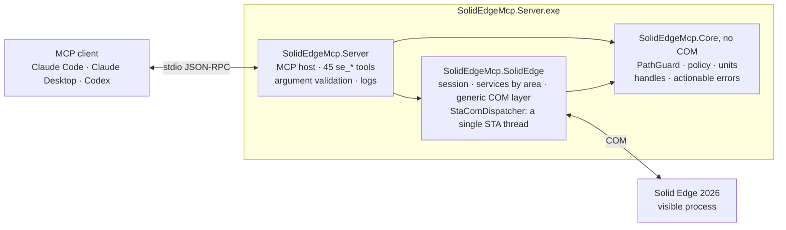

# solid_edge_mcp

**Unofficial local [MCP](https://modelcontextprotocol.io) server to operate Solid Edge from Claude Code,
Claude Desktop, Codex or any other MCP client.**


It lets an AI assistant work in Solid Edge through COM with the breadth of a person: querying
models, drawing sketches, creating part and sheet metal features, building assemblies, making
drawings and exporting. It is general purpose: it does not depend on specific files, a specific
machine or a specific workflow. Each modeling operation is checked by measuring the model and, if
it fails or has no effect, it is undone and the reason and the next step are explained.

Tested with Solid Edge **Community Edition 2026** on Windows 11 x64.

> [!NOTE]
> **Alpha** version (0.1.0). It works and has been validated end to end with Claude Code and
> Codex, but the tools and their parameters may still change.

## Contents

- [What you can ask for](#what-you-can-ask-for)
- [How it works](#how-it-works)
- [Tools](#tools)
- [Architecture](#architecture)
- [Requirements](#requirements)
- [Installation](#installation)
- [Configuration](#configuration)
- [Registering with clients](#registering-with-clients)
- [Security](#security)
- [Validation](#validation)
- [Known limitations](#known-limitations)
- [Repository structure](#repository-structure)
- [Development](#development)
- [Project status](#project-status)
- [License](#license)
- [Trademarks and disclaimer](#trademarks-and-disclaimer)

## What you can ask for

Natural-language requests that Claude Code and Codex completed using only this server. The result
was measured afterwards, separately, by reopening the generated files.

| Request (summary) | Client | Verified result |
|---|---|---|
| Sheet metal part with a 100 × 60 tab and two 20 flanges; flat pattern to DXF and an A3 drawing with the flat pattern and an isometric view to PDF | Claude Code | 9,871.239 mm³ = 6000 + 2·(75π + 1700); box 100 × 60 × 21; DXF with the contour and 2 bend lines; one-page A3 PDF |
| Assembly with a 120 × 80 × 10 base and two 20 × 20 × 30 blocks: mates, interference check, bill of materials, and an A3 drawing with a parts list to PDF | Claude Code | 50 calls, 0 errors; 6 mates solved and both blocks fully defined; no interference; BOM 1 + 2; one-page A3 PDF |
| Plate with 4 holes and 4 R5 fillets, 6061-T6 aluminum, exported to STEP | Codex | 20 calls, 0 errors; 58,416.92 mm³ = 58,631.52 − 4·(25 − 25π/4)·10; 0.15843 kg |

## How it works

- **Few tools, many actions.** Each `se_<area>` tool groups its operations under an `action`
  parameter, so the model does not have to load hundreds of schemas.
- **Millimeters and degrees.** Lengths in mm and angles in degrees. Only the generic `se_com_*`
  layer uses API units (meters and radians, collections starting at 1).
- **Handles.** Objects are returned as identifiers (`doc:3`, `sketch:5`, `face:12`) that are passed
  unchanged to other calls. They expire when the document is closed, undone or recalculated; face
  and edge handles also expire when the model changes.
- **Verification.** Each new operation is checked (status and volume change). If it fails or has no
  effect, it is deleted or undone, and the error carries a code, the cause and the next step.
- **Three layers.** Specific tools verified for common tasks; access to any API object and method
  (`se_com_*`); and any interface command (`se_command`). What each route covers, function by
  function: [docs/COBERTURA.md](docs/COBERTURA.md).

Illustrative example of the sequence an assistant follows for a 100 × 50 × 20 mm block:

```text
se_session    {"action":"connect"}
se_documents  {"action":"new","kind":"part"}
se_sketch     {"action":"create","plane":"1"}                                → sketch:5
se_sketch     {"action":"rectangle","sketch":"sketch:5","points":[0,0,100,50]}
se_sketch     {"action":"close","sketch":"sketch:5"}
se_extrude    {"sketch":"sketch:5","operation":"add","distance":20}
se_physical   {"density":7850}                       → 100 000 mm³ (100 · 50 · 20), 0.785 kg
```

## Tools

45 tools, grouped by area.

| Area | Tool | What it does |
|---|---|---|
| **Server and session** | `se_server_info` | Version, allowed folders, work folder, limits and configuration warnings. Does not need Solid Edge. |
| | `se_session` | Status, connect (attaches to the open Solid Edge or starts it visibly) and disconnect. |
| **Documents** | `se_documents` | Create a part, sheet metal, assembly, drawing or weldment; open, activate, save, save as or copy, close; undo and redo what Solid Edge records; recalculate. |
| **Data** | `se_properties` | Document properties by configuration (summary, custom…): list, set and delete. |
| | `se_variables` | Variables and dimensions: list, read, set a value or formula (returns the volume change), create, delete, rename, comment, expose and limit. |
| | `se_material` | Material libraries: current material, properties and assignment (updates density and mass). |
| | `se_appearance` | Colours (face styles): list, create and delete styles; colour the body, faces, features or assembly components by style or #RRGGBB with opacity, read them back and remove them. |
| **Query** | `se_feature_tree` | Features in order with their status, the modeling mode and the volume. |
| | `se_geometry` | Summary, faces and edges with handles and filters; in assemblies, per occurrence and in assembly coordinates. |
| | `se_measure` | Minimum distance and angle between faces, edges, planes or occurrences, also in assemblies. |
| | `se_physical` | Volume, area, mass, center of gravity and inertia, with the given density or the material's. |
| | `se_selection` | Read, replace, extend or clear the active selection. |
| **View and application** | `se_view` | Capture the view as an image, framing (on drawings, the whole sheet with the title block), orientation and display mode. Does not change the model. |
| | `se_options` | Solid Edge options and document units: list, read and change them; returns the previous value so it can be restored. |
| | `se_ui` | Windows, environments and ribbon: list, activate and arrange windows; list environments and the tabs, groups and commands of the ribbon. |
| **Sketches** | `se_sketch` | Lines, rectangles, polylines, circles, arcs, ellipses, splines, points, corner fillet, edge projection, revolve axis and validated close; list the elements and relations of a sketch. |
| | `se_sketch_constraint` | Geometric relations (horizontal, parallel, tangent, equal, symmetric…) and dimensions that move the geometry. |
| | `se_ref_plane` | Reference planes: list, and create offset or angled ones. |
| **Part** | `se_extrude` | Boss or cut by extrusion: blind, through all or up to next; normal, reversed or symmetric. |
| | `se_revolve` | Boss or cut by revolution about the sketch axis. |
| | `se_hole` | Simple, counterbored, countersunk and threaded holes at points on a plane, without a sketch. |
| | `se_round` | Edge fillet with a constant radius. |
| | `se_chamfer` | Edge chamfer with equal setback. |
| | `se_pattern` | Rectangular pattern, circular pattern and mirror of features. |
| | `se_shell` | Shell with a common wall thickness and optional open faces. |
| | `se_draft` | Face draft relative to a neutral plane. |
| | `se_loft_sweep` | Loft, sweep and helix, as a boss or a cut. |
| | `se_part_feature` | Rib from an open sketch (up to the part or to a finite depth), thicken faces and mirror the whole body. |
| | `se_feature_edit` | Suppress, unsuppress, delete or rename a feature. |
| **Sheet metal** | `se_sheetmetal` | Settings (thickness, radius, reliefs, K-factor), tab, contour flange, flange, hem, corner break and flat pattern with cut size. |
| | `se_sheetmetal_form` | From a sketch: dimple, drawn cutout, normal cutout, etch, jog, bend and bead. |
| **Assemblies** | `se_assembly` | Insert, move, rotate, fix, replace, show or hide, suppress and delete occurrences. |
| | `se_relations` | Planar (mate and flush), axial, insert, parallel, tangent, angle and rigid set relations, checked geometrically; list and delete. |
| | `se_interference` | Interferences between occurrences, with the affected pairs. |
| | `se_bom` | Top-level or flat bill of materials, grouped by file. |
| **Drawings** | `se_drawing` | Sheets; base, projected, auxiliary, section and detail views; dimensions and dimensions retrieved from the model; parts list; update. |
| | `se_annotation` | Text, balloons, callouts, centre marks, centre lines and leaders attached to the views; list and delete. |
| **Export** | `se_export` | Part, sheet metal and assembly to STEP, IGES, Parasolid, STL, JT, SAT, 3MF or PDF; drawings to PDF, DXF, DWG, IGES or TIF; sheet metal flat pattern to DXF or DWG. |
| **Full API access** | `se_com_describe` | Properties and methods, with the types of their parameters, of any API object or interface. |
| | `se_com_get` | Reads a property of an API object; objects come back as handles. |
| | `se_com_set` | Changes a property of an API object. |
| | `se_com_invoke` | Calls any API method with positional arguments. |
| | `se_com_items` | Lists the items of an API collection with their handles. |
| | `se_com_constants` | Searches the API enumerations for constants. Does not need Solid Edge. |
| | `se_command` | Searches for and runs interface commands, as if the person clicked them. |

Each tool declares its MCP annotations (read-only, destructive…) so the client can decide when to
ask for approval. What has no specific tool (booleans between bodies, assembly patterns, surfaces, weld
symbols…) is done with `se_com_*` or `se_command`; details are in
[docs/COBERTURA.md](docs/COBERTURA.md).

## Architecture



- **`SolidEdgeMcp.Server`**: the executable. MCP host over stdio with the official
  `ModelContextProtocol` 2.2.0 SDK, the 45 tools, argument validation and logging of each operation
  with an `op#` number.
- **`SolidEdgeMcp.SolidEdge`**: everything that talks COM. The session (attaches to Solid Edge or
  starts it), the services by area, the generic layer and `StaComDispatcher`, a single STA thread
  with an OLE message filter through which every COM call passes, one at a time and with a time
  limit.
- **`SolidEdgeMcp.Core`**: no COM, covered by unit tests. `PathGuard`, policy, unit conversion
  (mm ↔ m, degrees ↔ rad), the handle registry and the error model.
- The Solid Edge interop is generated on each machine from the local installation
  (`scripts/generate-interop.ps1`); it is not versioned or distributed.

## Requirements

- Windows x64 with Solid Edge installed and licensed (the Community Edition works).
- .NET 10 SDK to build (version pinned in `global.json`).
- Windows PowerShell 5.1 to generate the interop (the script relaunches itself with it if it is run
  from PowerShell 7).

With the Community Edition, the license is provided through the machine variable
`SE_LICENSE_SERVER`. Processes opened before Solid Edge was installed do not have it; the server
copies it when it starts `Edge.exe`.

## Installation

```powershell
git clone https://github.com/gabichuuuuu/solid_edge_mcp.git
cd solid_edge_mcp

# 1. Interop from the type libraries of your Solid Edge (not distributed; goes to lib\interop)
.\scripts\generate-interop.ps1

# 2. Build and publish (self-contained for win-x64)
dotnet publish src\SolidEdgeMcp.Server -c Release -r win-x64 --self-contained -o publish

# 3. Policy: copy the example and adjust the allowed folders
New-Item -ItemType Directory -Force "$env:LOCALAPPDATA\SolidEdgeMcp" | Out-Null
Copy-Item config\policy.example.json "$env:LOCALAPPDATA\SolidEdgeMcp\policy.json"
```

Optional: `.\scripts\dump-api.ps1` dumps the API to `reference\api\*.txt` so you can look up
signatures and constants. It is not versioned either.

## Configuration

`policy.json` accepts comments and trailing commas; an unknown property is an error. It is looked up,
in this order, in `--policy <path>`, in the `SOLID_EDGE_MCP_POLICY` variable and in
`%LocalAppData%\SolidEdgeMcp\policy.json`.

| Key | Purpose | Example |
|---|---|---|
| `allowedRoots` | The only folders where files are opened, saved, exported and inserted. Absolute paths; environment variables are expanded. `%LocalAppData%\SolidEdgeMcp\work` is always allowed. | `["%USERPROFILE%\\Documents"]` |
| `startSolidEdgeIfNotRunning` | Starts Solid Edge on first use if none is open. | `true` |
| `operationTimeoutSeconds` | Maximum time of each COM operation, in seconds. | `120` |
| `startupTimeoutSeconds` | Maximum time for Solid Edge to start, in seconds. | `180` |
| `limits` | `maxListItems`, `maxImageWidth`, `maxImageHeight`, `maxHandles`. | `500`, `4096`, `4096`, `5000` |

Full example in [config/policy.example.json](config/policy.example.json). `se_server_info` shows the
effective folders and the configuration warnings.

Logs go to `%LocalAppData%\SolidEdgeMcp\logs` (one UTF-8 file per day; each operation with its
`op#`). Standard output is reserved for the MCP protocol.

## Registering with clients

Replace `<path>` with the folder of your publish output and of your `policy.json`.

**Claude Code**

```powershell
# -s user: in all your projects; -s local: only in the current project
claude mcp add -s user solid-edge -- "<path>\publish\SolidEdgeMcp.Server.exe" --policy "<path>\policy.json"
```

If long operations exceed the client's limit, adjust the `MCP_TOOL_TIMEOUT` variable.

**Claude Desktop** (`claude_desktop_config.json`)

```json
{
  "mcpServers": {
    "solid-edge": {
      "command": "<path>\\publish\\SolidEdgeMcp.Server.exe",
      "args": ["--policy", "<path>\\policy.json"]
    }
  }
}
```

**Codex** (`~/.codex/config.toml`, or `.codex/config.toml` in a project that Codex trusts)

```toml
[mcp_servers.solid_edge]
command = "<path>\\publish\\SolidEdgeMcp.Server.exe"
args = ["--policy", "<path>\\policy.json"]
env_vars = ["USERPROFILE", "LOCALAPPDATA", "APPDATA"]  # the policy expands %USERPROFILE%
startup_timeout_sec = 30
tool_timeout_sec = 300
```

## Security

- **Allowed folders only.** Every file path goes through `PathGuard`, which resolves `..`, links,
  junctions, 8.3 names, network drives and letter case before comparing, and rejects anything outside
  `allowedRoots`: including `\\?\` paths, alternate data streams, device names and links that leave
  the folder.
- **Generic layer behind approval.** `se_com_*` also filters arguments that look like paths or go to
  file methods, but it can do anything the API allows. For that reason, the tools that write
  (`se_com_set`, `se_com_invoke`, `se_command`…) are announced as destructive, so the client asks for
  approval.
- **Documents are data.** Text read from documents (names, properties, notes) is treated as
  information, never as instructions.
- **Errors without stack traces.** The client receives a code, the cause and the next step; the
  details stay in the log.
- **Residual risk.** Solid Edge can open, on its own, linked files of an assembly that are outside
  the allowed folders, and between a path check and its use another process could change a link
  inside an allowed folder.

## Validation

Results (unit tests and acceptance suite run on 2026-10-11):

- `dotnet build SolidEdgeMcp.slnx`: 0 warnings (warnings are treated as errors).
- Tests without Solid Edge: `SolidEdgeMcp.Core.Tests` 60/60 and `SolidEdgeMcp.Server.Tests` 57/57.
- Acceptance suite against real Solid Edge 2026: **1068 calls and 353 checks**, with values
  calculated by hand (or Solid Edge reference values when there is no simple formula, noted in the
  script). All of them pass with the Debug executable.
- Coverage by value: the 45 tools have correct calls, and `A10` runs every value of the action,
  orientation, direction, type and unit enumerations that the other scripts do not use.
- Real end-to-end use by Claude Code and Codex with natural-language requests
  ([What you can ask for](#what-you-can-ask-for)).

| Script | Covers |
|---|---|
| `A01` | Session and errors |
| `A02` | Full part: data, view, selection, editing, exports and undo |
| `A03` | Part features, ribs, thicken and mirrored body |
| `A04` | Sketches and dimensions |
| `A05` | Sheet metal |
| `A06` | Assemblies |
| `A07` | Drawings, annotations and export to PDF, DXF and DWG |
| `A08` | COM layer and commands |
| `A09` | Faces per occurrence and measurements in an assembly |
| `A10` | Enumeration variants |
| `A11` | Options and document units |
| `A12` | Windows, environments and ribbon |
| `A13` | Colours of a body, faces, features and assembly components |

## Known limitations

- Some Solid Edge 2026 API functions fail or damage the document (corner closing, gussets,
  louvers, several hem types…); they are marked with ✘ in [docs/COBERTURA.md](docs/COBERTURA.md).
- After an `RPC_E_SERVERFAULT`, Solid Edge becomes unstable and must be restarted
  (`se_com_invoke {"target":"app","method":"Quit"}` and `se_session connect`), which closes everything
  that is open.
- Solid Edge does not record as an undoable step an operation created through the API from a sketch:
  `se_documents undo` only undoes what Solid Edge records. To remove an operation, use
  `se_feature_edit`.
- The `se_command` commands that ask for a selection or a dialog box wait for the person.
- The Boundary and SmoothBoundary display modes are not applied in Solid Edge 2026.
- An exported drawing that is not saved shows "Error: No reference" in the title block fields that
  come from the file, such as the date; the server warns about it.
- Windows x64 only; tested only with Solid Edge Community Edition 2026.

## Repository structure

```text
solid_edge_mcp/
├── src/
│   ├── SolidEdgeMcp.Server/       MCP executable: Program.cs, Tools/ (45 tools), Infrastructure/
│   ├── SolidEdgeMcp.SolidEdge/    COM: Com/ (StaComDispatcher, generic layer), Services/, Session/
│   └── SolidEdgeMcp.Core/         no COM: PathGuard, policy, units, handles, errors
├── tests/
│   ├── SolidEdgeMcp.Core.Tests/   unit tests, no Solid Edge
│   ├── SolidEdgeMcp.Server.Tests/ tool registration and arguments, no Solid Edge
│   └── SolidEdgeMcp.Acceptance/   MCP client, run.ps1 and scripts A01–A13 against real Solid Edge
├── scripts/                       generate-interop.ps1, dump-api.ps1
├── config/                        policy.example.json
├── docs/                          COBERTURA.md (coverage by function and route)
├── lib/interop/  reference/       generated on each machine, not versioned
├── AGENTS.md  ESTADO.md  PLAN.md  project rules, status and plan (in Spanish)
└── CHANGELOG.md  LICENSE
```

## Development

From the repository root (required by `global.json`):

```powershell
dotnet build SolidEdgeMcp.slnx
dotnet test --project tests\SolidEdgeMcp.Core.Tests\SolidEdgeMcp.Core.Tests.csproj
dotnet test --project tests\SolidEdgeMcp.Server.Tests\SolidEdgeMcp.Server.Tests.csproj
```

The tests do not need Solid Edge and do not exercise COM. If `dotnet` is not on the `PATH`, use the
one in `C:\Program Files\dotnet`.

### Acceptance suite

Tools are validated against real Solid Edge with `tests/SolidEdgeMcp.Acceptance`: scripts of MCP
calls (`scripts/A01`–`A09`, from session to assemblies, drawings and the COM layer; `A10`, the
orientation, direction and type values that the others do not use; `A11`–`A12`, options and user
interface; `A13`, colours), with volumes, measurements and
expected errors calculated by hand. Each script creates and closes its documents without saving:

```powershell
dotnet build SolidEdgeMcp.slnx
.\tests\SolidEdgeMcp.Acceptance\run.ps1            # all; or e.g. run.ps1 A03 A09
.\tests\SolidEdgeMcp.Acceptance\run.ps1 -Server publish\SolidEdgeMcp.Server.exe   # the published build
```

The script syntax is described in the header of `tests/SolidEdgeMcp.Acceptance/Program.cs`.

### Republishing while the server is in use

While a session uses the server, `publish/` is locked. Publish to another folder and replace only the
files that change, moving the old ones into a subfolder: Windows allows renaming a loaded executable or
DLL, but not overwriting it. This is safe if the changed files are already loaded in that process
(usually only `SolidEdgeMcp.*`); the session keeps running the old version until the server restarts.

### Adding or changing a tool

1. Do not guess signatures or constants: look them up in `reference/api` or with `se_com_describe` /
   `se_com_constants`.
2. Register it in `Program.ToolTypes` and add argument cases to `ToolRegistrationTests`.
3. Validate it against real Solid Edge with temporary documents in an allowed folder, closing them
   without saving, and check the measurable result (volume, bounding box, face count, exported file).
4. Update this README, [docs/COBERTURA.md](docs/COBERTURA.md) and [CHANGELOG.md](CHANGELOG.md).

Commits follow Conventional Commits, in English.

## Project status

- **Alpha (0.1.0).** Working, registered in Claude Code and Codex, and validated end to end. Change
  history in [CHANGELOG.md](CHANGELOG.md).
- **Next:** more high-level tools for families that today go through COM (rib networks, lips,
  grilles, booleans between bodies, assembly patterns, drawing symbols) and MCP
  prompts for common workflows.
- **Pending:** continuous integration (CI).

## License

Released under the [MIT License](LICENSE). Copyright (c) 2026 Gabriel Spoleto Couto.

## Trademarks and disclaimer

Solid Edge is a trademark or registered trademark of Siemens Industry Software Inc. or its
subsidiaries or affiliates. Siemens is a registered trademark of Siemens Trademark GmbH & Co. KG.
Other trademarks belong to their respective owners. This project is independent and is not
affiliated with, sponsored by or endorsed by Siemens. The COM interop and the API dumps are
generated locally from your own Solid Edge installation; they are not distributed with this
repository, and no prebuilt binaries are distributed because a build contains that interop.
