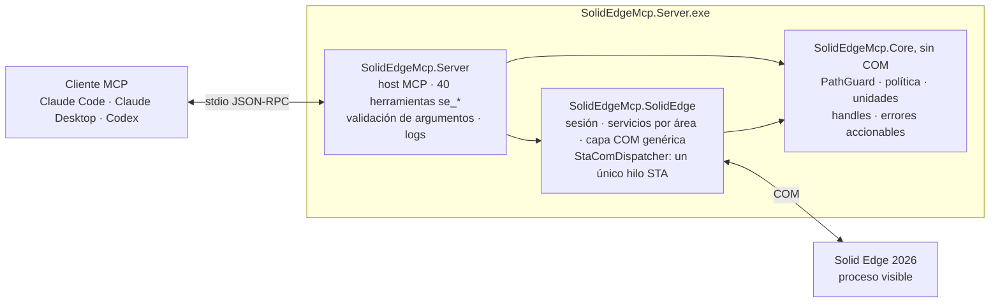

# solid_edge_mcp

**Servidor [MCP](https://modelcontextprotocol.io) local para manejar Solid Edge desde Claude Code,
Claude Desktop, Codex o cualquier otro cliente MCP.**


Permite a un asistente de IA trabajar en Solid Edge por COM con la amplitud de una persona:
consultar modelos, dibujar bocetos, crear operaciones de pieza y chapa, montar conjuntos, hacer
planos y exportar. Es de uso general: no depende de unos archivos, un equipo ni un flujo
concretos. Cada operación de modelado se comprueba midiendo el modelo y, si falla o no tiene
efecto, se deshace y se explica el motivo y el siguiente paso.

Probado con Solid Edge **Community Edition 2026** en Windows 11 x64.

> [!NOTE]
> Versión **alfa** (0.1.0) en un repositorio privado. Está operativa y validada de extremo a
> extremo con Claude Code y Codex, pero las herramientas y sus parámetros aún pueden cambiar.

## Contenido

- [Qué puedes pedirle](#qué-puedes-pedirle)
- [Cómo funciona](#cómo-funciona)
- [Herramientas](#herramientas)
- [Arquitectura](#arquitectura)
- [Requisitos](#requisitos)
- [Instalación](#instalación)
- [Configuración](#configuración)
- [Registro en clientes](#registro-en-clientes)
- [Seguridad](#seguridad)
- [Validación](#validación)
- [Limitaciones conocidas](#limitaciones-conocidas)
- [Estructura del repositorio](#estructura-del-repositorio)
- [Desarrollo](#desarrollo)
- [Estado del proyecto](#estado-del-proyecto)

## Qué puedes pedirle

Encargos en lenguaje natural que Claude Code y Codex completaron usando solo este servidor. El
resultado se midió después por separado, reabriendo los archivos generados.

| Encargo (resumido) | Cliente | Resultado comprobado |
|---|---|---|
| Chapa con una pestaña de 100 × 60 y dos bridas de 20; desarrollo a DXF y plano A3 con el desarrollo y una isométrica a PDF | Claude Code | 9 871,239 mm³ = 6000 + 2·(75π + 1700); caja 100 × 60 × 21; DXF con el contorno y 2 líneas de plegado; PDF de una página A3 |
| Conjunto con una base de 120 × 80 × 10 y dos bloques de 20 × 20 × 30: relaciones, interferencias, lista de materiales y plano A3 con lista de piezas a PDF | Claude Code | 50 llamadas, 0 errores; 6 relaciones resueltas y los dos bloques totalmente definidos; sin interferencias; BOM 1 + 2; PDF de una página A3 |
| Placa con 4 agujeros y 4 redondeos R5, de aluminio 6061-T6, exportada a STEP | Codex | 20 llamadas, 0 errores; 58 416,92 mm³ = 58 631,52 − 4·(25 − 25π/4)·10; 0,15843 kg |

Otros encargos verificados (brida con patrón circular y plano, eje escalonado con agujero M6 ×
12…) están en [ESTADO.md](ESTADO.md).

## Cómo funciona

- **Pocas herramientas, muchas acciones.** Cada herramienta `se_<área>` agrupa sus operaciones en
  un parámetro `action`, para no cargar al modelo con cientos de esquemas.
- **Milímetros y grados.** Longitudes en mm y ángulos en grados. Solo la capa genérica `se_com_*`
  usa las unidades del API (metros y radianes, colecciones desde 1).
- **Handles.** Los objetos se devuelven como identificadores (`doc:3`, `sketch:5`, `face:12`) que
  se pasan tal cual a otras llamadas. Caducan al cerrar, deshacer o recalcular el documento; los de
  caras y aristas, también cuando cambia el modelo.
- **Verificación.** Cada operación nueva se comprueba (estado y cambio de volumen). Si falla o no
  tiene efecto, se borra o se deshace y el error trae un código, la causa y el siguiente paso.
- **Tres capas.** Herramientas específicas verificadas para lo habitual; acceso a cualquier objeto
  y método del API (`se_com_*`); y cualquier orden de la interfaz (`se_command`). Qué cubre cada
  vía, función por función: [docs/COBERTURA.md](docs/COBERTURA.md).

Ejemplo ilustrativo de la secuencia que sigue un asistente para un bloque de 100 × 50 × 20 mm:

```text
se_session    {"action":"connect"}
se_documents  {"action":"new","kind":"part"}
se_sketch     {"action":"create","plane":"1"}                                → sketch:5
se_sketch     {"action":"rectangle","sketch":"sketch:5","points":[0,0,100,50]}
se_sketch     {"action":"close","sketch":"sketch:5"}
se_extrude    {"sketch":"sketch:5","operation":"add","distance":20}
se_physical   {"density":7850}                       → 100 000 mm³ (100 · 50 · 20), 0,785 kg
```

## Herramientas

40 herramientas, agrupadas por área.

| Área | Herramienta | Qué hace |
|---|---|---|
| **Servidor y sesión** | `se_server_info` | Versión, carpetas permitidas, carpeta de trabajo, límites y avisos de configuración. No necesita Solid Edge. |
| | `se_session` | Estado, conectar (se engancha al Solid Edge abierto o lo arranca visible) y desconectar. |
| **Documentos** | `se_documents` | Crear pieza, chapa, conjunto, plano o soldadura; abrir, activar, guardar, guardar como o copia, cerrar; deshacer y rehacer lo que Solid Edge registra; recalcular. |
| **Datos** | `se_properties` | Propiedades del documento por conjunto (resumen, personalizadas…): listar, fijar y borrar. |
| | `se_variables` | Variables y cotas: listar, leer, fijar valor o fórmula (devuelve el cambio de volumen), crear y borrar. |
| | `se_material` | Bibliotecas de materiales: material actual, propiedades y asignación (actualiza densidad y masa). |
| **Consulta** | `se_feature_tree` | Operaciones en orden con su estado, el modo de modelado y el volumen. |
| | `se_geometry` | Resumen, caras y aristas con handles y filtros; en conjuntos, por ocurrencia y en coordenadas del conjunto. |
| | `se_measure` | Distancia mínima y ángulo entre caras, aristas, planos u ocurrencias, también en conjuntos. |
| | `se_physical` | Volumen, área, masa, centro de gravedad e inercia, con la densidad dada o la del material. |
| | `se_selection` | Leer, sustituir, ampliar o vaciar la selección activa. |
| **Vista** | `se_view` | Captura de la vista como imagen, encuadre (en planos, la hoja entera con el cajetín), orientación y modo de visualización. No cambia el modelo. |
| **Bocetos** | `se_sketch` | Líneas, rectángulos, polilíneas, círculos, arcos, elipses, splines, puntos, redondeo de esquina, proyección de aristas, eje de revolución y cierre validado. |
| | `se_sketch_constraint` | Relaciones geométricas (horizontal, paralela, tangente, igual, simétrica…) y cotas que mueven la geometría. |
| | `se_ref_plane` | Planos de referencia: listar y crear desplazados o en ángulo. |
| **Pieza** | `se_extrude` | Protrusión o vaciado por extrusión: finita, pasante o hasta la siguiente; normal, inversa o simétrica. |
| | `se_revolve` | Protrusión o vaciado por revolución alrededor del eje del boceto. |
| | `se_hole` | Agujeros simples, abocardados, avellanados y roscados en puntos de un plano, sin boceto. |
| | `se_round` | Redondeo de aristas con radio constante. |
| | `se_chamfer` | Chaflán de aristas con retranqueo igual. |
| | `se_pattern` | Patrón rectangular, patrón circular y simetría de operaciones. |
| | `se_shell` | Vaciado de paredes con espesor común y caras abiertas opcionales. |
| | `se_draft` | Desmoldeo de caras respecto a un plano neutro. |
| | `se_loft_sweep` | Solevado, barrido y hélice, como protrusión o como vaciado. |
| | `se_feature_edit` | Suprimir, reactivar, borrar o renombrar una operación. |
| **Chapa** | `se_sheetmetal` | Ajustes (espesor, radio, alivios, factor neutro), pestaña, brida de contorno, brida, dobladillo, rotura de esquina y desplegado con tamaño de corte. |
| | `se_sheetmetal_form` | Desde un boceto: embutido, recorte embutido, recorte normal, grabado, desvío, pliegue y cordón. |
| **Conjuntos** | `se_assembly` | Insertar, mover, girar, fijar, reemplazar, mostrar u ocultar, suprimir y borrar ocurrencias. |
| | `se_relations` | Relaciones plana, axial e inserción, comprobadas geométricamente; listar y borrar. |
| | `se_interference` | Interferencias entre ocurrencias, con los pares afectados. |
| | `se_bom` | Lista de materiales de primer nivel o plana, agrupada por archivo. |
| **Planos** | `se_drawing` | Hojas; vistas base, proyectada, auxiliar, sección y detalle; cotas y cotas recuperadas del modelo; lista de piezas; actualizar. |
| **Exportación** | `se_export` | Pieza, chapa y conjunto a STEP, IGES, Parasolid, STL, JT, SAT, 3MF o PDF; planos a PDF, DXF, DWG, IGES o TIF; desarrollo de chapa a DXF o DWG. |
| **Acceso total** | `se_com_describe` | Propiedades y métodos, con los tipos de sus parámetros, de cualquier objeto o interfaz del API. |
| | `se_com_get` | Lee una propiedad de un objeto del API; los objetos vuelven como handles. |
| | `se_com_set` | Cambia una propiedad de un objeto del API. |
| | `se_com_invoke` | Llama a cualquier método del API con argumentos posicionales. |
| | `se_com_items` | Lista los elementos de una colección del API con sus handles. |
| | `se_com_constants` | Busca constantes en las enumeraciones del API. No necesita Solid Edge. |
| | `se_command` | Busca y lanza órdenes de la interfaz, como si la persona las pulsara. |

Cada herramienta declara sus anotaciones MCP (solo lectura, destructiva…) para que el cliente
decida cuándo pedir aprobación. Lo que no tiene herramienta específica (rosca, nervio, booleanas,
patrones de conjunto, anotaciones de plano…) se hace con `se_com_*` o `se_command`; el detalle
está en [docs/COBERTURA.md](docs/COBERTURA.md).

## Arquitectura



- **`SolidEdgeMcp.Server`**: el ejecutable. Host MCP por stdio con el SDK oficial
  `ModelContextProtocol` 2.2.0, las 40 herramientas, la validación de argumentos y el registro de
  cada operación con un número `op#`.
- **`SolidEdgeMcp.SolidEdge`**: todo lo que habla COM. La sesión (se engancha a Solid Edge o lo
  arranca), los servicios por área, la capa genérica y `StaComDispatcher`, un único hilo STA con
  filtro de mensajes OLE por el que pasan todas las llamadas COM, de una en una y con tiempo máximo.
- **`SolidEdgeMcp.Core`**: sin COM y cubierto por tests unitarios. `PathGuard`, política,
  conversión de unidades (mm ↔ m, grados ↔ rad), registro de handles y modelo de errores.
- La interop de Solid Edge se genera en cada equipo desde la instalación local
  (`scripts/generate-interop.ps1`); no se versiona ni se distribuye.

## Requisitos

- Windows x64 con Solid Edge instalado y con licencia (sirve la Community Edition).
- SDK de .NET 10 para compilar (versión fijada en `global.json`).
- Windows PowerShell 5.1 para generar la interop (el script se relanza con él si se ejecuta desde
  PowerShell 7).

Con la Community Edition, la licencia llega por la variable de máquina `SE_LICENSE_SERVER`. Los
procesos abiertos antes de instalar Solid Edge no la tienen; el servidor la copia al arrancar
`Edge.exe`.

## Instalación

```powershell
git clone https://github.com/gabichuuuuu/solid_edge_mcp.git
cd solid_edge_mcp

# 1. Interop desde las type libraries de tu Solid Edge (no se distribuye; va a lib\interop)
.\scripts\generate-interop.ps1

# 2. Compilar y publicar (autocontenido para win-x64)
dotnet publish src\SolidEdgeMcp.Server -c Release -r win-x64 --self-contained -o publish

# 3. Política: copia el ejemplo y ajusta las carpetas permitidas
New-Item -ItemType Directory -Force "$env:LOCALAPPDATA\SolidEdgeMcp" | Out-Null
Copy-Item config\policy.example.json "$env:LOCALAPPDATA\SolidEdgeMcp\policy.json"
```

Opcional: `.\scripts\dump-api.ps1` vuelca el API a `reference\api\*.txt` para consultar firmas y
constantes. Tampoco se versiona.

## Configuración

`policy.json` admite comentarios y comas finales; una propiedad desconocida es un error. Se busca,
por este orden, en `--policy <ruta>`, en la variable `SOLID_EDGE_MCP_POLICY` y en
`%LocalAppData%\SolidEdgeMcp\policy.json`.

| Clave | Para qué sirve | Ejemplo |
|---|---|---|
| `allowedRoots` | Únicas carpetas donde se abren, guardan, exportan e insertan archivos. Rutas absolutas; se expanden las variables de entorno. `%LocalAppData%\SolidEdgeMcp\work` se permite siempre. | `["%USERPROFILE%\\Documents"]` |
| `startSolidEdgeIfNotRunning` | Arranca Solid Edge al primer uso si no hay ninguno abierto. | `true` |
| `operationTimeoutSeconds` | Tiempo máximo de cada operación COM, en segundos. | `120` |
| `startupTimeoutSeconds` | Tiempo máximo del arranque de Solid Edge, en segundos. | `180` |
| `limits` | `maxListItems`, `maxImageWidth`, `maxImageHeight`, `maxHandles`. | `500`, `4096`, `4096`, `5000` |

Ejemplo completo en [config/policy.example.json](config/policy.example.json). `se_server_info`
muestra las carpetas efectivas y los avisos de configuración.

Los logs van a `%LocalAppData%\SolidEdgeMcp\logs` (un archivo diario en UTF-8; cada operación con
su `op#`). La salida estándar queda reservada al protocolo MCP.

## Registro en clientes

Sustituye `<ruta>` por la carpeta de tu publicación y de tu `policy.json`.

**Claude Code**

```powershell
# -s user: en todos tus proyectos; -s local: solo en el proyecto actual
claude mcp add -s user solid-edge -- "<ruta>\publish\SolidEdgeMcp.Server.exe" --policy "<ruta>\policy.json"
```

Si las operaciones largas superan el límite del cliente, ajusta la variable `MCP_TOOL_TIMEOUT`.

**Claude Desktop** (`claude_desktop_config.json`)

```json
{
  "mcpServers": {
    "solid-edge": {
      "command": "<ruta>\\publish\\SolidEdgeMcp.Server.exe",
      "args": ["--policy", "<ruta>\\policy.json"]
    }
  }
}
```

**Codex** (`~/.codex/config.toml`, o `.codex/config.toml` de un proyecto en el que Codex confíe)

```toml
[mcp_servers.solid_edge]
command = "<ruta>\\publish\\SolidEdgeMcp.Server.exe"
args = ["--policy", "<ruta>\\policy.json"]
env_vars = ["USERPROFILE", "LOCALAPPDATA", "APPDATA"]  # la política expande %USERPROFILE%
startup_timeout_sec = 30
tool_timeout_sec = 300
```

## Seguridad

- **Solo carpetas permitidas.** Toda ruta de archivo pasa por `PathGuard`, que resuelve `..`,
  enlaces, junctions, nombres 8.3, unidades de red y mayúsculas antes de comparar, y rechaza lo que
  quede fuera de `allowedRoots`: también rutas `\\?\`, flujos alternativos, nombres de dispositivo
  y enlaces que salgan de la carpeta.
- **Capa genérica bajo aprobación.** `se_com_*` también filtra los argumentos que parecen rutas o
  van a métodos de archivo, pero puede hacer cualquier cosa que permita el API. Por eso las
  herramientas que escriben (`se_com_set`, `se_com_invoke`, `se_command`…) se anuncian como
  destructivas, para que el cliente pida aprobación.
- **Los documentos son datos.** El texto leído de los documentos (nombres, propiedades, notas) se
  trata como información, nunca como instrucciones.
- **Errores sin trazas.** El cliente recibe código, causa y siguiente paso; el detalle queda en el
  log.
- **Riesgo residual.** Solid Edge puede abrir por su cuenta archivos vinculados de un conjunto
  fuera de las carpetas permitidas, y entre la comprobación de una ruta y su uso otro proceso
  podría cambiar un enlace dentro de una carpeta permitida.

## Validación

Estado a 2026-10-10 ([ESTADO.md](ESTADO.md)):

- `dotnet build SolidEdgeMcp.slnx`: 0 avisos (los avisos son errores).
- Tests sin Solid Edge: `SolidEdgeMcp.Core.Tests` 60/60 y `SolidEdgeMcp.Server.Tests` 31/31.
- Batería de aceptación contra Solid Edge 2026 real: **871 llamadas y 227 comprobaciones** con
  valores calculados a mano (o de referencia de Solid Edge cuando no hay fórmula sencilla,
  anotados en el guion). Todas pasan con el ejecutable de Debug y con el publicado.
- Cobertura por valor: las 40 herramientas tienen llamadas correctas y `A10` recorre todos los
  valores de acción, orientación, dirección, tipo y unidades que no usan los demás guiones.
- Uso real de extremo a extremo por Claude Code y Codex con encargos en lenguaje natural
  ([Qué puedes pedirle](#qué-puedes-pedirle)).

| Guion | Cubre |
|---|---|
| `A01` | Sesión y errores |
| `A02` | Pieza completa: datos, vista, selección, edición, exportaciones y deshacer |
| `A03` | Operaciones de pieza |
| `A04` | Bocetos y cotas |
| `A05` | Chapa |
| `A06` | Conjuntos |
| `A07` | Planos y exportación a PDF, DXF y DWG |
| `A08` | Capa COM y órdenes |
| `A09` | Caras por ocurrencia y medidas en conjunto |
| `A10` | Variantes de las enumeraciones |

## Limitaciones conocidas

- Algunas funciones del API de Solid Edge 2026 fallan o dañan el documento (cerrar esquinas,
  cartelas, persianas, varios tipos de dobladillo…); están marcadas con ✘ en
  [docs/COBERTURA.md](docs/COBERTURA.md).
- Tras un `RPC_E_SERVERFAULT`, Solid Edge queda inestable y hay que reiniciarlo
  (`se_com_invoke {"target":"app","method":"Quit"}` y `se_session connect`), lo que cierra todo lo
  abierto.
- Solid Edge no registra como paso deshacible una operación creada por el API desde un boceto:
  `se_documents undo` solo deshace lo que Solid Edge registra. Para quitar una operación,
  `se_feature_edit`.
- Las órdenes de `se_command` que piden selección o un cuadro de diálogo esperan a la persona.
- Los modos de visualización Boundary y SmoothBoundary no se aplican en Solid Edge 2026.
- Un plano exportado sin guardar muestra «Error: No reference» en los campos del cajetín que salen
  del archivo, como la fecha; el servidor avisa.
- Solo Windows x64; probado únicamente con Solid Edge Community Edition 2026.

## Estructura del repositorio

```text
solid_edge_mcp/
├── src/
│   ├── SolidEdgeMcp.Server/       ejecutable MCP: Program.cs, Tools/ (40 herramientas), Infrastructure/
│   ├── SolidEdgeMcp.SolidEdge/    COM: Com/ (StaComDispatcher, capa genérica), Services/, Session/
│   └── SolidEdgeMcp.Core/         sin COM: PathGuard, política, unidades, handles, errores
├── tests/
│   ├── SolidEdgeMcp.Core.Tests/   unitarios, sin Solid Edge
│   ├── SolidEdgeMcp.Server.Tests/ registro y argumentos de las herramientas, sin Solid Edge
│   └── SolidEdgeMcp.Acceptance/   cliente MCP, run.ps1 y guiones A01–A10 contra Solid Edge real
├── scripts/                       generate-interop.ps1, dump-api.ps1
├── config/                        policy.example.json
├── docs/                          COBERTURA.md (cobertura por función y vía)
├── lib/interop/  reference/       generados en cada equipo, no versionados
└── AGENTS.md  ESTADO.md  PLAN.md  CHANGELOG.md
```

## Desarrollo

Desde la raíz del repositorio (lo exige `global.json`):

```powershell
dotnet build SolidEdgeMcp.slnx
dotnet test --project tests\SolidEdgeMcp.Core.Tests\SolidEdgeMcp.Core.Tests.csproj
dotnet test --project tests\SolidEdgeMcp.Server.Tests\SolidEdgeMcp.Server.Tests.csproj
```

Los tests no necesitan Solid Edge ni prueban COM. Si `dotnet` no está en el `PATH`, usa el de
`C:\Program Files\dotnet`.

### Batería de aceptación

La validación de las herramientas se hace contra Solid Edge real con
`tests/SolidEdgeMcp.Acceptance`: guiones de llamadas MCP (`scripts/A01`–`A09`, de sesión a
conjuntos, planos y capa COM; `A10`, los valores de orientación, dirección y tipo que no usan los
demás) con volúmenes, medidas y errores esperados calculados a mano. Cada guion crea y cierra sin
guardar sus documentos:

```powershell
dotnet build SolidEdgeMcp.slnx
.\tests\SolidEdgeMcp.Acceptance\run.ps1            # todos; o p. ej. run.ps1 A03 A09
.\tests\SolidEdgeMcp.Acceptance\run.ps1 -Server publish\SolidEdgeMcp.Server.exe   # la publicación
```

La sintaxis de los guiones está en la cabecera de `tests/SolidEdgeMcp.Acceptance/Program.cs`.

### Republicar con el servidor en uso

Mientras una sesión usa el servidor, `publish/` está bloqueado. Publica en otra carpeta y
sustituye solo los archivos que cambien, moviendo los antiguos a una subcarpeta: Windows permite
renombrar un ejecutable o una DLL cargados, pero no sobrescribirlos. Es seguro si los archivos que
cambian ya están cargados en ese proceso (normalmente solo `SolidEdgeMcp.*`); la sesión sigue con
la versión antigua hasta que reinicie el servidor.

### Añadir o cambiar una herramienta

1. No adivines firmas ni constantes: búscalas en `reference/api` o con `se_com_describe` /
   `se_com_constants`.
2. Regístrala en `Program.ToolTypes` y añade casos de argumentos en `ToolRegistrationTests`.
3. Valídala contra Solid Edge real con documentos temporales en una carpeta permitida, cerrándolos
   sin guardar, y comprueba el resultado medible (volumen, caja envolvente, número de caras,
   archivo exportado).
4. Actualiza este README, [docs/COBERTURA.md](docs/COBERTURA.md), [ESTADO.md](ESTADO.md) y
   [CHANGELOG.md](CHANGELOG.md).

Reglas completas del proyecto en [AGENTS.md](AGENTS.md); plan en [PLAN.md](PLAN.md). Commits
convencionales en inglés.

## Estado del proyecto

- **Alfa privada (0.1.0).** Operativa, registrada en Claude Code y Codex y validada de extremo a
  extremo. Historial de cambios en [CHANGELOG.md](CHANGELOG.md).
- **Siguiente:** más herramientas de alto nivel para familias que hoy van por COM (rosca, nervio,
  red de nervios, labio, rejilla, booleanas entre cuerpos, patrones de conjunto, anotaciones de
  plano) y prompts MCP para flujos habituales.
- **Aplazado hasta hacer público el repositorio:** licencia e integración continua.

---

Solid Edge es una marca de Siemens Digital Industries Software. Este proyecto no está afiliado a
Siemens ni distribuye ninguno de sus archivos: la interop se genera en cada equipo desde la
instalación local.
