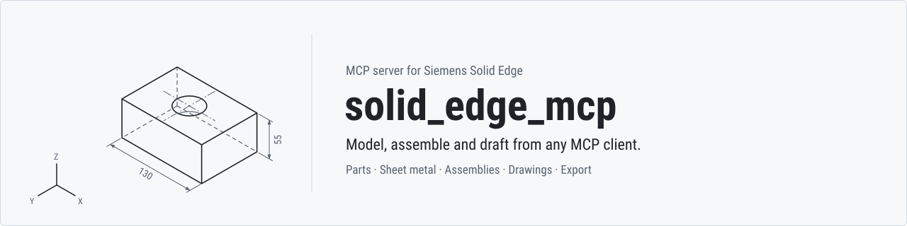

<div align="center">

<picture>
  <source media="(prefers-color-scheme: dark)" srcset="docs/assets/banner-dark.svg">
  
</picture>

**Unofficial local [MCP](https://modelcontextprotocol.io) server to operate Siemens Solid Edge from Claude Code,
Claude Desktop, Codex or any other MCP client.**


[](docs/COVERAGE.md#progress)
[](#license)

[Quick start](#quick-start) · [Examples](#what-you-can-ask-for) · [Tools](#tools) · [Coverage](docs/COVERAGE.md) · [Changelog](CHANGELOG.md) · [Contributing](CONTRIBUTING.md)

</div>

It lets an AI assistant help you work in Solid Edge through COM: querying models, drawing
sketches, creating part and sheet metal features, building assemblies, making drawings and
exporting. You stay in control: tools that can change anything are flagged so your MCP client
asks for your approval. It is general purpose: it does not depend on specific files, a specific
machine or a specific workflow.

<table>
<tr>
<td width="50%" valign="top">

**Broad coverage**

Parts, sheet metal, assemblies, drawings and export with 77 tools, plus the whole API through a
generic COM layer.

</td>
<td width="50%" valign="top">

**Verified changes**

Each modeling operation is measured. If it fails or has no effect, it is undone and the error
explains why and what to do next.

</td>
</tr>
<tr>
<td width="50%" valign="top">

**Safe by default**

Files only inside allowed folders. Tools that can change anything are flagged so the client asks
for approval.

</td>
<td width="50%" valign="top">

**Tested for real**

3642 calls and 1907 checks against real Solid Edge 2026, compared with expected values computed from formulas.

</td>
</tr>
</table>

> [!NOTE]
> Current version (1.0.0), tested with Solid Edge **Community Edition 2026** on Windows 11 x64. It
> works and has been validated end to end with Claude Code and Codex. Tool names and parameters are
> stable: an incompatible change waits for a major version (listed in the changelog).

## Progress

<picture>
  <source media="(prefers-color-scheme: dark)" srcset="docs/assets/progress-dark.svg?v=28df108b">
  
</picture>

Each square is one function of the [coverage map](docs/COVERAGE.md): it works through the MCP, it fails
in Solid Edge 2026 itself (documented, with an alternative when there is one) or it is not tested yet.
`scripts/update-progress.ps1` redraws the chart from the coverage tables.

## What you can ask for

Natural-language requests that Claude Code and Codex completed using only this server. The result
was measured afterwards, separately, by reopening the generated files.

| Request (summary) | Client | Verified result |
|---|---|---|
| Sheet metal part with a 100 × 60 tab and two 20 flanges; flat pattern to DXF and an A3 drawing with the flat pattern and an isometric view to PDF | Claude Code | 9,871.239 mm³ = 6000 + 2·(75π + 1700); box 100 × 60 × 21; DXF with the contour and 2 bend lines; one-page A3 PDF |
| Assembly with a 120 × 80 × 10 base and two 20 × 20 × 30 blocks: mates, interference check, bill of materials, and an A3 drawing with a parts list to PDF | Claude Code | 50 calls, 0 errors; 6 mates solved and both blocks fully defined; no interference; BOM 1 + 2; one-page A3 PDF |
| Plate with 4 holes and 4 R5 fillets, 6061-T6 aluminum, exported to STEP | Codex | 20 calls, 0 errors; 58,416.92 mm³ = 58,631.52 − 4·(25 − 25π/4)·10; 0.15843 kg |
| A Ø50 × 30 cylinder from the installation's inch part template, a stainless steel found in its libraries, the top face red, an isometric capture, and where the hole button is on the ribbon (names searched, not assumed) | Claude Code | 19 turns, 0 errors; 58,904.86 mm³ = π·25²·30; 0.4565 kg at 7,750 kg/m³; Home › Solids › Hole, id 10307 |
| Prompt `/mcp__solid-edge__model_part`: a 100 × 60 × 10 steel plate with four Ø8 holes 10 mm from the corners and R5 vertical corner rounds, saved | Claude Code | 17 turns, 0 errors; 57,774.78 mm³ = 60,000 − 4·(25 − 25π/4)·10 − 4·π·4²·10; 0.4525 kg; bounding box 100 × 60 × 10 |
| Weldment: a 200 × 100 × 10 base plate, a mitred frame of a 20 × 20 section of its own on a closed rectangle, a 4 mm fillet weld between the plate and one bar, and an assembly hole repeated in 3 columns | Claude Code | 30 turns, 0 errors; cut length 520 mm = 180 + 80 + 180 + 80, bars of 64,000 mm³; bead 1,440 mm³ = 4·4/2·180; 1 + 2 hole faces |
| Solid Edge's version and default part template; the start screen turned off and back on; a 100 × 60 × 8 steel plate with a Ø10 through hole; a dark blue to white gradient background for an isometric capture, then the previous background again; an A3 drawing with front, top and right views, printed to PDF with Microsoft Print to PDF | Claude Code | 40 turns, 0 errors; 47,371.68 mm³ = 48,000 − π·5²·8; 0.3711 kg at 7,833 kg/m³; start screen and background as before; first-angle views (top below, right on the left); one-page A3 PDF, 420 × 297 mm |

## Quick start

### Requirements

- Windows x64 with Solid Edge installed and licensed (the Community Edition works).
- .NET 10 SDK to build (version pinned in `global.json`).
- Windows PowerShell 5.1 to generate the interop (the script relaunches itself with it if it is run
  from PowerShell 7).

With the Community Edition, the license is provided through the machine variable
`SE_LICENSE_SERVER`. Processes opened before Solid Edge was installed do not have it; the server
copies it when it starts `Edge.exe`.

### Install

```powershell
git clone https://github.com/gabichuuuuu/solid-edge-mcp.git
cd solid-edge-mcp

# 1. Interop from the type libraries of your Solid Edge (not distributed; goes to lib\interop)
.\scripts\generate-interop.ps1

# 2. Build and publish (self-contained for win-x64)
dotnet publish src\SolidEdgeMcp.Server -c Release -r win-x64 --self-contained -o publish

# 3. Policy: copy the example and adjust the allowed folders
New-Item -ItemType Directory -Force "$env:LOCALAPPDATA\SolidEdgeMcp" | Out-Null
Copy-Item config\policy.example.json "$env:LOCALAPPDATA\SolidEdgeMcp\policy.json"
```

Optional: `.\scripts\dump-api.ps1` dumps the API to `reference\api\*.txt` so you can look up
signatures and constants. It is not versioned either.

### Register with your client

Replace `<path>` with the folder of your publish output and of your `policy.json`.

**Claude Code**

```powershell
# -s user: in all your projects; -s local: only in the current project
claude mcp add -s user solid-edge -- "<path>\publish\SolidEdgeMcp.Server.exe" --policy "<path>\policy.json"
```

If long operations exceed the client's limit, adjust the `MCP_TOOL_TIMEOUT` variable. When the client asks for progress notifications, the server sends one every 5 seconds while a call runs, so clients that reset their time limit on progress keep waiting.

<details>
<summary><b>Claude Desktop</b> (<code>claude_desktop_config.json</code>)</summary>

```json
{
  "mcpServers": {
    "solid-edge": {
      "command": "<path>\\publish\\SolidEdgeMcp.Server.exe",
      "args": ["--policy", "<path>\\policy.json"]
    }
  }
}
```

</details>

<details>
<summary><b>Codex</b> (<code>~/.codex/config.toml</code>, or <code>.codex/config.toml</code> in a project that Codex trusts)</summary>

```toml
[mcp_servers.solid_edge]
command = "<path>\\publish\\SolidEdgeMcp.Server.exe"
args = ["--policy", "<path>\\policy.json"]
env_vars = ["USERPROFILE", "LOCALAPPDATA", "APPDATA"]  # the policy expands %USERPROFILE%
startup_timeout_sec = 30
tool_timeout_sec = 300
```

</details>

## How it works

- **Few tools, many actions.** Each `se_<area>` tool groups its operations under an `action`
  parameter, so the model does not have to load hundreds of schemas.
- **Millimeters and degrees.** Lengths in mm and angles in degrees. Only the generic `se_com_*`
  layer uses API units (meters and radians, collections starting at 1).
- **Handles.** Objects are returned as identifiers (`doc:3`, `sketch:5`, `face:12`) that are passed
  unchanged to other calls. They expire when the document is closed, undone or recalculated; face
  and edge handles also expire when the model changes.
- **Verification.** Each new operation is checked (status and volume change). If it fails or has no
  effect, it is deleted or undone, and the error carries a code, the cause and the next step.
- **Three layers.** Specific tools verified for common tasks; access to any API object and method
  (`se_com_*`); and any interface command (`se_command`). What each route covers, function by
  function: [docs/COVERAGE.md](docs/COVERAGE.md).

Illustrative example of the sequence an assistant follows for a 100 × 50 × 20 mm block:

```text
se_session    {"action":"connect"}
se_documents  {"action":"new","kind":"part"}
se_sketch     {"action":"create","plane":"1"}                                → sketch:5
se_sketch     {"action":"rectangle","sketch":"sketch:5","points":[0,0,100,50]}
se_sketch     {"action":"close","sketch":"sketch:5"}
se_extrude    {"sketch":"sketch:5","operation":"add","distance":20}
se_physical   {"density":7850}                       → 100 000 mm³ (100 · 50 · 20), 0.785 kg
```

## Tools

77 tools, grouped by area.

| Area | Tools |
|---|---|
| **Server and session** | `se_server_info` `se_session` |
| **Documents and data** | `se_documents` `se_properties` `se_variables` `se_part_family` `se_material` `se_appearance` `se_layer` `se_links` |
| **Query** | `se_feature_tree` `se_geometry` `se_measure` `se_physical` `se_selection` `se_sensor` |
| **View and application** | `se_view` `se_section_view` `se_model_view` `se_options` `se_ui` `se_app` `se_customize` `se_styles` |
| **Sketches** | `se_sketch` `se_sketch_constraint` `se_sketch_edit` `se_sketch3d` `se_region` `se_ref_plane` |
| **Part** | `se_extrude` `se_revolve` `se_hole` `se_round` `se_chamfer` `se_pattern` `se_shell` `se_draft` `se_loft_sweep` `se_part_feature` `se_body` `se_face_relation` `se_face_split` `se_pmi` `se_primitive` `se_surface` `se_curve` `se_feature_edit` `se_simplify` |
| **Sheet metal** | `se_sheetmetal` `se_sheetmetal_form` |
| **Assemblies** | `se_assembly` `se_relations` `se_assembly_pattern` `se_assembly_config` `se_assembly_family` `se_component_group` `se_component_query` `se_assembly_feature` `se_frame` `se_interference` `se_bom` |
| **Drawings** | `se_drawing` `se_drawing_view` `se_dimension` `se_annotation` `se_sheet_content` |
| **Export, publishing and printing** | `se_export` `se_publish` `se_print` |
| **Full API access** | `se_com_describe` `se_com_get` `se_com_set` `se_com_invoke` `se_com_items` `se_com_constants` `se_command` |

<details>
<summary><b>What each tool does</b></summary>

| Area | Tool | What it does |
|---|---|---|
| **Server and session** | `se_server_info` | Version, allowed folders, work folder, limits and configuration warnings. Does not need Solid Edge. |
| | `se_session` | Status, connect (attaches to the open Solid Edge or starts it visibly), disconnect, quit and restart (refused while a document has unsaved changes). |
| **Documents** | `se_documents` | Create a part, sheet metal, assembly, drawing or weldment; open, activate, save, save as or copy, close; import STEP, IGES, Parasolid, JT, SAT, STL, OBJ, 3MF, DXF or DWG files as new documents; undo and redo what Solid Edge records; recalculate; list this installation's templates; read and set the document status (in work, in review, released…). |
| **Data** | `se_properties` | Document properties by configuration (summary, custom…): list, set and delete. |
| | `se_variables` | Variables and dimensions: list, read, set a value or formula (returns the volume change), create, delete, rename, comment, expose and limit. |
| | `se_part_family` | Family of parts: family variables, members with their values and suppressed features, apply a member to the master (checked), write member files, copy, rename and delete members. |
| | `se_material` | Material libraries: current material, properties and assignment (updates density and mass). |
| | `se_appearance` | Colours (face styles): list, create and delete styles; colour the body, faces, features or assembly components by style or #RRGGBB with opacity, read them back and remove them. |
| | `se_layer` | Layers of models and drawing sheets: list, create, activate, show or hide, make selectable or not, delete empty ones and move sketch geometry, drawing views, dimensions and annotations between them. |
| | `se_links` | Links between files: what a document refers to (components, drawing models, copied parts) and whether they are found, replace a referenced file, break copied parts, where a file is used (directly or up to the top), top-level assemblies and the document search of File > Open (title, subject, date). |
| **Query** | `se_feature_tree` | Features in order with their status, the modeling mode and the volume. |
| | `se_geometry` | Summary, faces and edges with handles and filters; in assemblies, per occurrence and in assembly coordinates. |
| | `se_measure` | Minimum distance and angle between faces, edges, planes or occurrences, also in assemblies. |
| | `se_physical` | Volume, area, mass, center of gravity and inertia of a part (with the given density or the material's) or of an assembly (with the material of each part). |
| | `se_selection` | Read, replace, extend or clear the active selection. |
| | `se_sensor` | Sensors of parts, sheet metal and assemblies: watch a variable, the minimum distance between two faces, edges or occurrences (a clearance between parts that follows their moves) the area of a face, or in sheet metal the smallest distance between holes, cutouts, edges, dimples, louvers or beads, with a condition (greater or less than, equal, between); list their values and whether each one meets its condition, change them and read manual ones again. |
| **View and application** | `se_view` | Capture the view as an image (optionally with the colours at its corners, edges and centre), framing (on drawings, the whole sheet with the title block), orientation, display mode and named views (list, save the current one, apply, delete); the view style of a model window and its background (solid, gradient or image); the camera (eye, target, up, perspective and field of view), zoom and rotation. Does not change the model. |
| | `se_section_view` | 3D section views of parts, sheet metal and assemblies (View > Section) from a sketch profile: the part that stays (inside or outside of a closed profile, either side of an open line), depth and direction along the sketch normal, caption, fasteners cut or not; show, hide, what is drawn, the cutting plane and its opacity; delete, reporting the unused reference planes that Solid Edge deletes with it. Does not change the model. |
| | `se_model_view` | PMI model views of parts, sheet metal and assemblies: by standard orientation or the current one, render mode, the section views, PMI dimensions and annotations each shows (read back), its 3D PDF flag; apply one to the window, rename, delete. Drawings place them as views and `se_publish` puts them in 3D PDF files. |
| | `se_options` | Every Solid Edge option by page of the Options dialog (general, save, file locations, colours, helpers, assembly, drawing, units, simulation…) and document units: list, read and change them (returns the previous value); save all of them to a snapshot file and restore it. The preferences a drawing saves (projection angle, drawing view defaults, grid, the line style of each kind of edge…). |
| | `se_ui` | Windows, environments, ribbon and interface display: list, activate and arrange windows; list environments and the tabs, groups and commands of the ribbon; find a button by the text it shows (any language or theme); colour theme, status bar, edge bar, recent files shown, and position and size of the main window. |
| | `se_app` | Solid Edge as a program: version, edition, language and folders; the Add-In Manager (load and unload add-ins); default template of each document type; the recent files list; the data Solid Edge's AI automatic drawing creation learns from, extracted from saved drawings. |
| | `se_customize` | The Customize dialog: ribbon themes (create from the default one, activate, rename, button size and labels, remove), tabs, groups and commands of a theme, and keyboard shortcuts of each environment. |
| | `se_styles` | Styles of a document: dimension, text, character, line, fill, hatch, dash, drawing view, table and frame styles of drawings, and view and face styles of models. List them, read every property, change one (read back, with the previous value; colours as #RRGGBB and enumerations by name), create one from another, activate, delete, and import them from another drawing. The 8 lights of a view style: colour, intensity and direction, read back. |
| **Sketches** | `se_sketch` | Lines, rectangles, polylines, circles, arcs, ellipses, splines, conics, points, corner fillet and chamfer, edge projection, revolve axis and validated close; list the elements and relations of a sketch. The same 2D geometry is drawn on drawing sheets (2D drafting) and on the 2D layouts of an assembly. Sketch blocks of parts and layouts: make a block from elements, place it at a scale and angle; features take the profile with its blocks. |
| | `se_sketch_constraint` | Geometric relations (horizontal, parallel, tangent, equal, symmetric…) and dimensions that move the geometry, in sketches and on drawing sheets. |
| | `se_sketch_edit` | Move, rotate, scale and mirror elements (in place, keeping the relations among them, or as connected copies), trim, extend, split, corner, offset a chain, construction geometry, rectangular and circular patterns and delete, in sketches and on drawing sheets; each result measured. |
| | `se_sketch3d` | 3D sketches of parts in model space: polylines tied end to end, arcs, circles, splines through points, points, fillets between lines and 3D relations (parallel, perpendicular, connect, tangent, on a plane, symmetric, lock…); each element read back with its ends, centre, length or radius. A 3D sketch is a sweep path for `se_loft_sweep`. |
| | `se_region` | Closed regions of drawing sheets and sketches: fills and hatching (round a point among the elements or by the corners of a polygon) with fill style, colour, angle and spacing; list, restyle and delete them; area properties (area, perimeter, centroid, second moments, principal axes, radii of gyration and section moduli), minus holes. The point is proved to be inside a closed loop before Solid Edge looks for the region. |
| | `se_ref_plane` | Reference planes of parts and assemblies: list; offset, angled, through three points, midway between two planes, normal to an edge (at an end, a distance or a fraction of its length) and tangent to a cylinder, each checked against its geometry and global, as the Planes commands make them; in an assembly, offset and angled from assembly planes or faces of occurrences and normal to an edge of an occurrence. Coordinate systems by origin and angles or along two edges, with their origin and axes. Show, hide, rename and delete planes and coordinate systems (the base ones and those something is built on are kept). |
| **Part** | `se_extrude` | Boss or cut by extrusion: blind, through all or up to next; normal, reversed or symmetric. |
| | `se_revolve` | Boss or cut by revolution about the sketch axis. |
| | `se_hole` | Simple, counterbored, countersunk and threaded holes at points on a plane, without a sketch. |
| | `se_round` | Edge fillet with a constant radius, or a variable one (a radius at the start and the end of each edge). |
| | `se_chamfer` | Edge chamfer with equal setback. |
| | `se_pattern` | Rectangular pattern, circular pattern, pattern along an edge and mirror of features; mirror copies and copies along an edge of construction geometry (surfaces, curves, construction bodies); copies of the whole part along an edge. |
| | `se_shell` | Shell with a common wall thickness and optional open faces. |
| | `se_draft` | Face draft relative to a neutral plane. |
| | `se_loft_sweep` | Loft, sweep (along a sketch, a 3D curve or a 3D sketch) and helix, as a boss or a cut. |
| | `se_part_feature` | Rib from an open sketch (up to the part or to a finite depth), thicken faces and mirror the whole body; direct edits: delete faces (the solid heals), holes up to a diameter and rounds, offset faces, replace faces with a plane or a surface, merge adjacent faces into one B-spline face, delete a region bounded by a loop of edges, and resize holes and rounds; slots along an open path, web networks and lips in shelled parts, normal protrusions and cutouts (the region inside or outside closed curves projected or wrapped onto faces, raised or recessed, e.g. a logo), scaling of the body, copies of saved parts (scaled or mirrored), splitting a body by a plane into design bodies and uniting them again (`se_geometry` and `se_physical` measure every body), and fillet weld beads between faces of the part, with equal or unequal legs. |
| | `se_body` | Bodies of a part: list the design and construction bodies; subtract and intersect design bodies (with a closed body as the tool, or an open surface that keeps the side its normal points to or the other one); unite closed construction bodies (end-capped surfaces) with a design body, the tools staying as construction bodies; emboss closed bodies into another (thickened or as a cut only, with a clearance, on either side); turn design bodies into construction bodies and closed construction bodies (end-capped surfaces) into design bodies; divide a saved part into one part file per piece by a reference plane or a surface. Each result is checked by the volume and the bodies. |
| | `se_face_relation` | 3D relations between faces of a part, as the Relate commands of synchronous modelling: coplanar, offset at a distance, parallel, perpendicular, tangent and concentric (the faces move and the target stays; each relation is checked on the geometry, and one that Solid Edge cannot meet is deleted), and fixed faces; list relations, edit the distance of an offset and delete relations; read and set the live rules of the session, restore their defaults and put them back. |
| | `se_face_split` | Faces of the body split into more faces without changing its volume (to draft, colour or relate part of a face): by reference planes, surfaces or curves that cross them, along the silhouette seen from a plane (a sphere at its equator), or by a line at a distance from an edge of the face. Each split is checked by the faces and the volume, and the new faces are returned. |
| | `se_pmi` | 3D (PMI) dimensions of a part or sheet metal document, the ones synchronous features carry (the height, width and length of a box, the height and diameter of a cylinder): list them with their value, type, lock and status; drive the model to a new value with the measured end, the origin end or both ends moving (the value the model reaches is read back, and the old one is put back if Solid Edge does not reach it); lock and unlock them; delete them (the model stays as it is); show or hide the PMI dimensions and annotations in the window. |
| | `se_primitive` | Box (optionally turned about the plane normal), cylinder or sphere placed by its centre on a plane or face, added or cut, without a sketch. |
| | `se_surface` | Construction surfaces: extruded or revolved from a sketch (open or closed, with end caps), offset from a face, lofted through sections, swept along a sketch or a 3D curve, stitched, filling a closed chain of edges, copied from faces, and BlueSurf through section edges with guides; trim a surface where surfaces or curves cross it, extend it from its edges (natural, linear or reflective), close surfaces that enclose a volume into a solid construction body, and blend two surfaces with a constant radius (trimmed to it); list and delete. Each result is checked by its area or volume. |
| | `se_curve` | Construction curves: through 3D points, intersections of faces, surfaces and the body, sketches projected onto faces, crossings of two sketches, chains of edges, contours drawn on a face through points on it, sketches wrapped onto cylindrical or conical faces, and isoclines (where the face normal makes an angle with a plane, e.g. a silhouette); split a curve where planes or other curves cross it (its length is checked); list and delete. |
| | `se_feature_edit` | Suppress, unsuppress, delete or rename a feature or a group; group features and dissolve a group; move a feature before or after another; roll the model back to a feature (new features go after it) and forward to its end. |
| | `se_simplify` | The simplified model of a part or sheet metal part, which assemblies can show instead of the design body: make it, delete holes up to a diameter, rounds, chosen faces and regions bounded by edges from it (each change checked on its body, the design body untouched), switch between the design and the simplified model, list and delete its features; the simplified model of an assembly (without chosen or small components), written as a part. |
| **Sheet metal** | `se_sheetmetal` | Settings (thickness, radius, reliefs, K-factor), gauges of a material library, tab, contour flange, flange, hem, corner break, flat pattern with cut size, changes of the angle and radius of existing bends, a flange matched to a parallel plane (onto it, short of it or beyond it), and conversion of a thin-walled part into sheet metal. |
| | `se_sheetmetal_form` | From a sketch: dimple, drawn cutout, normal cutout, etch, jog, bend and bead. |
| **Assemblies** | `se_assembly` | Insert, move, rotate, fix, replace, show or hide, suppress and delete occurrences; activate or inactivate them; make a subassembly from occurrences, move occurrences into a subassembly and disperse one; copy the components of another assembly in, kept in step with it, plain or mirrored. |
| | `se_relations` | Planar (mate and flush), axial (rotation locked or free), insert, parallel, tangent, angle, center-plane, connect (points of edges onto points, faces, planes or edges), coordinate system and rigid set relations, each checked geometrically; gear relations between two gears or a gear and a rack, in teeth or turns; list and delete. |
| | `se_assembly_pattern` | Component patterns that follow a part pattern (e.g. a pin repeated on every hole of a hole pattern): list, create, delete and dissolve. |
| | `se_assembly_family` | Alternate positions and families of assemblies: turn a saved assembly into one with named members, add, activate, rename and delete members, write one as a plain assembly, and leave components out of a member of a family. |
| | `se_assembly_config` | Display configurations: save which components are shown under a name, apply, list and delete them; automatic exploded views with the exploded placement of each component. |
| | `se_component_group` | Component groups (the groups of PathFinder): create, add and remove components, rename, show and hide, ungroup, pack the occurrences of one file and unpack, and delete a group together with its components (with an explicit confirmation). |
| | `se_component_query` | Find components as the Select Tools do: by occurrence name or by the properties and material of their files (all criteria at once), among all, shown, hidden or selected components and inside subassemblies, or inside a box (zone); the matches are selected and can be shown alone (a matched subassembly whole), hidden or shown; queries and zones can be saved in the assembly, run, renamed and deleted. |
| | `se_assembly_feature` | Extruded and revolved cutouts and holes (simple or countersink) made in the assembly through chosen parts, from a sketch drawn in the assembly or centers on an assembly plane; mirrors of cutouts about an assembly plane; rectangular patterns of cutouts and holes; extruded and revolved protrusions (assembly bodies); fillet welds (bead) and label welds in a weldment; list and delete. |
| | `se_frame` | Structural frames (sections from the installed library or your own part, mitred or butted) and pipes with elbows and fittings, along a polyline or assembly sketch lines; members and segments with their extent and cut lengths (also per member); list the library, list, delete and repair (frames made elsewhere before any assembly feature). |
| | `se_interference` | Interferences between occurrences, with the affected pairs. |
| | `se_bom` | Top-level or flat bill of materials, grouped by file. |
| **Drawings** | `se_drawing` | Sheets and background sheets (the frame and title block: list, show or hide, draw and write on them, replace one with a background of another drawing, add, rename and delete one no sheet uses); base (also of an assembly display configuration, of a member of an assembly family or alternate position, or of a PMI model view), projected, auxiliary, section and detail views; 2D model views (what is drawn on the 2D model sheet, at a scale); dimensions (also coordinate, angular coordinate and chamfer dimensions) and dimensions retrieved from the model; parts list; bend table; tolerance table (the dimensions of a view with an ISO fit); family of parts table (one row per member); block table (the blocks placed on a sheet and their quantity); the tables of a drawing read back with their cells; blocks (create from sheet graphics, place scaled and turned, import from a drawing, delete); update. |
| | `se_drawing_view` | Display of a drawing view as in its Properties dialog: hidden and tangent edges, shading, captions and the display of each member of an assembly view (hide a part, show it as reference), checked by the edges drawn; break lines (add, list, show or hide, remove); broken-out sections cut to a depth; the other alternate positions of an assembly drawn as phantoms; conversion of a view to 2D geometry. |
| | `se_dimension` | Tolerance of a dimension of a drawing, a sketch or the PMI: plus/minus deviations, limits, ISO fits for holes and shafts (H7, g6, alone or with deviations or limits), basic and reference dimensions; prefix, suffix and a text shown instead of the value. |
| | `se_annotation` | Text, balloons, callouts, centre marks, centre lines, leaders, surface finish symbols, datums, datum targets and points, bolt hole circles, corner annotations (edge conditions, ISO 13715), feature control frames, weld symbols and GOST weld symbols attached to the views; the saved notes of the note library; list and delete. |
| | `se_sheet_content` | Tables of your own (a revision list, notes in columns), pictures (a logo), smart frames (reserved areas) and symbols (saved drawings, embedded, linked or copied as geometry) on drawing sheets: a table with headers, rows and column widths where you want it, a cell changed, rows added, an image sized by width or height, an empty frame of a style; list and delete, everything read back. |
| **Export, publishing and printing** | `se_export` | Part, sheet metal and assembly to STEP, IGES, Parasolid, STL, JT, SAT, 3MF or PDF (a picture of the view); drawings to PDF, DXF, DWG, IGES or TIF; sheet metal flat pattern to DXF or DWG. PDF files are read back for their pages and page sizes. |
| | `se_publish` | 3D PDF documents of saved parts, sheet metal and assemblies (one file, or a folder with its subfolders) with the 3D PDF templates of the installation: the model in 3D that the reader can turn, every PMI model view as a 3D view, next/previous view buttons, STEP AP242 and JT files embedded, and an HTML page with the model; each PDF checked for its pages, 3D views, widgets and embedded files. |
| | `se_print` | Prints the sheets of a drawing as the Print command does: lists the Windows printers (connection, port, driver, state, whether they ask for a file name) and Solid Edge's print settings; prints every working sheet or the chosen ones on a printer or to files in a folder (one PDF, PostScript or printer file per sheet, checked for its pages and page size), with paper size, orientation, scale or fit to the paper, colours as black and copies; Solid Edge's print settings are put back afterwards. The mesh of the 3D Print command for a part, sheet metal or assembly: triangles, mesh area and volume against the model's. |
| **Full API access** | `se_com_describe` | Properties and methods, with the types of their parameters, of any API object or interface. |
| | `se_com_get` | Reads a property of an API object; objects come back as handles. |
| | `se_com_set` | Changes a property of an API object. |
| | `se_com_invoke` | Calls any API method with positional arguments (through the typed interface, with an IDispatch fallback for omitted optional arguments). Refuses the few members known to close Solid Edge or leave it unstable. |
| | `se_com_items` | Lists the items of an API collection with their handles. |
| | `se_com_constants` | Searches the API enumerations for constants. Does not need Solid Edge. |
| | `se_command` | Searches for and runs interface commands, as if the person clicked them; checks whether this installation knows a command and its licence includes it. |

</details>

### Prompts

Workflow prompts, which Claude Code shows as `/mcp__solid-edge__<name>` commands: `model_part` (a part from a
description, feature by feature, checked and optionally saved with a material), `part_from_template` (a variant of a
saved part from variable values, with its drawing, STEP and PDF), `manufacturing_drawing` (views, dimensions and parts
list of a part or assembly, to PDF) and `welded_frame` (plates, structural frames, fillet welds and holes in a
weldment). Example: `/mcp__solid-edge__model_part "a 100 x 60 x 10 plate with four 8 mm holes" "<folder>\plate.par" "Steel"`.

Each tool declares its MCP annotations (read-only, destructive…) so the client can decide when to
ask for approval. What has no specific tool (booleans between bodies, 3D sketches…) is done with
`se_com_*` or `se_command`; details are in [docs/COVERAGE.md](docs/COVERAGE.md).

## Architecture


- **`SolidEdgeMcp.Server`**: the executable. MCP host over stdio with the official
  `ModelContextProtocol` 2.2.0 SDK, the 77 tools, argument validation and logging of each operation
  with an `op#` number.
- **`SolidEdgeMcp.SolidEdge`**: everything that talks COM. The session (attaches to Solid Edge or
  starts it), the services by area, the generic layer and `StaComDispatcher`, a single STA thread
  with an OLE message filter through which every COM call passes, one at a time and with a time
  limit.
- **`SolidEdgeMcp.Core`**: no COM, covered by unit tests. `PathGuard`, policy, unit conversion
  (mm ↔ m, degrees ↔ rad), the handle registry and the error model.
- The Solid Edge interop is generated on each machine from the local installation
  (`scripts/generate-interop.ps1`); it is not versioned or distributed.

## Configuration

`policy.json` accepts comments and trailing commas; an unknown property is an error. It is looked up,
in this order, in `--policy <path>`, in the `SOLID_EDGE_MCP_POLICY` variable and in
`%LocalAppData%\SolidEdgeMcp\policy.json`.

| Key | Purpose | Example |
|---|---|---|
| `allowedRoots` | The only folders where files are opened, saved, exported and inserted. Absolute paths; environment variables are expanded. `%LocalAppData%\SolidEdgeMcp\work` is always allowed. | `["%USERPROFILE%\\Documents"]` |
| `startSolidEdgeIfNotRunning` | Starts Solid Edge on first use if none is open. | `true` |
| `operationTimeoutSeconds` | Maximum time of each COM operation, in seconds. | `120` |
| `startupTimeoutSeconds` | Maximum time for Solid Edge to start, in seconds. | `180` |
| `limits` | `maxListItems`, `maxImageWidth`, `maxImageHeight`, `maxHandles`. | `500`, `4096`, `4096`, `5000` |

Full example in [config/policy.example.json](config/policy.example.json). `se_server_info` shows the
effective folders and the configuration warnings.

Logs go to `%LocalAppData%\SolidEdgeMcp\logs` (one UTF-8 file per day; each operation with its
`op#`). Standard output is reserved for the MCP protocol.

## Security

- **Allowed folders only.** Every file path goes through `PathGuard`, which resolves `..`, links,
  junctions, 8.3 names, network drives and letter case before comparing, and rejects anything outside
  `allowedRoots`: including `\\?\` paths, alternate data streams, device names and links that leave
  the folder.
- **Generic layer behind approval.** `se_com_*` also filters arguments that look like paths or go to
  file methods, but it can do anything the API allows. For that reason, the tools that write
  (`se_com_set`, `se_com_invoke`, `se_command`…) are announced as destructive, so the client asks for
  approval.
- **Documents are data.** Text read from documents (names, properties, notes) is treated as
  information, never as instructions.
- **Errors without stack traces.** The client receives a code, the cause and the next step; the
  details stay in the log.
- **Residual risk.** Solid Edge can open, on its own, linked files of an assembly that are outside
  the allowed folders, and between a path check and its use another process could change a link
  inside an allowed folder.

To report a vulnerability, see [SECURITY.md](SECURITY.md).

## Validation

Results (unit tests and acceptance suite run on 2026-10-12):

- `dotnet build SolidEdgeMcp.slnx`: 0 warnings (warnings are treated as errors).
- Tests without Solid Edge: `SolidEdgeMcp.Core.Tests` 75/75 and `SolidEdgeMcp.Server.Tests` 377/377.
- Acceptance suite against real Solid Edge 2026: **4375 calls and 2228 checks** in `A01`–`A51`, with expected
  values computed from formulas (or Solid Edge reference values when there is no simple formula, noted in the script). All of
  them pass.
- Coverage by value: the 77 tools have correct calls, and `A10` runs every value of the action,
  orientation, direction, type and unit enumerations that the other scripts do not use.
- Real end-to-end use by Claude Code and Codex with natural-language requests
  ([What you can ask for](#what-you-can-ask-for)).

<details>
<summary><b>Acceptance scripts</b></summary>

| Script | Covers |
|---|---|
| `A01` | Session and errors |
| `A02` | Full part: data, view and named views, selection, editing, exports and undo |
| `A03` | Part features, ribs, thicken, mirrored body, reference planes and coordinate systems, direct face edits, slots, web networks, lips, body scale, copied parts, and split and united bodies |
| `A04` | Sketches, corner chamfers and dimensions, also on a drawing sheet |
| `A05` | Sheet metal, bend angle and radius changes, bend table on a drawing |
| `A06` | Assemblies |
| `A07` | Drawings, annotations, drawing and weld symbols, and export to PDF, DXF and DWG |
| `A08` | COM layer and commands |
| `A09` | Faces per occurrence and measurements in an assembly |
| `A10` | Enumeration variants |
| `A11` | Options and document units |
| `A12` | Windows, environments and ribbon |
| `A13` | Colours of a body, faces, features and assembly components |
| `A14` | Component patterns that follow a part pattern; display configurations; cutouts, holes, patterns, protrusions and welds made in the assembly |
| `A15` | Primitives: box (also turned), cylinder and sphere added and cut, on base planes and faces |
| `A16` | Layers of a part (sketch geometry), a drawing (per sheet: a view and annotations) and an assembly |
| `A17` | Construction surfaces: extruded, revolved, offset, lofted, swept, stitched and bounded |
| `A18` | Construction curves (also contours on a face and wrapped sketches) and sweeps or cuts along them |
| `A19` | Family of parts: members, apply, member file; part display configurations through the COM layer |
| `A20` | Structural frames and pipes from the installed libraries |
| `A21` | Solid Edge as a program: options by page with snapshot and restore, interface display, version, add-ins, default templates, recent files, command licence check, ribbon themes and keyboard shortcuts; every setting is put back |
| `A22` | Document styles (drawing and model), the preferences a drawing saves, the view style and background of a window checked by the colours of a capture, and the camera: perspective, zoom and rotation |
| `A23` | Display of drawing views (hidden edges, shading, members of an assembly view), break lines, conversion to 2D, and import of STEP, IGES, Parasolid, STL and DXF files |
| `A24` | Sketch editing: move, rotate, scale and mirror (related sets and copies), trim, extend, split, corner, offset, construction, patterns and delete, also on a drawing sheet |
| `A25` | Assembly structure (activate, inactivate, bundle, transfer, disperse), links (list, replace, break), where used, top-level assemblies, document search, physical properties of assemblies and attribute sets |
| `A26` | Closed regions: fills by elements and by points, the side of a split region, refused points (outside, on an element, no loop, island), fill styles, list and delete, and area properties with holes against values computed from formulas (inertia of a triangle, an L-like section, an ellipse) |
| `A27` | Background sheets: list them with the sheets that use them, show or hide the background of a sheet, draw and write on a background, replace one with a background of another drawing (changes detected, a frame of another paper size reported), add one of a custom size and give it to a sheet, refuse to delete one in use, rename, and the background view |
| `A28` | 3D section views checked by the colour of the cut in a capture: inside and outside of a closed profile, both sides of an open line, extents along the sketch normal (front, back, a depth, symmetric), show, hide, edit, the look repeated by the next section views, delete (the reference plane of the profile stays), refused arguments and a section of an assembly |
| `A29` | 3D PDF publishing: a part with STEP and JT files embedded, the same part published again without the pages of the first publish, an assembly with its template, a folder with and without its subfolders, the HTML page, and refused cases (existing file, unknown template, a drawing, two files that would write the same PDF, open documents) |
| `A30` | Reference planes and coordinate systems: global planes in a part (in the feature tree), rename, hide, delete, and the planes kept because a plane, a sketch or a feature is built on them; in an assembly, planes offset from base planes and from a face of an occurrence, turned about a hinge and normal to an edge of an occurrence, a coordinate system, hide and show every plane, and the planes kept because of a plane, an assembly sketch or a relation |
| `A31` | Component groups, queries and zones: pack and unpack, groups that refuse a component already grouped, remove, add, rename, hide and show, ungroup and delete with the components; queries by occurrence name, title, material and a custom property, two criteria at once, hidden, shown and selected components, parts inside a subassembly (also three levels down) with their path, show only (a matched subassembly whole), show and hide; zones with and without overlap; saved queries and zones run, renamed, kept after saving and reopening, and deleted |
| `A32` | Printing drawing sheets to PDF files with the Microsoft Print to PDF printer (nothing goes on paper): the Windows printers and Solid Edge's print settings, every working sheet fitted to A4 (one PDF per sheet, checked for its page count and size), one sheet named in another case on A3 portrait at half size, as black and with two copies, refused cases (a printer that asks for a file name without a folder, an unknown printer or sheet, a bad scale, existing files) and the print settings put back |
| `A33` | More kinds of assembly relations: center plane with two faces and with one, connect (the start of an edge onto a face, onto the end of another edge, the middle of an edge onto a face), coordinate systems (an origin and axes turned 90 degrees, and a system of the assembly), gears with the axial rotation unlocked (40:20 driven by an angle relation, flip) and a rack moving 100 mm per turn, the refused cases, and the cam and path methods refused by the COM layer |
| `A34` | More drawing dimensions and annotations: coordinate dimensions from a corner (horizontal and vertical, also in a view at 1:2), angular coordinate dimensions of holes about a flange centre (counterclockwise and clockwise), a chamfer dimension, a bolt hole circle through three holes, a datum target A1 on a leader and a datum point, and the refused cases |
| `A35` | Tables and pictures on a drawing sheet: a revision table with headers, rows, column widths and position, a cell changed and a row added, a table in the default place, a logo sized by width with its proportions kept, the list, the refused cases and deleting them |
| `A36` | Drawing views: a broken-out section of a block with a blind hole from below cut 15 mm deep from the top inside a square outline, with the refused cases (an outline away from the part, too few points, no depth); a base view of an assembly display configuration that hides one part, and an unknown configuration refused |
| `A37` | Feature tree: a group of two holes (holes apart and a hole already in a group refused) suppressed and dissolved, holes moved (not before the synchronous box), the model rolled back to a hole, a variable-radius round added there and the model rolled forward; holes resized (a blind one keeps its depth) and a round resized (a variable-radius one refused); user-defined sets in synchronous modelling; the generic layer refusing `Rounds.AddBlend` and `ResizeHoles.Add` |
| `A38` | Bodies: the design and construction bodies listed, an end-capped surface turned into a design body and subtracted from the block (the tool body stays), a design body turned back into a construction body, an open surface as the tool keeping either side, intersect (the common volume; refused when the bodies do not overlap), a construction body remade with `RecoveredBodies` through the generic layer, emboss thickened, with a clearance, on the other side and as a cut only; normal protrusions inside and outside a projected rectangle, a normal cutout, a clockwise outline closed on its first point and a rectangle wrapped on a cylinder; a saved part divided by a plane into two part files (refused before saving, with too few paths and when already divided), each piece opened and measured |
| `A39` | Face relations: a box top kept 10 mm below another and edited to coplanar, two box tops made coplanar with a third, a side of a turned box made parallel and another perpendicular to the side of the block, a cylinder made tangent to the back face, a hole made concentric with a boss (it now runs through it), a fixed face, relations deleted by index and by a handle that follows the renumbering; refused cases (the target among the faces, planes that are not parallel, a negative distance, a tangent between planes, faces of ordered features, a boss concentric with another: the model and the earlier relation stay); live rules read, switched off, restored by Solid Edge (offset stays off) and put back with the values read before, also from sheet metal, which has no face relations. |
| `A40` | Match face of sheet metal: the outer face of a 20 mm flange moved onto a plane 10 mm into the tab (-1000 mm3, the face at y = 10), 5 mm short of it and 5 mm beyond it, onto a plane 10 mm outside the tab (+1000 mm3), the inner face onto the plane (the outer one ends at y = 9) and 20 mm short of the end face of the tab given as the plane; refused without a face or a plane, with a bend face, with a plane that is not parallel and in a part, and the edge face of the flange left failed by Solid Edge and deleted |
| `A41` | PMI dimensions and unite: a closed construction body added to a block (+16000 mm3, the body reaching x = 120 and z = 30), two at once (144000 mm3) and one inside the block refused (the volume stays), refused with an open surface, a design body or no tools; the three dimensions of a synchronous box listed (20, 60 and 100, driven), the width set to 80 by name, the length to 120 by index with the origin end moving and to 140 by handle with both ends moving and left locked; a height Solid Edge cannot reach rejected (the model keeps 20), lock and unlock, the dimensions hidden and shown, refused calls, the height deleted (the model stays); the diameter of a cylinder set from 40 to 50 with both sides moving; refused in a drawing |
| `A42` | Surface, curve and face edits: the top and front of a block copied as one surface (8000 mm2), the top split by a plane (3000 + 3000), a line 10 mm from the bottom's front edge (1000 + 5000) and the same line asked for on the front face, which Solid Edge first puts on the bottom (redone on the front: 1500 + 500), the front split by a surface and the back by a curve, the volume unchanged; a wall trimmed by another wall (1000 left) and by a curve (500), extended natural, linear and reflective (+800, +300, +450), a tube and two planes closed into a solid (60000 mm3), BlueSurf through two lines with and without a guide (6324.555 mm2), a circle refused as a section; isoclines of a sphere at 30 degrees (circles at z = 10 and -10, 108.828 long) and its parting split into two halves; a curve split by a plane, by a crossing curve, by two planes at once on different edges and by a curve and an edge of another curve at once (its length stays 100), the curve itself and a curve along it refused, a curved curve split by another; the top of a block and the round along its edge merged into one B-spline face (6285.4 mm2, 7 faces to 6), a second merge with the front face whose fit changes the volume, reported and deleted, and the same merge on the second body of a split part (1885.6 mm2), whose round is also resized and deleted and whose top is offset and replaced by a plane; refused cases, and the generic layer refusing `SplitCurves` with a curve or several edges instead of one edge |
| `A43` | Welds, copies and simplified models: a fillet weld of leg 5 between a plate and a rib (a bead body of 1250 mm3) and of legs 5 and 8 (2000 mm3, 100 x 5 x 8), refused without target faces or a leg and between faces that do not meet; a wall surface mirrored about YZ (x = −10) and copied along a curve (x = 30 and 50), refused in a rectangular pattern; a block copied three times along a 400 mm curve (360000 mm3), refused with features, mixed handles or another type; the 3D print mesh of a block with two holes within 0.2 % of its volume; the holes of both halves of a split block deleted (two features, 120000 mm3, then refused); a simplified model without its round (118429.2 mm3) and its hole (120000 mm3) while the design body stays, switched to the design model and back, a feature deleted, its hole face deleted (120000 mm3 again), refused before it exists, twice and with a face of the design body. |
| `A44` | Sensors, surface blends, deleted regions and conics: a variable sensor between 20 and 50 (30 met, 60 flagged), a thickness sensor between the top and bottom faces (20 mm, changed to more than 25: flagged) and a face area sensor (6000 mm2), a manual sensor out of date until read again, refusals of bad conditions, names and deletions, and the sensors and their units kept after saving and opening the part; variable and area sensors of a sheet metal part, which still saves, and its distance sensor refused; a clearance sensor between two blocks of an assembly that follows a move (30 mm, then 10 mm and flagged); a blend of R10 between two crossing surfaces in the corner a point picks (a quarter cylinder of 471.24 mm2 at x = y = 10) and of R5 in the opposite corner (235.62 mm2), refused on one surface, with the point on a face and with a radius that does not fit; a 20 x 20 x 5 boss removed by the loop of edges at its base from the simplified model (122000 to 120000 mm3, design body unchanged) and from the design body; a conic of rho 0.5 closed with a line (15 mm high, 5002.29 mm3). |
| `A45` | Dimension tolerances: a sketch dimension of 100 mm with +0.2/-0.1; drawing dimensions with +0.1/-0.2, a fit H7 on the 60 mm one, prefix 2x and suffix TYP, a shaft fit g6 with limits and limits of ±0.05, then texts cleared and back to nominal; refusals of missing or bad deviations and fit classes (h7 for a hole, G6 for a shaft); the tolerance table of the view refused while no dimension has a fit, then one row 60 / H7 at the position given. |
| `A46` | Family of parts and block tables: refused for a view of a part without a family and for a sheet without blocks (no table left behind); the table of a block whose depth is the family variable, members Thick (30.000 mm) and Thin (10.000 mm), at the position given; a sheet block placed twice listed once with quantity 2, above the title block. |

</details>

## Known limitations

- Some Solid Edge 2026 API functions fail or damage the document (corner closing, gussets,
  louvers, several hem types…); they are marked with ✘ in [docs/COVERAGE.md](docs/COVERAGE.md).
- After an `RPC_E_SERVERFAULT`, or when features that worked start failing, Solid Edge is unstable and must
  be restarted with `se_session restart` (refused while a document has unsaved changes).
- Solid Edge does not record as an undoable step an operation created through the API from a sketch:
  `se_documents undo` only undoes what Solid Edge records. To remove an operation, use
  `se_feature_edit`.
- The `se_command` commands that ask for a selection or a dialog box wait for the person.
- A Solid Edge dialog that waits for an answer (e.g. a first-use tip) blocks Solid Edge until the person
  answers it: the blocked call fails with `dialog_open` and names the dialog, and `se_session status`
  lists it. The server never presses dialog buttons.
- The Boundary and SmoothBoundary display modes are not applied in Solid Edge 2026.
- Program settings: suspending the recent files list (`se_app suspend_recent`) does not stop Solid Edge 2026
  from adding the files saved with `save_as`; with no document window open Solid Edge cannot read some
  drawing options and reports others as -1, so an options snapshot is restored in the state it was made in;
  and a folder option that had no value (such as Macros) cannot be emptied again through the API.
- View: Solid Edge 2026 does not set the colour of a solid background through its API (`se_view background`
  draws a gradient with the same colour at both ends instead) and changes environment backgrounds to solid.
- The radial menu cannot be customized through the API: its `DumpPallets` and `SavePallets` methods close
  Solid Edge 2026, so the COM layer refuses them.
- An exported drawing that is not saved shows "Error: No reference" in the title block fields that
  come from the file, such as the date; the server warns about it.
- Planar cam and path relations leave Solid Edge 2026 unstable through its API, so they are refused: add them with
  the Cam and Path commands of Solid Edge.
- Surfaces: Solid Edge 2026 does not trim surfaces with reference planes through its API (use a surface on the plane or a
  curve). Faces merged with `se_part_feature redefine_faces` become a B-spline fitted to the edges around them, which
  can change the volume: the answer warns when it changes by more than 0.01 %.
- Printing: only printing to files (Microsoft Print to PDF) is tested, not printing on paper. When Windows manages
  the default printer ("Let Windows manage my default printer"), it makes the last printer used the default:
  `se_print` reports the change but does not undo it, since it is a Windows setting.
- Windows x64 only; tested only with Solid Edge Community Edition 2026.

## Development

From the repository root (required by `global.json`):

```powershell
dotnet build SolidEdgeMcp.slnx
dotnet test --project tests\SolidEdgeMcp.Core.Tests\SolidEdgeMcp.Core.Tests.csproj
dotnet test --project tests\SolidEdgeMcp.Server.Tests\SolidEdgeMcp.Server.Tests.csproj
```

The tests do not need Solid Edge and do not exercise COM. If `dotnet` is not on the `PATH`, use the
one in `C:\Program Files\dotnet`.

### Repository structure

```text
solid-edge-mcp/
├── src/
│   ├── SolidEdgeMcp.Server/       MCP executable: Program.cs, Tools/ (77 tools), Infrastructure/
│   ├── SolidEdgeMcp.SolidEdge/    COM: Com/ (StaComDispatcher, generic layer), Services/, Session/
│   └── SolidEdgeMcp.Core/         no COM: PathGuard, policy, units, handles, errors
├── tests/
│   ├── SolidEdgeMcp.Core.Tests/   unit tests, no Solid Edge
│   ├── SolidEdgeMcp.Server.Tests/ tool registration and arguments, no Solid Edge
│   └── SolidEdgeMcp.Acceptance/   MCP client, run.ps1 and scripts A01–A51 against real Solid Edge
├── scripts/                       generate-interop.ps1, dump-api.ps1, update-progress.ps1
├── config/                        policy.example.json
├── docs/                          COVERAGE.md (coverage by function and route), assets/
├── lib/interop/  reference/       generated on each machine, not versioned
└── CHANGELOG.md  LICENSE  NOTICE  CLA.md
```

### Acceptance suite

Tools are validated against real Solid Edge with `tests/SolidEdgeMcp.Acceptance`: scripts of MCP
calls (`A01`–`A51`, listed under [Validation](#validation)) with expected volumes, measurements
and errors written in advance. Each script creates and closes its documents without saving:

```powershell
dotnet build SolidEdgeMcp.slnx
.\tests\SolidEdgeMcp.Acceptance\run.ps1            # all; or e.g. run.ps1 A03 A09
.\tests\SolidEdgeMcp.Acceptance\run.ps1 -Server publish\SolidEdgeMcp.Server.exe   # the published build
```

The script syntax is described in the header of `tests/SolidEdgeMcp.Acceptance/Program.cs`.

### Republishing while the server is in use

While a session uses the server, `publish/` is locked. Publish to another folder and replace only the
files that change, moving the old ones into a subfolder: Windows allows renaming a loaded executable or
DLL, but not overwriting it. This is safe if the changed files are already loaded in that process
(usually only `SolidEdgeMcp.*`); the session keeps running the old version until the server restarts.

### Adding or changing a tool

1. Do not guess signatures or constants: look them up in `reference/api` or with `se_com_describe` /
   `se_com_constants`.
2. Register it in `Program.ToolTypes` and add argument cases to `ToolRegistrationTests`.
3. Validate it against real Solid Edge with temporary documents in an allowed folder, closing them
   without saving, and check the measurable result (volume, bounding box, face count, exported file).
4. Write its rows in [docs/COVERAGE.md](docs/COVERAGE.md) with the status found in step 3, describe it in
   this README and add it to [CHANGELOG.md](CHANGELOG.md). Raise the `<Version>` of
   `src/SolidEdgeMcp.Server/SolidEdgeMcp.Server.csproj` with the release: minor for new tools or actions,
   patch for fixes.

Commits follow Conventional Commits, in English.

The progress section and chart, the progress badge, the tool count and the version shown in this README
are generated by `scripts\update-progress.ps1` from `docs/COVERAGE.md`, the tools declared in `src` and
the project version; a tool that `docs/COVERAGE.md` does not mention yet is listed there as not tested.
Run it before committing, or from a local pre-commit hook with `-Staged`, which regenerates them from
what the commit contains.

## Project status

- **Current version (1.0.0).** The first complete version: working, registered in Claude Code and Codex,
  and validated end to end, by the acceptance suite and by sessions in which Claude uses Solid Edge from requests in
  plain language. Change history in [CHANGELOG.md](CHANGELOG.md).
- **Next:** more high-level tools for the functions that today go through COM (see
  [docs/COVERAGE.md](docs/COVERAGE.md)), MCP prompts for common workflows and an easier installation.
- **Pending:** continuous integration (CI).

## License

Copyright (c) 2026 Gabriel Spoleto Couto.

Released under the [GNU Affero General Public License v3.0 only](LICENSE) (AGPL-3.0-only). You may
use, study, modify and share it, but if you distribute it, or a modified version, or let others use
a modified version over a network, you must release the complete source code under the same license.

**Additional permission under GNU AGPL version 3 section 7.** If you modify this program, or any
covered work, by linking or combining it with Siemens Solid Edge or with interop assemblies
generated from its type libraries (or a modified version of them), containing parts covered by the
terms of the Solid Edge license, the licensors of this program grant you additional permission to
convey the resulting work. This permission is also in the [NOTICE](NOTICE) file, and every source file
carries the copyright and license header.

**Commercial license.** To use it in a closed-source product or service, or under other terms than
the AGPL, a separate commercial license is available from the author: open an issue with the
[Commercial license](https://github.com/gabichuuuuu/solid-edge-mcp/issues/new/choose) template, without
confidential details, and you will get a private contact.

**Contributions.** To keep both licenses possible, pull requests are accepted only from
contributors who agree to the [contributor license agreement](CLA.md) (CLA), which lets the author
relicense their contribution; you keep the copyright of your work. Open an issue before submitting
one; see [CONTRIBUTING.md](CONTRIBUTING.md).

Versions published before the change to the AGPL (2026-10-11) remain available under the MIT
License.

## Trademarks and disclaimer

Solid Edge is a trademark or registered trademark of Siemens Industry Software Inc. or its
subsidiaries or affiliates. Siemens is a registered trademark of Siemens Trademark GmbH & Co. KG.
Other trademarks belong to their respective owners. This project is independent and is not
affiliated with, sponsored by or endorsed by Siemens. The COM interop and the API dumps are
generated locally from your own Solid Edge installation; they are not distributed with this
repository, and no prebuilt binaries are distributed because a build contains that interop.
