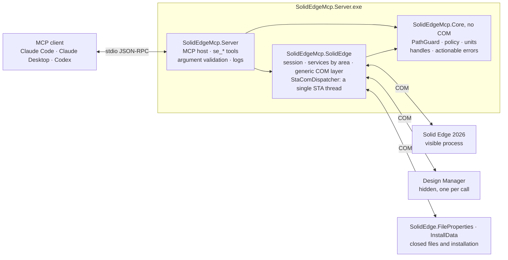

# Architecture

- **`SolidEdgeMcp.Server`**: the executable. MCP host over stdio with the official
  `ModelContextProtocol` 2.2.0 SDK, the tools, argument validation and logging of each operation
  with an `op#` number.
- **`SolidEdgeMcp.SolidEdge`**: everything that talks COM. The session (attaches to Solid Edge or
  starts it), the services by area, the generic layer and `StaComDispatcher`, a single STA thread
  with an OLE message filter through which every COM call passes, one at a time and with a time
  limit.
- **`SolidEdgeMcp.Core`**: no COM, covered by unit tests. `PathGuard`, policy, unit conversion
  (mm ↔ m, degrees ↔ rad), the handle registry and the error model.
- **The programs installed with Solid Edge** have COM servers of their own: Design Manager
  (`se_design_manager`, started hidden for each call and closed after it), the file property library
  (properties and thumbnails of closed files) and the installation data (`se_server_info`).
- The Solid Edge interop is generated on each machine from the local installation
  (`scripts/generate-interop.ps1`): beside the server in a build from source, and by the server itself
  on its first start in the distributed package. It is not versioned or distributed.
