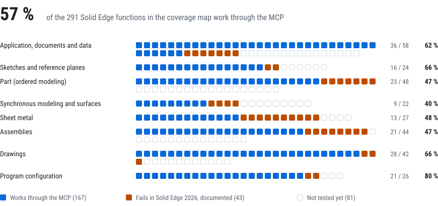

# Solid Edge coverage

Which Solid Edge functions can be used from the MCP and through which route. Checked with Solid Edge
Community Edition 2026 (226.00.01.004). Date of the last review: 2026-10-12.

## How to read this table

Every Solid Edge function is accessible through one of these routes:

- **High level**: a specific `se_*` tool, in mm and degrees, with verification of the result and
  reversal if it fails. It is the preferred route.
- **COM**: the generic layer (`se_com_describe` to see members and signatures, `se_com_get`,
  `se_com_set`, `se_com_invoke`, `se_com_items`, `se_com_constants`). It reaches any API object and
  method, in meters and radians, without automatic verification: check the result with
  `se_geometry`, `se_physical` or `se_view capture`. Faces and edges read from an occurrence go in
  as their reference in the assembly.
- **Command**: `se_command` runs any interface command (`find` searches by name and environment).
  Commands that ask for a selection or a dialog box wait for the person.

Status: **✔** tested in Solid Edge 2026; **·** not tested yet (reachable through the API or a command,
with no verified route); **✘** fails or damages the document in Solid Edge 2026 (do not use).
`se_server_info` (version, policy and allowed folders of the server) is not a Solid Edge function and
has no row.

The tables list every function of Solid Edge 2026 found in its type libraries (the collections that
create objects and the methods of the application and documents) and in its command sets, so the
progress measures how much of the whole program works through the MCP. Separate applications installed
beside Solid Edge (CAM Pro, Electrical Design, Technical Publications) are outside this list.

<!-- progress:start -->
## Progress

<picture>
  <source media="(prefers-color-scheme: dark)" srcset="assets/progress-dark.svg">
  
</picture>

**56 % working** (160 of 283 functions work through the MCP, ✔): 41 do not work in Solid Edge 2026
and are documented, with an alternative when there is one (✘), and 82 are still to be tested (·).
Every function, tested or not, can also be reached through the generic COM layer and `se_command`.

| Area | ✔ | ✘ | · | Working |
|---|---|---|---|---|
| Application, documents and data | 36 | 7 | 15 | 62 % |
| Sketches and reference planes | 16 | 2 | 6 | 66 % |
| Part (ordered modeling) | 23 | 7 | 18 | 47 % |
| Synchronous modeling and surfaces | 9 | 4 | 9 | 40 % |
| Sheet metal | 13 | 10 | 4 | 48 % |
| Assemblies | 19 | 7 | 15 | 46 % |
| Drawings | 23 | 2 | 12 | 62 % |
| Program configuration | 21 | 2 | 3 | 80 % |
| **Total** | **160** | **41** | **82** | **56 %** |

Generated by `scripts/update-progress.ps1` from the tables below.
<!-- progress:end -->

## Application, documents and data

| Function | Route | Status |
|---|---|---|
| Connect, start Solid Edge with a license, reconnect, quit and restart it | High level `se_session` | ✔ |
| Create part, sheet metal, assembly, drawing, weldment (template optional; without a `.pwd` template, as in Solid Edge 2026, the weldment is an assembly with the weldment assembly template) | `se_documents new` | ✔ |
| Open, activate, save, save as, save a copy, close | `se_documents` | ✔ |
| Undo, redo, recalculate | `se_documents undo/redo/recompute` | ✔ (only what Solid Edge records; see the note) |
| Document properties (summary, custom) | `se_properties` | ✔ |
| Variables, dimensions and formulas; rename, comment, expose (assemblies, part families) and limits (range or allowed values) | `se_variables` | ✔ |
| Solid Edge options, one global parameter at a time (list, read, write), and document options; document display units. The settings by category are under [Program configuration](#program-configuration) | `se_options` | ✔ |
| Windows (list, activate, arrange, state), environments, ribbon tabs, groups and command ids | `se_ui` | ✔ |
| Feature tree; suppress, delete, rename | `se_feature_tree`, `se_feature_edit` | ✔ |
| Geometry (body, faces, edges with filters) | `se_geometry` | ✔ |
| Measure distances and angles (in part and in assembly) | `se_measure` | ✔ |
| Mass, volume, center of gravity, inertia of a part, or of an assembly with the material of each part (its mass and inertia only when every part has a density; A25) | `se_physical` | ✔ |
| Active selection (read, change) | `se_selection` | ✔ |
| View: fit (on drawings, the whole sheet with the title block), orientation, mode, PNG capture (optionally with the colours at its corners, edges and centre, to check what it shows) | `se_view` | ✔ |
| Named views: list (the 6 standard ones and the saved ones), save the current view with a description, apply, delete | `se_view named_views`, `save_view`, `apply_view`, `delete_view` | ✔ |
| Display modes Boundary and SmoothBoundary | — | ✘ Solid Edge 2026 changes them to Smooth (`not_supported` error) |
| View style of a model window: read it and apply another one (the built-in Medium, Light, Dark, Outdoor, Indoor, Performance and Studio, or one of the document) | `se_view style` | ✔ |
| Background of the window's view style: solid, gradient (horizontal, vertical, diagonal or spot, two colours) or image (one of the installation or in an allowed folder); returns the previous one to put it back | `se_view background` | ✔ The colour of a solid background is not set through the API (`SetGradientColor` and the background colour option change nothing): the server draws a gradient with the same colour at both ends. Colours render slightly off (#FF0000 shows as #F80004) |
| Environment backgrounds (static and immersive, skybox) | — | ✘ Solid Edge 2026 changes them to solid, also after `SetSkyboxSkyFile` |
| Camera: read it; set eye, target and up; parallel or perspective with its field of view; zoom by a factor; rotate about an axis through the target. Fit, orientation and capture keep the field of view of a perspective camera | `se_view camera`, `set_camera`, `zoom`, `rotate` | ✔ |
| Export STEP, IGES, Parasolid, STL, JT, SAT, 3MF, PDF, DXF, DWG | `se_export` | ✔ |
| Material: libraries, properties, assignment (updates density and mass) | `se_material` | ✔ |
| List the installed material libraries | COM (`Application.GetMaterialTable().GetMaterialLibraryList`; A08) | ✔ |
| Create or edit materials and libraries | COM (`Application.GetMaterialTable()`) | ✘ Only the libraries in the Solid Edge installation folder can be edited, and the MCP does not write there: with a library copied to an allowed folder, `AddMaterialToLibrary` changes nothing, `RenameMaterial` and `GetMaterialListFromLibrary` give E_FAIL, `ApplyMaterialToDoc` E_INVALIDARG and `ImportMaterialDataFromFile` E_POINTER (`GetMaterialList` and `GetMatLibFileName`: E_NOTIMPL). `ExportMaterialDataToFile` writes a library to XML |
| Colours: list, create and delete face styles; apply them (or a #RRGGBB colour with opacity) to the body, faces, features or assembly components; read and remove them | `se_appearance` | ✔ |
| Remove the style of a feature | — | ✘ `SetStyle` with an empty style keeps it (`not_supported`; apply another one) |
| Layers of models and drawings: list, create, activate, show or hide, selectable, delete empty ones, move elements (sketch geometry, drawing views, dimensions, annotations); per sheet in drawings | `se_layer` | ✔ |
| Family of parts: family variables, members (values, suppressed features, description), apply to the master, member files, copy, rename, delete | `se_part_family` | ✔ |
| Part display configurations: save what is shown, apply, find, list and delete (`PartConfigurations.Add`, `Apply`, `Find`, `Delete`; they do not store feature suppression, use family members for that) | COM | ✔ |
| Family of parts options (`FamilyMembers.FamilyofPartsOption[option]`, read and written; A19) | COM | ✔ |
| Suppressed relationships and live rules of a member (`FamilyMember.AddSuppressedRelationship` with a 3D relationship of `PartDocument.Constraints`, read back and removed; 2D sketch relations give E_NOINTERFACE; `LiveRule[igCoplanarLiveRule]` read, written and restored with `RestoreDefaultLiveRules`, index 17 gives E_INVALIDARG; `MovePrecedence`) | COM | ✔ |
| 3D PMI model views by standard orientation (`PMI.PMIModelViews.AddByStandardViewOrientation`; A08) | COM | ✔ |
| Live sections on a reference plane (`Model.LiveSections.Add(plane)` in ordered and synchronous modeling; `Range`, `Edges`, `Visible`, `Delete`; `SphereFeatures.AddByCenterAndRadius` with `vbCreateLiveSection` adds one too) | COM | ✔ |
| Simulation and generative studies | COM / Command | ✘ With the Community Edition licence: `StudyOwner.AddStudy`, `AddConstraint` (with `dwDOF`) and `AddLoad` work, but `Study.Solve` neither meshes nor solves (`seApplicationGlobalSimulationToggleSwitch` is off) and `GenerativeStudies` gives E_FAIL |
| Optimization of a simulation study (design variables and limits) and load functions | COM (`Optimization`, `FunctionOwner`) | · |
| Open other CAD formats as new Solid Edge documents from a template (STEP, IGES and Parasolid give the exact volume, STL a faceted body of the same size, DXF a drawing with its 2D elements; JT, SAT, OBJ, 3MF and DWG go the same way, not tested; A23) | `se_documents import` (`Documents.OpenWithTemplate`) | ✔ |
| 3D PDF publishing with the installed 3D PDF templates: a saved part, sheet metal or assembly, or a folder of them (with its subfolders), STEP AP242 and JT files embedded, an HTML page with the 3D model (A29) | `se_publish templates`, `pdf3d` | ✔ Solid Edge publishes only while no document is open, and within one session each single-file publish carries the pages of the earlier ones over (2, 4, 6…): the server publishes every file through a folder of its own |
| Attach other files to a 3D PDF | COM (`Publish3DPDFEx` ListOfAttachments) | ✘ Nothing was embedded in Solid Edge 2026 (an array of paths, an object array or a single path) |
| PMI model views and named views chosen for a 3D PDF, navigation buttons and custom properties in it | COM (`Publish3DPDFEx`) | · |
| Links between documents: list them (component files of an assembly, models of a drawing with their views, copied parts of a part), replace a referenced file (every occurrence of it in an assembly, the model of a drawing with its views updated, the source of copied parts) and break copied parts (A25). `Application.ReplaceReference` opens the Replace dialog box (API documentation), so it is not used | `se_links list`, `replace`, `break` | ✔ |
| Inter-part links (geometry copied between parts in the context of an assembly) | COM (`InterpartLinks`) | · |
| Where used (the documents of the chosen folders that use a file, directly or up to the top), top-level assemblies of a set or a folder, and the document search of File > Open with title, subject and date of change (A25) | `se_links where_used`, `top_level`, `search` | ✔ |
| Search the text inside documents | COM (`Application.FindSEDocumentsContainingText`) | · It returned no files in the tests (a folder outside the Windows Search index, which it probably needs); `se_links search` filters by title, subject and file name |
| Copy, rename and replace documents together with their links (Design Manager, Pack and Go) | Design Manager (separate program) | · |
| Built-in data management: revisions, revision history, document status | COM (`Application.GetRevisionsHistory`, `GetLatestRevision`) | · |
| Teamcenter and Insight XT data management | COM (`Application.SolidEdgeTCE`, `SolidEdgeInsightXT`) | · |
| Attribute sets: custom data stored on features, reference planes, occurrences, 2D elements, drawing views and sheets, with typed values (text, integer, long, single, double, currency, date) kept in the file (A25). Documents, faces and edges have no `AttributeSets` in Solid Edge 2026; `AttributeQuery.QueryObjects.Item` gives E_UNEXPECTED | COM (`AttributeSets`) | ✔ |
| Property tables attached to features and faces | COM (`AttachedPropertyTables`, `PropertyTableDefinitions`) | · |
| Sensors and sheet metal sensors: create, read and check | COM (`Sensors`, `SheetMetalSensors`) | · |
| 3D section views of a part, sheet metal or assembly from a sketch profile: the part that stays (inside or outside of a closed profile, either side of an open line), extent along the sketch normal (front, back, a depth, symmetric), caption, fasteners cut or not; show, hide, what is drawn, the cutting plane and its opacity; delete (A28) | `se_section_view` | ✔ Deleting a section view also deletes its profile, without undo, and the local planes that only it used (listed in the result); planes made by `se_ref_plane` stay. A new section view repeats the display and plane visibility last set in its document |
| 3D section views by planes | COM (`SectionViews.AddByPlane`, `AddByPlaneEx`) | ✘ Both give E_FAIL in Solid Edge 2026; a profile drawn on the plane (`se_section_view add`) makes the same cut |
| Section views in PMI model views; changing the planes of a section view | COM (`SectionView.AddToModelView`, `EditByPlane`) | · |
| Cutaway views of the model | Command | · |
| View and face styles of a model: list, read every property, change one (read back; colours as #RRGGBB, enumerations by name: shadows, reflections, silhouettes, hidden lines, ambient light, opacity, diffuse colour…), create from another one, apply a view style, delete | `se_styles` | ✔ |
| Lights of a view style (8 per style: colour, intensity, direction, flags) and skybox images | COM (`ViewStyle.GetLight`, `SetLight`, `AddLight`, `SetSkyboxSideFilename`…) | · |
| Decals: an image on faces, by label or by planar projection | COM (`Decals.AddByLabel`, `AddByPlanarProjection`) | · |
| Send documents by e-mail and routing slips | COM (`Application.MailSession`, `RoutingSlip`) | · |
| 3D printing (send the model to a printer or a printing service) | Command | · |

## Sketches and reference planes

| Function | Route | Status |
|---|---|---|
| Sketch on a principal plane, a reference plane or a planar face; in an assembly, on its base or reference planes | `se_sketch create` | ✔ |
| Line, rectangle, polyline, circle, arc, ellipse, spline, point, corner fillet and chamfer | `se_sketch` | ✔ |
| Revolve axis (also one side of the profile: a copy is used and the profile stays closed) | `se_sketch axis` | ✔ |
| Validate a closed profile or an open chain | `se_sketch close` | ✔ |
| List the elements of a sketch (with keypoints) and its relations and dimensions | `se_sketch info`, `se_sketch_constraint list` | ✔ |
| Project model edges onto the sketch | `se_sketch project` | ✔ |
| 2D relations (horizontal, parallel, tangent, equal, symmetric…) and dimensions (length, true distance, interior angle, radius, diameter) | `se_sketch_constraint` | ✔ |
| Sketch text | — | ✘ `Profile.TextProfiles` has no `Add`: text profiles are created only with the Text command in Solid Edge |
| 3D sketches: lines (`Sketches3D.Add`, `Lines3D.Add` in m, checked by `Length`; A08); 3D paths are also covered by `se_curve points`, usable as sweep paths | COM (`Sketches3D`) | ✔ |
| Offset and angled planes, global as the Planes commands make them (named, in the feature tree); the API's default is a local plane, which has no name, is not in the feature tree and cannot be renamed (E_FAIL) or deleted (E_INVALIDARG) | `se_ref_plane` | ✔ |
| Planes through 3 points (vertices or edge midpoints), midway, normal to an edge (at an end, a distance or a fraction of its length), tangent to a cylinder or cone (parallel to a plane or at an angle about the axis); coordinate systems by origin and angles or along two edges | `se_ref_plane` | ✔ |
| Planes tangent to a curved surface (cylinder, sphere…) at an edge end | `se_ref_plane tangent points` | ✔ |
| Reference axes | — | ✘ `RefAxes` has no Add (the axes come from features such as revolves) |
| Reference planes and coordinate systems created in an assembly: offset from an assembly plane or a planar face of an occurrence, angled about the line where the parent meets a pivot, normal to an edge of an occurrence (at an end, a distance or a fraction), coordinate systems by origin and angles (their planes are faces there); each plane checked against its geometry (A30) | `se_ref_plane` | ✔ Three-point planes need point objects (`AddBy3Points` with coordinate arrays gives E_NOINTERFACE) and there is no mid plane in assemblies; tangent planes are not offered there |
| Show, hide, rename and delete reference planes and coordinate systems (A30) | `se_ref_plane show`, `hide`, `rename`, `delete` | ✔ The API deletes base planes and the base coordinate system, and deleting a plane deletes the sketches on it (part) or fails the planes made from it (assembly): those deletes are refused, as are planes that planes, sketches, features or assembly relations are built on |
| Edit sketch elements: move, rotate, scale and mirror (in place or as copies; elements tied by relations move as a set and keep the relations among them, copies keep their connections), trim, extend, split, corner, offset of a chain, switch to construction, delete; also on drawing sheets (A24) | `se_sketch_edit` | ✔ |
| Stretch sketch elements (move the points inside a fence) | Command | · |
| Sketch patterns: rectangular (columns, rows, spacing, angle) and circular (occurrences, sweep; a centre on the element is refused, as `CircularPatterns2d.AddByCircleEx` with spacing 0 brings Solid Edge down; A24) | `se_sketch_edit pattern_rectangular`, `pattern_circular` | ✔ |
| Conics and complex strings | COM (`Conics2d`, `ComplexStrings2d`) | · |
| Area properties of a closed region of a sketch or a drawing sheet: area, perimeter, centroid, second moments about the centroid, principal moments and angle, radii of gyration and section moduli, minus holes (A26) | `se_region area` | ✔ Solid Edge measures a closed loop inside the region (an island) instead of the region, so holes are passed apart and subtracted (parallel axis theorem); a point outside every region brings it down (`RPC_E_SERVERFAULT`), so the server proves the point is inside a loop first |
| Sketch blocks in parts and assemblies: create, place, views and labels | COM (`SketchBlocks`, `SketchBlockOccurrences`, `SketchBlockViews`, `SketchBlockLabels`) | · |
| Component sketches (layout sketches from which parts are made) | COM (`ComponentSketches`) | · |
| 3D sketches: arcs, ellipses, B-spline curves, points and 3D relations | COM (`Arcs3D`, `Ellipses3D`, `BSplineCurves3D`, `Points3D`, `Sketch3DRelations`) | · |
| Intersection points | COM (`IntersectionPoints`) | · |

## Part (ordered modeling)

| Function | API collection | Route | Status |
|---|---|---|---|
| Boss and cut by extrusion (blind, through, up to next, symmetric) | `ExtrudedProtrusions`, `ExtrudedCutouts` | `se_extrude` | ✔ |
| Revolve (boss and cut) | `RevolvedProtrusions`, `RevolvedCutouts` | `se_revolve` | ✔ |
| Holes (simple, countersunk, counterbored, threaded; through, up to next or finite) | `Holes`, `HoleDataCollection` | `se_hole` | ✔ |
| Edge fillet and chamfer | `Rounds`, `Chamfers` | `se_round`, `se_chamfer` | ✔ |
| Rectangular and circular pattern; mirror | `Patterns`, `MirrorCopies` | `se_pattern` | ✔ |
| Shell (thin wall) | `Thinwalls` | `se_shell` | ✔ |
| Draft | `Drafts` | `se_draft` | ✔ |
| Loft, sweep (along a sketch or a 3D curve), helix (boss and cut) | `LoftedProtrusions`, `SweptProtrusions` (curve path: its edges as `igEdgeBasedCrossSection`), `HelixProtrusions`… | `se_loft_sweep` | ✔ |
| Loft with a guide curve (an included open sketch) or with end tangency; helix with an end pitch (variable pitch) | `Models.AddLoftedProtrusion` (guide arguments, igNormal ends), `Models.AddFiniteBaseHelix` (`EndPitch`) | COM | ✔ |
| Thin wall on a loft, conical helix | `LoftedProtrusion.SetThinWallOptions`, `AddFiniteBaseHelix` (`TaperAngle`) | — | ✘ The thin wall options are stored (`GetThinWallOptions` reads them back) but the solid does not change after `Recompute`; a taper with igLeft leaves no body |
| Sweep along two paths: the section follows both (a 20 x 10 section between a vertical path and a slanted one grows to 30 x 15) | `Models.AddSweptProtrusion`, `SweptProtrusions` (NumCurves 2) | COM | ✔ |
| Rib from an open sketch (up to the part or to a finite depth; symmetric or to one side) | `Ribs` | `se_part_feature rib` | ✔ |
| Thread on a cylinder | `Threads` | — | ✘ `Threads.Add` returns E_INVALIDARG for every combination tried (faces or edges as ends, `HoleData` from `Add` or `AddEx` with the ISO Metric table); use `se_hole` tapped (cosmetic) or a helix cut with `se_loft_sweep` (physical) |
| Web network from open lines (to the next face or a finite depth) | `WebNetworks` | `se_part_feature web_network` | ✔ |
| Lip on a chain of rim edges (flush with the side face) | `Lips` | `se_part_feature lip` | ✔ |
| Vent | `Vents` | — | ✘ `AddFinite` and `AddThroughAll` return E_FAIL for every combination tried (circle or four-line boundary; elements of the sketch, of an included profile or the profiles themselves; ribs and spars crossing or ending on the boundary; both sides; all optional arguments; ordered and synchronous) |
| Mounting boss | `MountingBossCollection` | — | ✘ `Add` leaves the feature failed with a sketch point on a plane above or at the open face of a shelled part, on either side, with or without the optional arguments; the sketch with only a point cannot be included (`CreateIncludedProfile` E_FAIL) |
| Thicken faces (the side that adds material by default) | `Thickens` | `se_part_feature thicken` | ✔ |
| Split a body by a reference plane into design bodies and unite design bodies again (checked by the number and volume of the bodies); `se_geometry` and `se_physical` measure every body (volume, box, faces and edges of all of them; mass properties of the whole part, with the volume of each body) | `Splits`, `Unions` | `se_part_feature split`, `unite` | ✔ |
| Extra design bodies; subtract and intersect between bodies | `Models.AddBody`, `Subtracts`, `Intersects`, `BooleanFeatures` | — | ✘ `Models.AddBody` and a split by a construction surface leave a single body, so no two overlapping bodies can be made to subtract or intersect |
| Primitives: box, cylinder and sphere, added or cut, by their centre on a plane or face (built in synchronous modeling) | `BoxFeatures`, `CylinderFeatures`, `SphereFeatures` | `se_primitive` | ✔ |
| Slot along an open path (rounded or square ends; through or to a depth; counterbored) | `Slots` | `se_part_feature slot` | ✔ |
| Box turned about the plane normal (kept centred on the given point) | `BoxFeatures.AddByCenter` (angle) | `se_primitive angle` | ✔ |
| Box by two opposite corners or by three points (an edge, then a point on the opposite edge) | `BoxFeatures.AddByCenter` (corners turned into centre, size and angle) | `se_primitive corners` | ✔ |
| Tubes | `TubeFeatures` | — | ✘ `TubeFeatures` has no `Add`: tubes are made only with the Tube command |
| Mirror the whole body about a plane, keeping the original | `MirrorParts` | `se_part_feature mirror_body` | ✔ |
| Scale the body (uniform or per axis, about the part origin) | `ScaleBodyFeatures` | `se_part_feature scale_body` | ✔ |
| Copied part (scaled, mirrored about a reference plane): base body of an empty part or united with the body | `Models.AddCopiedPart` | `se_part_feature copy_part` | ✔ |
| Pattern along an open edge: count, spacing along the edge, towards its end or its start | `Patterns.AddByCurve` (anchor = start vertex of the edge) | `se_pattern curve` | ✔ |
| User-defined pattern | `UserDefinedPatterns` | — | ✘ `AddByProfiles` gives E_FAIL with one or two included profiles and with the sketch profile |
| Variable-radius rounds, blends between faces and surface blends | `Rounds.AddVariable`, `AddBlend`, `AddSurfaceBlend`; `Blends` | COM | · |
| Solid sweep: a tool body swept along a path (boss and cut) | `SolidSweptProtrusions`, `SolidSweptCutouts` | COM | · |
| Protrusions and cutouts normal to a face | `NormalToFaceProtrusions`, `NormalToFaceCutouts` | COM | · |
| Emboss a body with tool bodies | `EmbossFeatures` | COM | · |
| Divide a part into separate part files | `DividedParts` | COM | · |
| Feature groups and user-defined sets | `FeatureGroups`, `UserDefinedSets` | COM | · |
| Patterns of design bodies; pattern and mirror copies of construction geometry | `PatternParts`, `PatternCopyGeometries`, `MirrorCopyGeometries` | COM | · |
| Inter-part copies (bodies and surfaces of another part of the assembly) and copied constructions | `InterpartConstructions`, `CopyConstructions` | COM | · |
| Duplicate the bodies of one occurrence onto others | `Duplicates` | COM | · |
| Turn bodies into construction bodies and back | `ToggleToConstructions`, `ToggleToDesigns` | COM | · |
| Recover a solid from surfaces | `RecoveredBodies` | COM | · |
| Subdivision modeling | `SubdivisionFeatures` | COM | · |
| Simplified model: simplify features, delete regions, automatic simplification | `SimplifiedModels`, `AutoSimplifyFeatures`, `DeleteRegions` | COM | · |
| Blanks and blank surfaces of faces along a draw direction | `Blanks`, `BlankSurfaces` | COM | · |
| Relief patches from edges or profiles | `ReliefPatchFeatures` | COM | · |
| Welds in a part document (fillet, groove, stitch and label welds) | `PartFilletWelds`, `PartGrooveWelds`, `PartStitchWelds`, `PartLabelWelds` | COM | · |
| Feature library: save features and place them in other parts | — | Command | · |
| Engineering Reference calculators (gears, shafts, cams and others) | — | Command | · |

## Synchronous modeling and surfaces

| Function | Route | Status |
|---|---|---|
| Switch between synchronous and ordered modeling | COM (`ModelingMode` 1 synchronous, 2 ordered) | ✔ |
| Delete faces (the solid heals), delete holes up to a diameter, delete rounds; offset faces along their normal (ordered) | `se_part_feature delete_faces`, `delete_holes`, `delete_rounds`, `offset_faces` | ✔ |
| Replace faces with a reference plane, a construction surface or a face of one (checked by volume and bounding box) | `se_part_feature replace_faces` | ✔ |
| Move and rotate faces | COM (`FaceMoves`, `FaceRotates`, `Model.SyncRotate`, `SyncLinearMove`) | ✘ `FaceMoves.Add` and `FaceRotates.Add` leave the feature failed in ordered and synchronous modeling (along the normal, along an edge, about an edge); `FaceMoves.AddEx` gives DISP_E_TYPEMISMATCH through IDispatch and, through the typed interface, a failed feature too (ordered and synchronous), and a two-point vector E_NOINTERFACE; `SyncRotate` and `SyncLinearMove` return without changing the body. Use `se_part_feature offset_faces` |
| Surfaces by extrusion and revolve (open or closed sketch, end caps) and offset from a face; list and delete | `se_surface` | ✔ |
| Lofted surfaces (sections in order, end caps), swept surfaces (along a sketch or a 3D curve), stitched surfaces (area checked), surface filling a closed chain of edges | `se_surface loft`, `sweep`, `stitch`, `bounded` | ✔ |
| Convert the body to a mesh (`Constructions.ConvertToMeshes.Add(body)`; A08). Afterwards Solid Edge cannot read the body (E_FAIL): `se_physical` still gives its volume, `se_feature_tree` notes it and `se_geometry` answers `no_brep_body`; the conversion cannot be undone, suppressed or deleted through the API | COM | ✔ |
| Lofted surfaces with a guide curve (`LoftedSurfaces.Add2`, guide = edge of a 3D curve), parting surfaces from edges and a plane (`PartingSurfaces.Add`, both sides), B-spline surfaces from poles, weights and knots (`BSplineSurfaces.Add`, returned as a copy construction) | COM | ✔ |
| Ruled and mid surfaces | COM (`RuledSurfaces`, `MidSurfaces`) | ✘ `RuledSurfaces.Add` gives E_NOINTERFACE normal to a reference plane and RPC_E_SERVERFAULT tangent continuous (Solid Edge has to be restarted); `MidSurfaces.Add` leaves the feature failed and `AddByBody` gives E_FAIL |
| Curves through 3D points (open or closed), intersection of faces, surfaces and the body, sketches projected onto faces, crossing of two sketches, composite of edges, contour on one face through points on it (open or closed), sketch wrapped onto cylindrical or conical faces; list and delete | `se_curve` | ✔ |
| Curves from a table: an Excel file with X, Y, Z in columns A–C, in an allowed folder (`CurvesByTables.Add(path)`; fit 0 gives one edge per segment, a closed periodic fit a closed curve; the tolerance, units and coordinate system arguments give E_INVALIDARG). `se_curve points` does the same without a file | COM | ✔ |
| Helical curves | — | ✘ `HelicalCurves.AddSingleSectionCurve` leaves the curve failed with no edges for every combination tried (reference axis or sketch line; start point on the axis, at the radius or a key point; both ends and directions; all three methods) |
| Contour curves across several faces | — | ✘ `ContourCurves.Add` returns E_FAIL with more than one face, also tangent ones; one curve per face works |
| Resize holes and rounds; redefine faces | COM (`ResizeHoles`, `ResizeRounds`, `RedefineFaces`) | · |
| Face relations (coplanar, parallel, concentric, tangent…) and 3D driving dimensions | COM (`PartDocument.Constraints`, PMI dimensions) | · |
| Split faces | COM (`SplitFaces`) | · |
| BlueSurf | COM (`BlueSurfs`) | · |
| Copy, trim, extend and intersect surfaces | COM (`CopySurfaces`, `TrimSurfaces`, `ExtendSurfaces`, `IntersectSurfaces`) | · |
| Parting split | COM (`PartingSplits`) | · |
| Split curves, offset edges and isocline curves | COM (`SplitCurves`, `OffsetEdges`, `IsoclineCurves`) | · |
| Point clouds and meshes for reverse engineering | COM (`ReferencePointClouds`) / Command | · |
| Surface analysis: curvature combs, zebra stripes, draft faces | Command | · |

## Sheet metal

| Function | Route | Status |
|---|---|---|
| Thickness, radius, reliefs and K-factor | `se_sheetmetal settings/set_settings` | ✔ |
| Gauges of a material library (thickness, bend radius, relief); the Excel gauge table (`ApplyGageFromGageTableToDoc`) gives E_FAIL | `se_sheetmetal gauge` | ✔ |
| Base and additional tab | `se_sheetmetal tab` | ✔ |
| Base contour flange (always toward the sketch normal) | `se_sheetmetal contour_flange` | ✔ |
| Flange (several edges, angle, side, radius) | `se_sheetmetal flange` | ✔ |
| Hem: closed, open, S-shaped, closed loop | `se_sheetmetal hem` | ✔ |
| Round or chamfered corner break | `se_sheetmetal break_corner` | ✔ |
| Flat pattern and cut size; flat pattern DXF | `se_sheetmetal flatten`, `se_export flatPattern` | ✔ |
| Dimple, drawn cutout, normal cutout, etch, jog, bend, U/V bead | `se_sheetmetal_form` | ✔ |
| Multi-edge flange in ordered modeling (same result as one flange per edge); contour flange on an edge (`ContourFlanges.AddSync` in synchronous, side igLeft with rectangular reliefs: the flange is built although the call returns E_POINTER, so check the volume) | COM (`MultiEdgeFlanges.Add`, `ContourFlanges.AddSync`) | ✔ |
| Lofted flange; multi-edge flange in synchronous modeling | COM (`Models.AddLoftedFlange`, `MultiEdgeFlanges`) | ✘ `AddLoftedFlange` and `AddLoftedFlangeEx` give DISP_E_TYPEMISMATCH also through the typed interface (origins as points; a flat array of doubles gives E_FAIL, the origin references E_INVALIDARG when null); `MultiEdgeFlanges.Add` in synchronous gives E_INVALIDARG with igRight and RPC_E_SERVERFAULT with igLeft (Solid Edge has to be restarted) |
| Change the angle or the inside radius of existing bends | `se_sheetmetal bend_angle`, `bend_radius` | ✔ |
| Unbend and rebend | — | ✘ `Unbends.Add` with the fixed face and the bend face of a flange throws RPC_E_SERVERFAULT |
| Edge rip (`RipEdges.Add` with the corner edges of a thin part copied into a sheet metal document) and enclosure bodies (`Models.AddLocalSimplifyEnclosure` with a body or faces: a new box body around them) | COM | ✔ |
| Convert a thin-walled part to sheet metal (base face and corner edges to rip; called through the typed interface, which accepts the edge array that IDispatch rejects with DISP_E_TYPEMISMATCH) | `se_sheetmetal convert` | ✔ |
| Tab and slot | COM (`TabAndSlotFeatures`) | ✘ `TabAndSlotFeatures.Add` gives E_NOINTERFACE with an edge, its start vertex and a face of the other body |
| Close corners (`CloseCorners`) | — | ✘ RPC_E_SERVERFAULT; broken graphics until restart |
| Gussets (`Gussets`) | — | ✘ corrupts the document |
| Louvers (`Louvers`) | — | ✘ does not resolve |
| Curl, open-loop and centered-loop hems | — | ✘ fail (RPC_E_SERVERFAULT) |
| S-shaped hem or loop on an edge adjacent to another hem | — | ✘ RPC_E_SERVERFAULT (undone) |
| Circular bead; punched and formed ends | — | ✘ no effect or E_FAIL |
| Flange in ordered modeling; `DimSide`; normal cutout `igBoth` or finite | — | ✘ |
| Cross brake | COM (`CrossBrakes`) | · |
| Bend bulge relief | COM (`BendBulgeReliefFeatures`) | · |
| Delete sheet metal faces (synchronous) | COM (`DelSMFaces`) | · |
| Match flange faces | COM (`MatchFlangeFaces`) | · |

## Assemblies

| Function | Route | Status |
|---|---|---|
| Insert, move, rotate, fix, replace, show/hide, suppress, delete components | `se_assembly` | ✔ |
| Planar (mate and flush), axial, insert, parallel (axes at a distance), tangent, angle (with a measurement plane) and rigid set relations; list and delete | `se_relations` | ✔ |
| Faces, edges and summary (volume and exact box, also rotated) of each occurrence in assembly coordinates (own handles; the occurrence is inferred in relations and measurements) | `se_geometry source` = occurrence | ✔ |
| Interferences | `se_interference` | ✔ |
| Bill of materials | `se_bom` | ✔ |
| Component pattern that follows a part pattern; list, delete and dissolve patterns | `se_assembly_pattern` | ✔ |
| Duplicate pattern (occurrences copied onto others at the same relative position) | `se_assembly_pattern duplicate` | ✔ |
| Component pattern along a curve | COM (`AssemblyPatterns.CreateAlongCurveEx3`: E_NOINTERFACE with part edges, their references and assembly layout lines) | ✘ |
| Component mirror | — | ✘ `AssemblyMirrors` has no Add (only lists existing mirrors) |
| Extruded cutouts made in the assembly through chosen parts (through all or to a depth; side), revolved cutouts (angle, side) and holes (simple or countersink, through all or to a depth, one or more centers); list and delete | `se_assembly_feature` | ✔ |
| Counterbore holes made in the assembly | — | ✘ `AssemblyFeaturesHoles.Add` with counterbore `HoleData` drills a through hole of the counterbore diameter; with several hole points in one profile only the first is drilled (one profile per center works) |
| Mirrors of assembly cutouts about an assembly plane (`MirrorType` 1; 59 leaves it failed); mirrored holes are refused because Solid Edge reports them fine even outside the parts; faces and area are those in the first part | `se_assembly_feature mirror` | ✔ |
| Extruded protrusions made in the assembly (an assembly body each; volume and box), rectangular patterns of assembly cutouts and holes (columns and rows along the sketch axes of a plane, turned by an angle; faces and box of the copies) and fillet welds between faces of a weldment (equal or unequal legs; bead volume and box) | `se_assembly_feature protrusion`, `pattern`, `fillet_weld` | ✔ |
| Swept protrusions made in the assembly, parts driven by the assembly, fillet welds in a plain assembly | COM (`AssemblyFeaturesSweptProtrusions`, `AssemblyDrivenPartFeatures`, `FilletWelds`) | ✘ `AssemblyFeaturesSweptProtrusions.Add` gives E_INVALIDARG or DISP_E_TYPEMISMATCH (origins nested, flat, or the line as trace), also through the typed interface with the origin on the section; `AssemblyDrivenPartFeaturesExtrudedCutouts.Add` closes Solid Edge; `FilletWelds.Add` outside a weldment gives E_INVALIDARG (`se_assembly_feature` refuses welds outside a weldment); pattern types other than 1 leave the pattern failed |
| Revolved protrusions made in the assembly (body volume) and label welds on edges of a weldment | `se_assembly_feature revolved_protrusion`, `label_weld` | ✔ |
| Threads, stitch welds and groove welds made in the assembly | COM (`AssemblyFeatures.Threads`, `StitchWelds`, `GrooveWelds`) | ✘ `Threads.Add` (tapped `HoleData`, cylinder face and end face, end types 0 or 13) and `StitchWelds.Add` (an edge, start vertex omitted) give E_FAIL and leave a failed feature; `GrooveWelds` has no `Add`; an edge of an occurrence has no `StartVertex` |
| Display configurations (shown and hidden components): list, save, apply, delete; the assembly must be saved (.cfg file) | `se_assembly_config` | ✔ |
| Automatic exploded view (spread distance, by part or subassembly) and the exploded placement of each component | `se_assembly_config explode`, `exploded` | ✔ |
| Manual explode steps, collapse, explode configurations, groups | Explode environment commands (`ExplodeExplodedViewCollapse`… do nothing when run by COM from the assembly environment) | ✘ |
| Structural frames along a polyline or assembly sketch lines, with a section of the installed library (copied into the work folder) or a part of your own, mitred or butted at the corners (one occurrence per member with its extent and its own body; cut length; welds and assembly features on the members keep working; `repair` for frames made elsewhere first); pipes along a polyline with elbows and other fittings from the library (segment occurrences with their cut lengths, fittings); an empty harness and the weldment flag of a document through COM | `se_frame`; COM (`Harnesses.Add`, `WeldmentAssembly`) | ✔ |
| Cut length of each frame member (`sectionCutLengths`, in member order; read through the typed interface: IDispatch gives DISP_E_TYPEMISMATCH) | `se_frame frame`, `list` | ✔ |
| Fastener systems; the occurrence of a frame section | COM (`FastenerSystems`, `StructuralFrame.ReturnOccurrenceForGivenSectionID`) / Command | ✘ `FastenerSystems` has no `Add` (Fastener System command with Standard Parts); `ReturnOccurrenceForGivenSectionID` returns no occurrence |
| Gear, cam (planar and barrel), path, center-plane, point and coordinate system relations | COM (`Relations3d.AddGear`, `AddPlanarCam`, `AddBarrelCam`, `AddPath`, `AddCenterPlane`, `AddPoint`, `AddCoordinateSystem`) | · |
| Capture fit; drag components with collision detection | Command | · |
| Make a subassembly from components (an empty assembly saved, inserted at the origin and filled with them at the same positions), move components into a subassembly, disperse a subassembly or every occurrence of it (A25). `BundleOccurrences` leaves the assembly's `Occurrences` failing with RPC_E_SERVERFAULT and `TransferOccurrences` out of a subassembly gives 0x80040223, so neither is used | `se_assembly bundle`, `transfer`, `disperse` | ✔ |
| Component groups: list, create, add and remove components, rename, show and hide, ungroup, pack every occurrence of a file and unpack, delete a group with its components (A31). A component already in a group makes `AssemblyGroups.Add` fail and leave an empty group, and `AddToGroup` nests the groups, so it is refused; `Delete` also deletes the components, so it needs `withComponents` | `se_component_group` | ✔ |
| Family of assemblies | COM (`AssemblyFamilyMembers`) | · |
| Virtual components and top-down design | COM (`VirtualComponentOccurrences`) / Command | · |
| Assembly layouts: 2D layouts on assembly planes, layouts torn off from edges | COM (`Layouts`, `ComponentLayouts`) | · |
| Copy an assembly into a part | COM (`AssemblyCopies`, `AsmCADDirects`) | · |
| Simplified assemblies | COM (`SimplifiedAssemblyModel`) | · |
| Queries and zones: components by occurrence name or by file properties (title, subject, author, manager, company, category, keywords, comments, document number, revision, project, material, custom), all criteria at once, among all, shown, hidden or selected components and inside subassemblies; components inside a box (with or without overlap); show only (a matched subassembly whole), hide or show the matches, undone if Solid Edge refuses one; saved queries and zones run, renamed and deleted (A31). The Status criterion is refused (E_INVALIDARG) or matches nothing, and `Query.Criteria` cannot be read | `se_component_query` | ✔ Status ✘ |
| Activate and inactivate part components (the assembly must have been saved: before that Solid Edge ignores it; a subassembly occurrence cannot be inactivated; inactive parts can still be measured; A25) | `se_assembly activate`, `inactivate` | ✔ |
| Unload hidden components | Command | · |
| Place standard parts from the Standard Parts library and from online catalogs (CADENAS, TraceParts) | Command | · |
| Motion simulation of mechanisms | Command | · |
| Animation, rendering and movies (Explode-Render-Animate) | Command | · |
| Harness: wires, cables, bundles, splices, wire paths, connectors and terminals | COM (`Wires`, `Cables`, `Bundles`, `Splices`, `WirePaths`, `ConnectorOwner`, `Terminals`) | · |
| XpresRoute tubes: paths of line and arc segments, tubes and segment relations | COM (`Paths`, `LineSegments`, `ArcSegments`, `Tube`, `SegmentRelations3d`) | · |
| Frame end caps and tube trims | COM (`EndCaps`, `AssemblyTrimTubeFeatures`) | · |
| Weldment documents (.pwd): weld beads by extrusion, revolve and sweep; weld preparation and machining (chamfers, cutouts, holes, rounds, patterns, mirrors) | COM (`WeldBeadByExtrudedProtrusions`, `WeldBeadByRevolvedProtrusions`, `WeldBeadBySweptProtrusions`, `WeldChamfers`, `WeldExtrudedCutouts`, `WeldHoles`, `WeldRounds`, `WeldPatterns`, `WeldMirrors`) | · |

## Drawings

| Function | Route | Status |
|---|---|---|
| Sheets: add, configure, activate, delete | `se_drawing` | ✔ |
| Base, projected, auxiliary, section and detail views; move, scale, delete | `se_drawing` | ✔ |
| Dimensions (length, distance, diameter, radius, angle) with automatic placement; retrieve dimensions | `se_drawing` | ✔ |
| Parts list | `se_drawing parts_list` | ✔ |
| Update views | `se_drawing update` | ✔ |
| Text, balloons, callouts, center marks, centerlines and leaders attached to the views; list and delete | `se_annotation` | ✔ |
| Surface finish symbols, datum frames and feature control frames (14 characteristics, diameter zone, material condition, datums), attached to the views or free | `se_annotation` | ✔ |
| Weld symbols (14 weld types on the arrow side, the other side or both, size, all around, field weld) on a leader from an edge | `se_annotation weld` | ✔ |
| Composite and multi-row feature control frames (up to 4 rows) | `se_annotation feature_control_frame rows`, `composite` | ✔ |
| Hole tables | — | ✘ `HoleTables2.Add` creates an empty table, but `AttachDrawingView` gives E_UNEXPECTED and, after an origin is added (`AddNewXYoriginEx` with the `Reference` of a view line), `AddHole` gives RPC_E_SERVERFAULT; use the Hole Table command in Solid Edge |
| Bend table of a sheet metal view (flat pattern or bent), placed above the title block or at a position | `se_drawing bend_table` | ✔ |
| Blocks: create from 2D elements of a sheet, place (position, scale, angle), import a saved drawing as a block, list, delete | `se_drawing blocks`, `create_block`, `place_block`, `import_block`, `delete_block` | ✔ |
| Block views and block labels (`Block.Views.Add`, `BlockView.BlockLabels.Add`; A07) | COM | ✔ |
| Editing a block's graphics: 2D elements added to a block view (`BlockView.Lines2d`, `Circles2d`…, in the coordinates the block was defined in) update its occurrences; new views (`Block.Views.Add`); `ReplaceGraphics` with the selected elements | COM | ✔ |
| 2D geometry on the sheet (lines, rectangles, circles, arcs, ellipses, splines, points, fillets) with relations and driving dimensions | `se_sketch`, `se_sketch_constraint` with a sheet or drawing handle | ✔ |
| Export PDF, DXF, DWG (a drawing that is not saved warns: the title block fields that come from the file, such as the date, show "Error: No reference") | `se_export` | ✔ |
| Broken views: break lines by direction, position, shape and gap, list, show or hide the breaks, remove (a break outside the view is refused; A23) | `se_drawing_view add_break`, `breaks`, `set_broken`, `remove_break` | ✔ |
| Broken-out sections | COM (`BrokenOutSectionProfiles`) | · |
| View display: hidden and tangent edges, shading, captions and the other view properties; per member of an assembly view (hide a part, show it as reference, edge styles), checked by the edges drawn before and after (A23) | `se_drawing_view display`, `set_display` | ✔ |
| Views of a display configuration or a PMI model view, 2D model views and alternate assembly positions | COM (`DrawingViews.AddWithConfiguration`, `AddPMIModelView`, `Add2dModelView`, `DrawingView.AddAlternateMember`) | · |
| Convert a view to 2D geometry (the view becomes a user view that no longer follows the model; A23) | `se_drawing_view to2d` | ✔ |
| Coordinate, angular coordinate, chamfer and symmetric diameter dimensions | COM (`Dimensions`) | · |
| Bolt hole circles, datum points, datum targets and corner annotations | COM (`BoltHoleCircles`, `DatumPoints`, `DatumTargets`, `CornerAnnotations`) | · |
| GOST weld symbols and technical requirements | COM (`GostWeldSymbols`, `TechnicalRequirements`) | · |
| Tables: custom, tolerance, family of parts and block tables | COM (`Tables`, `ToleranceTables`, `FOPTables`, `BlockTables`) | · |
| Harness tables (conductors and connectors) | COM (`ConductorTables`, `ConnectorTables`) | · |
| Background sheets: list them with the sheets that use them, show or hide the background of a sheet, draw and write on them, add one (paper or custom size) and give it to sheets, rename, delete one that no sheet uses, open the background view (A27) | `se_drawing sheets`, `setup_sheet`, `add_background`, `delete_sheet`, `activate_sheet`; `se_sketch`, `se_annotation` on the background sheet | ✔ Solid Edge deletes a background in use and leaves its sheets without one, so the server refuses it |
| Replace a background with a background of another drawing, optionally with its blocks (A27) | `se_drawing replace_background` | ✔ Solid Edge keeps the name and size of the background, and copies nothing when the drawing has no background of that name: the server compares the content before and after and warns about a frame made for another paper size |
| Styles: dimension, text, character, line, fill, hatch, dash, drawing view, table and smart frame styles: list, read every property, change one (read back; colours as #RRGGBB, enumerations by name), create from another one, activate, delete and import from another drawing | `se_styles` | ✔ Character, dash and frame styles are not imported (`ImportStyles2` has no type for them) |
| Delete a smart frame style | — | ✘ `SmartFrame2dStyles` has no `Remove` (`not_supported`) |
| Preferences saved in a drawing (the drawing pages of the Options dialog while it is active): projection angle, drawing view defaults, thread display, grid, bend notes, the line style of each kind of edge and the drawing view style of each kind of view | `se_options` scope `drawing` | ✔ Saved with the drawing, so not in option snapshots. Solid Edge replaces an unknown style name with another style, so the server checks the name first |
| Fills and hatching of closed regions: by the elements round a point (the side of a split region) or by the corners of a polygon; fill style, colour, angle and spacing; list and delete (A26) | `se_region fill`, `fills`, `style`, `delete` | ✔ Solid Edge cannot fill round an island (it fills the inner loop), so that fill is refused: draw a line across the hole and fill each side |
| Images, component images and OLE objects | COM (`Images2d`, `ComponentImages2d`, `Symbols`) | · |
| Smart frames | COM (`SmartFrames2d`) | · |
| Saved notes library | COM (`Application.AddNote`, `OpenNoteLibrary`, `GetSavedNote`) | · |
| Print sheets (printer, paper, scale, range) | COM (`DraftPrintUtility`) | · |
| Automatic drawing creation from the model | COM (`Application.CreateONNXModelsForAIAutomaticDrawingCreation`, `ExtractDataForAIAutomaticDrawingCreation`) | · |

## Program configuration

| Function | Route | Status |
|---|---|---|
| Options by page of the Options dialog (21 pages, 497 options): list, read and change, with the previous value | `se_options categories`, `list`, `get`, `set` | ✔ |
| Snapshot of every option to a file and restore (or list the differences) | `se_options snapshot`, `restore` | ✔ Restored in the state it was made in: with no document window Solid Edge cannot read about 30 drawing options and reports others as -1 (`state_mismatch` otherwise) |
| Display quality: tessellation, arcs, anti-aliasing, sharpness, shadows, view transitions | `se_options` (global parameters) | ✔ |
| Interface colours: background, highlight, selection, construction, failed, sheet; colour theme (light, medium, dark, framed) | `se_options`; `se_ui set_display theme` | ✔ Display colours need a document window open (E_FAIL with none) |
| Automatic save, backups and undo steps | `se_options` | ✔ |
| File locations (material table, hole size file, tolerance tables, property seed, macros, BOM files…) | `se_options` | ✔ Only into the allowed folders, the Solid Edge installation or back to the previous value; a folder that had no value (Macros) cannot be emptied again (E_FAIL) |
| Default template of each document type | `se_app templates`, `set_template` | ✔ `TemplateManager.GetActiveTemplates` gives a NullReferenceException: `se_documents templates` lists the template folders instead |
| Start-up and interface: start screen, recent files, command tips, status bar buttons, mouse wheel, orientation triad | `se_options`; `se_ui set_display` | ✔ 3D mouse option not changed in the tests |
| Main window: status bar, edge bar, position and size, language | `se_ui display`, `set_display` | ✔ Position and size only in the normal (not maximized) state |
| Grids and sketching helpers in each environment (drawing, synchronous, ordered) | `se_options` | ✔ |
| Assembly options: activation and simplification by assembly size, relationships, placement, PathFinder | `se_options` | ✔ Changing `ApplySimplifyOverridesToParts` or `...SubAssemblies` resets `UseAllSimplifiedParts` and `UseAllSimplifiedSubAssemblies` |
| Drawing options: edge styles, sheet display, PDF output, dimension style mapping, tolerance tables | `se_options` | ✔ The dimension style mapping options can only be read with a document open |
| Data management options: status folders, revisions, Teamcenter | `se_options` | ✔ Teamcenter and offline mode not changed in the tests |
| Simulation display colours | `se_options` | ✔ |
| Options that Solid Edge does not change through the API | `se_options set` | ✘ `OpenAsReadOnlyDftFile_IndirectFiles`, `ShowPFDocView`, `ShowDragRectTimeValue`, `LimitedUpdate`, `LimitedSave` and `FramePipingUniquenessAngleOrientation` keep their value (`option_not_applied`) |
| File naming rules and document numbering | COM (`Application.Get_Set_FileNamingRule`, `GetNextDocumentNumbers`) | · Only read: the rule reads false here, and `GetNextDocumentNumbers` hands out the next number of the managed numbering ("00000001"), so the tests do not call it again |
| Live rules (keep faces coplanar, parallel, concentric, tangent… while they are edited) | `se_options` (`ShowLiveRules`, `MakeLiveRulePanelVertical`: the panel); COM per operation | · They are not a program setting: each face move, rotate or offset takes its own (`LiveRules` and `LiveRulesOnOff` of `FaceMoves.AddEx`, `FaceRotates.AddEx`, `FaceOffsets.AddEx`), and a family member keeps its own (`FamilyMember.LiveRule`) |
| Add-ins: list, load and unload | `se_app addins`, `set_addin` | ✔ |
| Ribbon themes: create from the default one, activate, rename, button size and labels, remove | `se_customize` | ✔ The Solid Edge default theme is read-only; edits go between `BeginCustomization` and `EndCustomization` |
| Ribbon contents of a theme: tabs, groups and command buttons; show, hide, rename and remove them | `se_customize add_tab`, `add_group`, `add_command`, `set_item`, `remove_item` | ✔ |
| Keyboard shortcuts of each environment | `se_customize shortcuts`, `add_shortcut`, `remove_shortcut`, `reset_shortcuts` | ✔ `reset_shortcuts` not run in the tests (it removes the person's own shortcuts) |
| Radial menu | — | ✘ `RadialMenu.DumpPallets` and `SavePallets` close Solid Edge 2026 (access violation in control.dll), so the COM layer refuses them (`unsafe_member`); `Count` is 0 with a document open. Customize it in Solid Edge |
| Recent files list: read, suspend and resume, clear | `se_app recent`, `suspend_recent`, `resume_recent`, `clear_recent` | ✔ Suspending does not stop Solid Edge 2026 from adding the files saved with `save_as`; `clear_recent` not run in the tests (it empties the person's list) |
| Whether a command exists in this installation and its licence includes it | `se_command check` | ✔ |
| License, version and system information | `se_app info` | ✔ |
| Reset the configuration to its defaults | COM (`Application.ResetConfigFile`) | · |

## Notes

- **Undo**: Solid Edge does not record as an undoable step an operation created through the API from
  a sketch, and creating a sketch clears the history; after that, in that session of the document, it
  does not record holes or deletions either (in a reopened document it does). `se_documents
  undo/redo` read `UndoTransactionCount`/`RedoTransactionCount`, return `nothing_to_undo` when there
  are no steps, and check that the counter goes down. To remove an operation, use
  `se_feature_edit delete/suppress`.
